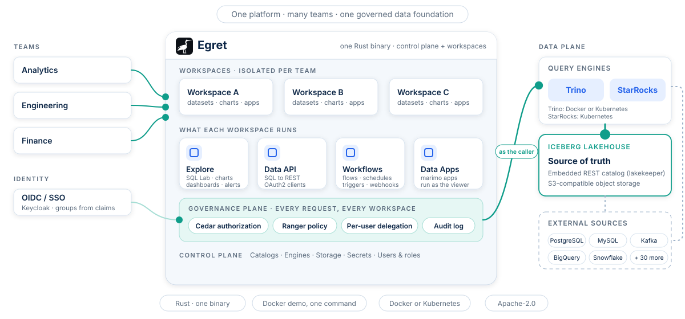

<div align="center">

<picture>
  <source media="(prefers-color-scheme: dark)" srcset=".github/assets/egret-wordmark-dark.svg">
  
</picture>

### Một nền tảng dữ liệu có governance cho mọi team

Các workspace được cô lập trên một nền dữ liệu chung có governance: BI, data API, workflow và data app,\
với chính sách truy cập được thực thi ngay trong query engine và mọi quyết định đều được audit.

[](https://github.com/egret-data/platform/actions/workflows/ci.yml)
[](LICENSE)
[](https://egret-data.github.io/docs/)
[](rust-toolchain.toml)

[**Tài liệu**](https://egret-data.github.io/docs/) ·
[**Chạy thử nhanh**](#chạy-thử-nhanh) ·
[**Kiến trúc**](#các-phần-khớp-với-nhau-thế-nào) ·
[**Vấn đề đã biết**](https://egret-data.github.io/docs/platform/known-issues) ·
[**Đóng góp**](CONTRIBUTING.md)

<sub>⚠️ Bản tham khảo tiếng Việt. Bản gốc (canonical) là tiếng Anh: [`README.md`](README.md).</sub>

<br>

<picture>
  <source media="(prefers-color-scheme: dark)" srcset=".github/assets/architecture-dark.svg">
  
</picture>

</div>

## Egret là gì

Phần lớn tổ chức cuối cùng có một công cụ BI, một catalog, một hệ thống access-policy và một công cụ workflow **cho mỗi
phòng ban**: silo, dữ liệu bị sao chép và những quy tắc truy cập không ai audit được. Egret thay tất cả bằng
**một lần triển khai**:

- **Một nền dữ liệu.** Một Iceberg lakehouse dùng chung và các query engine chạy trên đó. Team không sao chép dữ liệu; team nhận một workspace.
- **Workspace được cô lập.** Dashboard, dataset, chart, saved query, connection và API nằm trong workspace và không rò sang workspace khác.
- **Governance nằm trong engine, không đứng bên ngoài.** Một bộ phân quyền duy nhất (Cedar), query chạy theo từng người dùng (delegation), masking và row filter của Ranger, và audit log cho mọi quyết định.

Egret là một modular monolith viết bằng Rust (một binary, 37 crate) cùng giao diện React, gộp những thứ mà bình thường bạn
phải ghép từ Metabase hoặc Superset (BI), Lakekeeper (Iceberg catalog), Apache Ranger (access policy), một data-API builder
và một workflow engine.

## Điểm nổi bật

| Mảng | Bạn nhận được | |
|---|---|---|
| **Explore** | SQL Lab, dataset có metric, 19 loại chart, dashboard có filter và drill-through, alert và report (email và Slack, PNG và PDF). | [Tài liệu](https://egret-data.github.io/docs/platform/explore/sql-lab) |
| **Data API** | Xuất bản một câu `SELECT` có tham số thành REST endpoint, kèm OAuth2 client, version, rate limit và activity log. | [Tài liệu](https://egret-data.github.io/docs/platform/data-api/overview) |
| **Data Apps** | App [marimo](https://marimo.io) chạy với danh tính của người đang xem, nên chính sách dữ liệu đi theo người xem. | [Tài liệu](https://egret-data.github.io/docs/platform/explore/apps) |
| **Workflows** | Flow viết bằng YAML với schedule, webhook và trigger, execution có log, namespace và file. | [Tài liệu](https://egret-data.github.io/docs/platform/workflows/concepts) |
| **Governance** | Phân quyền Cedar, policy tương thích Ranger cho Trino và StarRocks, masking theo tag, classification, audit log, SSO (OIDC). | [Tài liệu](https://egret-data.github.io/docs/platform/data-governance/overview) |
| **Engine và catalog** | Dựng Trino và StarRocks từ giao diện (Docker hoặc Kubernetes); Iceberg REST catalog nhúng sẵn; federation qua hơn 30 connector. | [Tài liệu](https://egret-data.github.io/docs/platform/control-plane/query-engines) |

## Ảnh chụp màn hình

<table>
  <tr>
    <td width="50%"><a href="https://egret-data.github.io/docs/platform/explore/dashboards"></a><br><sub>Một dashboard trong workspace.</sub></td>
    <td width="50%"><a href="https://egret-data.github.io/docs/platform/explore/charts"></a><br><sub>Trình chỉnh sửa chart.</sub></td>
  </tr>
</table>

## Chạy thử nhanh

Chạy cả nền tảng trên Docker, không cần Kubernetes: Egret, Postgres, object storage, SSO Keycloak, một engine Trino,
Data Apps, một mail catcher, bộ render PDF/PNG và một workspace mẫu có dataset, chart và dashboard.

```bash
git clone https://github.com/egret-data/platform.git
cd platform
just demo-up
```

Sau đó mở <http://egret.localtest.me:8080> và đăng nhập bằng **Admin sign-in (break-glass)**:
`admin@egret.local` / `Admin12345!`. Hai người dùng SSO `admin-sso` và `member-sso` cũng có sẵn, và mọi
email demo gửi ra đều nằm trong Mailpit tại <http://localhost:8025>.

- **Cần** Docker có Compose v2, [`just`](https://github.com/casey/just), `curl` và `python3`, cùng 6 đến 8 GB RAM trống.
- **Lần chạy đầu phải build backend** (20 đến 40 phút); các lần sau dùng lại image.
- **Chỉ dành cho demo.** Stack dùng secret công khai cố định. Không bao giờ để lộ ra mạng.

Hướng dẫn đầy đủ (cổng, engine, Data Apps, cách reset) ở [`docs/en/guides/demo-stack.md`](docs/en/guides/demo-stack.md).
Với môi trường thật, xem [Deploy and operate](https://egret-data.github.io/docs/platform/deploy-operate/kubernetes) (Kubernetes và Helm,
`deploy/helm`) và [các khoá cấu hình](https://egret-data.github.io/docs/platform/reference/configuration-keys).

## Các phần khớp với nhau thế nào

- **Backend:** một Rust workspace (axum, tokio, sqlx) build thành một binary phục vụ API, control plane và mọi workspace.
- **Front end:** một ứng dụng React một trang (Vite, Tailwind, Radix) với hai khu vực: **Explore** (theo workspace) và **Control Plane và Governance** (admin nền tảng).
- **Trạng thái:** PostgreSQL cho metadata và object storage tương thích S3 (RustFS trong demo) cho lakehouse.
- **Engine:** Trino và StarRocks chạy dưới dạng container hoặc pod do Egret dựng và theo dõi; mỗi query chạy **với danh tính người gọi**.
- **Danh tính:** SSO OIDC cho con người; Egret cấp token ngắn hạn theo từng người dùng cho engine, nên không có mật khẩu engine dùng chung.

Đọc sâu hơn: [tổng quan nền tảng](docs/vi/architecture/platform-overview.md) (data plane, federation, vòng đời query có governance,
cô lập, bảo mật) và [thiết kế kiến trúc](docs/vi/architecture/2026-06-17-egret-architecture-design.md) đầy đủ.

## Tài liệu

| | |
|---|---|
| [Bắt đầu](https://egret-data.github.io/docs/platform/get-started/overview) | Egret là gì, các khái niệm, dashboard đầu tiên. |
| [Chạy demo stack](https://egret-data.github.io/docs/platform/get-started/run-the-demo-stack) | Chi tiết bản chạy nhanh trên Docker. |
| [Explore, Data API, Workflows](https://egret-data.github.io/docs/platform/explore/sql-lab) | Hướng dẫn người dùng từng trang, có ảnh chụp. |
| [Governance và Control Plane](https://egret-data.github.io/docs/platform/data-governance/overview) | Chính sách truy cập, engine, catalog, storage, secret. |
| [Tham chiếu](https://egret-data.github.io/docs/platform/reference/configuration-keys) | Các khoá cấu hình và REST API. |
| [Vấn đề đã biết](https://egret-data.github.io/docs/platform/known-issues) | Những gì còn mở, kèm mức độ, và những gì đã lên kế hoạch. |

Tài liệu nằm ở [`egret-data/docs`](https://github.com/egret-data/docs) (bản tiếng Anh là bản gốc); thay đổi nào ảnh hưởng điều người dùng thấy thì đi kèm cập nhật tài liệu.

## Bố cục repository

```text
crates/       37 crate Rust (server, auth, policy, catalog, engine, query, bi, workflow, apps, ...)
frontend/     ứng dụng React + Vite một trang
migrations/   migration của sqlx
deploy/       Dockerfile, Docker demo stack, Helm chart, cấu hình Keycloak và engine
apps-image/   image runtime cho Data Apps (marimo)
renderer/     bộ render PDF và PNG dùng cho report
plugin-host/  host JVM chạy các plugin của workflow
docs/         ghi chú kiến trúc, spec và plan (tiếng Anh là bản gốc, tiếng Việt là bản tham khảo)
```

## Trạng thái

Egret đang được phát triển tích cực. Xác thực và SSO, workspace, phân quyền thống nhất, thực thi Ranger, secrets vault,
BI và Explore, Iceberg catalog, dựng engine, Data Apps, Data API và workflow đã được xây dựng và đang dùng.
Các lỗi và khoảng trống còn mở được theo dõi, kèm mức độ, ở [Vấn đề đã biết](https://egret-data.github.io/docs/platform/known-issues).

## Đóng góp và bảo mật

Đọc [CONTRIBUTING.md](CONTRIBUTING.md): Conventional Commits, có test cho mỗi thay đổi, và có tài liệu cho mỗi thay đổi người dùng nhìn thấy.
Báo lỗ hổng bảo mật theo [SECURITY.md](SECURITY.md), không báo ở issue công khai. Mọi người tham gia tuân theo [Quy tắc ứng xử](CODE_OF_CONDUCT.md).

## Giấy phép

Phát hành theo [Apache License 2.0](LICENSE).
