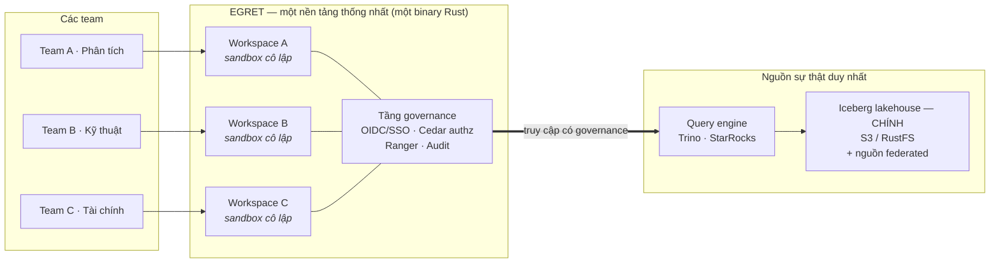
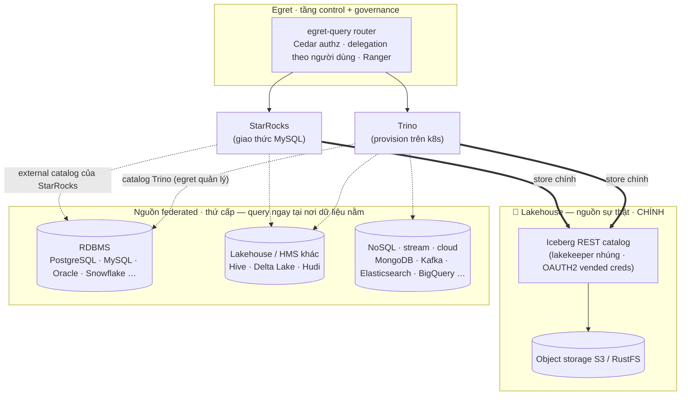
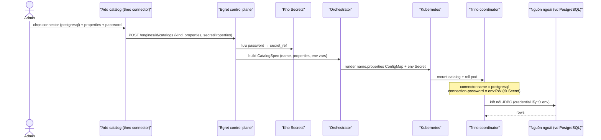
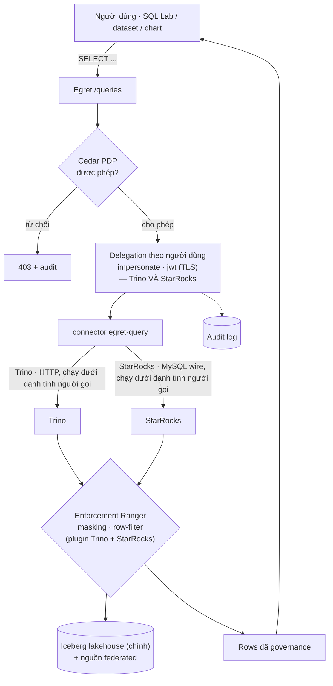
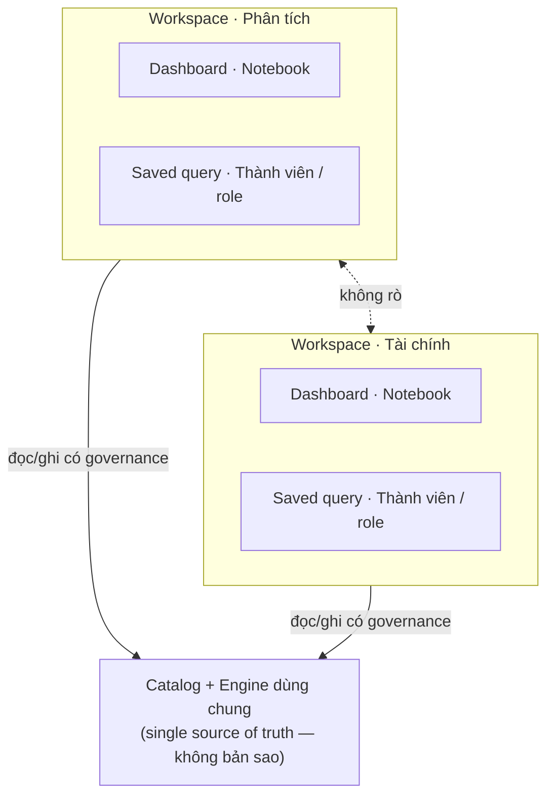
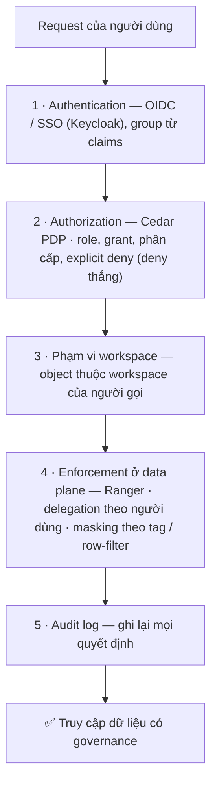
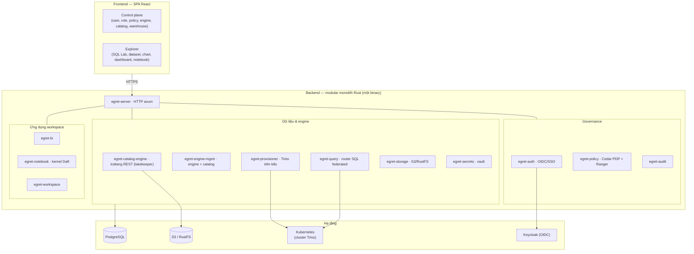

# Egret

> ⚠️ Bản tham khảo tiếng Việt. Bản gốc (canonical) là tiếng Anh: [`README.md`](README.md).

**Egret là một nền tảng dữ liệu (data platform) cấp doanh nghiệp, cho phép nhiều team cùng làm việc
trên MỘT nền tảng dữ liệu thống nhất** — thay vì mỗi phòng ban phải tự dựng riêng công cụ BI,
catalog và hệ thống access-policy. Một lần triển khai duy nhất mang lại cho toàn tổ chức **một nguồn
sự thật duy nhất (single source of truth)**, mỗi team có một **workspace được cô lập**, và **mọi truy
cập dữ liệu đều được kiểm soát và ghi log (audit)**.

Được viết bằng **Rust** (modular monolith — một binary, ~27 crate), Egret gộp lại những năng lực mà
bình thường bạn phải ghép từ Metabase/Superset (BI & explorer), Lakekeeper (Iceberg REST catalog),
Apache Ranger (access policy), DBApi (data API builder) và n8n (workflow automation) — thành một nền
tảng có governance thống nhất và cùng một design system.

---

## Vì sao chọn Egret

| Vấn đề thường gặp | Cách Egret giải quyết |
|---|---|
| Mỗi team tự chạy BI, catalog, warehouse riêng → silo & trùng lặp dữ liệu | **Single source of truth** — chung một Iceberg catalog + engine, chung một governance plane |
| Các team dẫm chân nhau lên dashboard, dataset, connection | **Cô lập theo workspace** — mỗi dự án/phòng ban có sandbox riêng |
| Access control rải rác, khó audit | **Security-first** — authorization thống nhất (Cedar PDP), OIDC/SSO với danh tính máy do egret tự sở hữu (không dùng credential engine dùng chung), enforcement bằng Ranger, masking theo tag, audit log đầy đủ |
| Dữ liệu nằm ở nhiều hệ thống (lake **và** RDBMS, NoSQL, stream) | **Query federation** — Trino đọc Iceberg-on-S3 *và* 30+ nguồn ngoài qua một mặt SQL có governance |
| Thêm team mới = phải dựng hạ tầng mới | Thêm workspace = vài cú click, không cần stack mới |

---

## Bức tranh tổng thể — một nền tảng, nhiều team



Mọi team đăng nhập vào **cùng một nền tảng** và đọc từ **cùng một tập dữ liệu có governance** — nhưng
làm việc trong một **workspace tách biệt**, và chỉ thấy được những gì policy cho phép.

---

## Data plane — Trino & StarRocks đọc dữ liệu thế nào (ngoài S3)

Nền tảng dữ liệu của Egret là một **Iceberg lakehouse** — một **Iceberg REST catalog** dùng chung
([lakekeeper](https://github.com/lakekeeper/lakekeeper) nhúng) trên S3/RustFS. Lakehouse đó là **store
chính**: các bảng của chính Egret nằm ở đây, và đây là nơi cả hai engine đọc/ghi. Nhưng nền tảng
**không** bị giới hạn ở đó — nhờ **query federation**, cả **Trino** và **StarRocks** đều có thể đọc dữ
liệu *tại chỗ* từ các hệ thống ngoài (cơ sở dữ liệu quan hệ, các định dạng lakehouse khác, NoSQL,
stream, cloud warehouse) mà không cần copy vào.

### Sơ đồ tổng thể data plane

**Iceberg lakehouse trên S3/RustFS là store chính** (nguồn sự thật). Cả hai engine đọc nó qua đường
**đậm**; các hệ thống ngoài được query tại chỗ như federation **thứ cấp** (đường nét đứt). Chỉ vẽ các
nguồn tiêu biểu — danh sách connector đầy đủ nằm ở bảng bên dưới.



- **Iceberg = chính.** Catalog nhúng (connector `iceberg`, type `rest`) được auto-wire lúc provision
  với **OAUTH2 vended credentials** — engine không bao giờ giữ khóa S3 dài hạn. Đây là nơi các bảng
  của chính Egret được ghi và đọc.
- **Cả hai engine đều federate.** **Trino** vươn tới hệ thống ngoài qua **catalog do egret quản lý**
  (luồng Add-catalog bên dưới); **StarRocks** mang theo **external catalog riêng** của nó (Hive,
  Iceberg, JDBC, …). Federation cho phép một query join dữ liệu lake với RDBMS/stream đang chạy **mà
  không cần copy vào**.

### Thêm một federated catalog — luồng credential

Mọi nguồn không phải warehouse được thêm qua form **"Add catalog" theo connector**. Egret lưu catalog
thành một bản ghi `EngineCatalog` (`kind` = `connector.name` của Trino), giữ **secret kết nối trong
vault**, và orchestrator render file `<tên>.properties` với các key có secret được inject từ env Secret
của pod dưới dạng `${ENV:VAR}` — **mật khẩu dạng plaintext không bao giờ nằm trong ConfigMap**.



### Connector được hỗ trợ (Trino, curated trong wizard)

Với engine **Trino**, Egret có sẵn một picker được curate, bám tài liệu, cho các connector phổ biến —
cộng thêm ô **nhập tên connector tùy ý** cho bất cứ thứ gì Trino hỗ trợ. Các nhóm dưới đây là ví dụ
tiêu biểu, không phải toàn bộ:

| Nhóm | Connector (ví dụ) |
|---|---|
| **Lakehouse / file** | **Iceberg** (metastore Hive · Glue · JDBC · REST · Nessie), Hive, Delta Lake, Hudi |
| **Quan hệ (JDBC)** | PostgreSQL, MySQL, MariaDB, SQL Server, Oracle, Redshift, Snowflake, ClickHouse, … |
| **NoSQL / search** | MongoDB, Cassandra, Elasticsearch, OpenSearch, Redis |
| **Streaming** | Kafka, Kinesis |
| **Cloud / API** | BigQuery, Google Sheets |
| **Observability / khác** | Prometheus, JMX, Memory, TPC-H, TPC-DS |

> **StarRocks** vươn tới cùng các loại nguồn qua **external catalog riêng** của nó (Iceberg, Hive,
> JDBC/MySQL/PostgreSQL, Delta, …); những catalog đó được cấu hình phía StarRocks, còn Egret query kết
> quả. **Object store tương thích S3** (AWS S3, RustFS, hoặc bất kỳ store S3-API nào qua `s3.endpoint`
> tùy chỉnh); các connector lakehouse có thể trỏ tới metastore/bucket riêng, độc lập với catalog nhúng
> của Egret.

### Vòng đời một query có governance

Federation không bao giờ đi vòng qua governance — mọi query đều được authorize, chạy **dưới danh tính
người gọi**, và được ghi audit:



- **Delegation theo người dùng (cả hai engine)** — query chạy dưới danh tính của **người gọi**, không
  phải một service account dùng chung. **Cả Trino và StarRocks** đều hỗ trợ `impersonate` (delegator
  tin cậy qua TLS) và `jwt` (JWT ngắn hạn của chính người gọi qua TLS, người dùng OIDC). Mỗi engine
  sau đó enforce policy của **chính người dùng đó** qua **plugin Ranger** của nó (column masking,
  row-level filter) — Egret phục vụ policy-download tương thích Ranger cho cả hai.

---

## Cô lập đa workspace

Một **workspace** là một sandbox độc lập cho một team hoặc dự án. Dashboard, dataset, chart, notebook,
saved query, database connection và định nghĩa API sống *bên trong* một workspace và không bao giờ rò
sang ranh giới khác. **Catalog** và **engine** dùng chung nằm bên dưới, nên việc cô lập không đồng
nghĩa với nhân bản dữ liệu.



- **Cô lập:** nội dung ở Workspace A vô hình với Workspace B.
- **Chung bên dưới:** cả hai đọc từ một catalog — không bản sao, không lệch (drift).
- **Access theo phạm vi:** mỗi workspace có thành viên, role và grant riêng.

---

## Security-first theo thiết kế

Access không bao giờ là chuyện làm sau. Mọi request đều đi qua các lớp kiểm soát trước khi chạm dữ
liệu — và mọi quyết định đều được ghi lại.



- **Một authorizer duy nhất** — Cedar là điểm quyết định policy duy nhất (template-per-role + linked
  policy-per-grant, deny thắng).
- **OIDC / SSO** — danh tính doanh nghiệp qua Keycloak; group lấy từ token claims.
- **Governance ở data plane** — tải policy kiểu Ranger cho Trino/StarRocks, query delegated theo người
  dùng, **column masking** và **row-level filter** theo tag.
- **Phân loại & ABAC** — tag phân loại dữ liệu gác quyền truy cập; luật theo thuộc tính/độ-mật (Cedar)
  cho các object BI.
- **Có thể audit** — audit log thật ghi lại ai truy cập gì, khi nào, và có được phép hay không.

### Danh tính, secret & cô lập

Security-first còn nghĩa là **tự sở hữu danh tính đầu-cuối** và **không bao giờ tin vào credential dùng chung**:

- **Token broker Machine-IdP** — Egret tự cấp **token engine ngắn hạn theo từng người dùng** từ
  identity provider nhúng của chính nó (`aud: engine`, ký bằng JWKS của Egret). Engine tin thẳng issuer
  của Egret, nên **không có mật khẩu engine dài hạn**, và ngay cả **người dùng local / non-OIDC** cũng
  có được quyền truy cập được scope và delegated. SSO chỉ còn làm authentication + JIT provisioning.
- **SSO back-channel logout** — một logout token OIDC từ Keycloak (RS256, xác thực bằng JWKS) thu hồi
  **toàn bộ** session của người dùng đó ở phía server, nên đăng xuất tập trung thực sự chấm dứt truy
  cập ở mọi nơi.
- **Vòng đời session & tài khoản** — admin reset password, khóa tức thì bằng **thu hồi session**,
  hard-delete kèm **gán lại nội dung** (không để dashboard mồ côi), và **last-admin guard** ngăn nền
  tảng tự khóa chính mình ra ngoài.
- **Vault secret có kiểu** — secret đa-trường, có kiểu theo phong cách Kubernetes (`Opaque` /
  `kubernetes.io/tls` / `basic-auth`) đứng sau mọi credential của connector, storage và TLS. Secret
  được inject vào pod dưới dạng env reference — **plaintext không bao giờ nằm trong ConfigMap** — và
  TLS ở ingress được phục vụ từ chứng chỉ do operator cung cấp.
- **Cô lập runtime** — mỗi notebook chạy trong một **pod được gia cố, riêng theo người-dùng × workspace**
  (non-root `uid 1000`, drop toàn bộ Linux capability, `NetworkPolicy` siết chặt, RBAC tối thiểu) và
  ghi vào một **namespace Iceberg riêng tư** qua token scoped theo namespace — không bao giờ dùng kernel
  chung.

---

## Năng lực cốt lõi — mỗi thứ đều là điều tối thiểu của một data platform

Một data platform doanh nghiệp không thể ship nửa vời. Mỗi năng lực dưới đây bịt một khoảng trống cụ
thể mà nếu thiếu sẽ buộc phải dùng thêm một công cụ riêng, một lần đăng nhập riêng, hoặc một lần review
bảo mật riêng:

- 🏢 **Đa workspace** — sandbox cô lập cho từng team/dự án trên dữ liệu dùng chung *(không dẫm chân, không silo)*
- 🔐 **Bảo mật thống nhất** — OIDC/SSO, authorization Cedar, enforcement Ranger, masking theo tag, audit *(một authorizer, không phải năm)*
- 🪪 **Tự sở hữu danh tính & secret** — token engine theo người dùng từ machine-IdP, back-channel logout, thu hồi session, vault secret có kiểu *(không credential dài hạn hay dùng chung)*
- 🧊 **Iceberg REST Catalog** — nhúng, tích hợp engine, đa-tenant theo workspace *(nguồn sự thật duy nhất)*
- 🔌 **Query federation** — Trino & StarRocks đọc Iceberg-on-S3 **và** 30+ nguồn ngoài (RDBMS, NoSQL, stream, cloud) qua một mặt SQL có governance *(query ngay tại nơi dữ liệu nằm — không copy)*
- ⚙️ **Provision engine** — provision & quản lý cluster **Trino** *và* **StarRocks** trên Kubernetes (autoscale HPA/KEDA, plugin Ranger đi kèm) *(compute co giãn, self-service)*
- 🕵️ **Delegation theo người dùng** — query chạy dưới danh tính người gọi (`impersonate` / `jwt` qua TLS), theo policy dữ liệu của chính người đó *(truy vết trách nhiệm ở mức dòng/cột)*
- 📊 **BI / Explorer** — SQL Lab, dataset, chart, dashboard (đa tab, filter, click behaviour) với độ tương đồng Metabase cao *(analyst tự phục vụ)*
- 📓 **Notebook** — notebook theo workspace trên kernel Daft **được cô lập**, kèm viz Python ngay trong notebook (plotly / matplotlib) *(data science, ngay trong nền tảng)*
- 🔌 **Data API Builder** — expose HTTP API có governance từ SQL (dynamic SQL kiểu MyBatis) *(phục vụ ứng dụng, không chỉ dashboard)*
- ⚙️ **Workflow Automation** — automation kiểu n8n: schedule, email, gọi API *(vận hành hóa dữ liệu)*

---

## Kiến trúc

- **Backend** — modular monolith: workspace Rust ~27 crate, một binary (axum + tokio + sqlx).
- **Frontend** — một SPA (React + Vite + Tailwind v4 + Radix), hai nhóm route: **Control plane**
  (governance/admin) và **Explorer** (làm việc theo workspace).
- **Hạ tầng** — PostgreSQL + object storage (S3/RustFS); engine chạy trên Kubernetes.



📐 **Tài liệu kiến trúc đầy đủ:**
- 🇬🇧 **Bản gốc:** [`docs/en/architecture/2026-06-17-egret-architecture-design.md`](docs/en/architecture/2026-06-17-egret-architecture-design.md)
- 🇻🇳 **Tham khảo:** [`docs/vi/architecture/2026-06-17-egret-architecture-design.md`](docs/vi/architecture/2026-06-17-egret-architecture-design.md)

> Quy ước tài liệu: **tiếng Anh là canonical**, tiếng Việt là bản dịch tham khảo; đặt dưới `docs/en/`
> và `docs/vi/` (cấu trúc mirror).

---

## Trạng thái

**Nền tảng, governance và analytics đã dựng xong và đang dùng:** authentication/SSO với **token broker
machine-IdP** (token engine theo người dùng, không có credential engine dài hạn) và **SSO back-channel
logout**, đa workspace, authorization Cedar thống nhất trên mọi enforcement site, console RBAC &
access-control, enforcement Ranger ở data plane với masking theo tag, một **vault secret có kiểu**, và
audit log đầy đủ. **BI/Explorer** đạt độ tương đồng Metabase cao (dataset, chart, dashboard) — đã kiểm
chứng end-to-end trên một engine Trino đã provision. **Iceberg catalog nhúng** chạy live end-to-end
(provision → auth → data plane); **provision engine** đã bao phủ **cả Trino và StarRocks trên
Kubernetes** kèm **catalog federation** (30+ connector) và **delegation theo người dùng bảo mật**
(`impersonate` + `jwt` qua TLS, đã kiểm chứng live); và **notebook** chạy cell thật trong **pod kernel
cô lập theo từng người dùng** kèm viz Python ngay trong notebook. Đang làm tiếp: hardening catalog
(storage profile, GC), delegation notebook/Daft, và các mặt Data API + Workflow.

Xem [Roadmap & trạng thái](docs/en/architecture/2026-06-17-egret-architecture-design.md#16-roadmap--status).

---

## Bố cục repository

```text
crates/      # ~27 crate Rust (egret-core, -server, -auth, -catalog-*, -policy, -engine-mgmt,
             #  -orchestrator, -query, -storage, -secrets, -bi, -notebook, -workspace, ...)
frontend/    # SPA React + Vite (control plane + explorer)
migrations/  # migration sqlx
deploy/      # Dockerfile, compose, helm
docs/        # en/ (canonical) + vi/ (tham khảo): architecture/, adr/, plans/, specs/
```

## License

TBD.
