# Egret — Master Architecture Design

> **Status:** Foundational · **Date:** 2026-06-17 · **Version:** 0.1
> This is the **canonical (source-of-truth) document** for the Egret project. All later tasks/specs reference it.
> A Vietnamese reference translation lives at [`docs/vi/architecture/2026-06-17-egret-architecture-design.md`](../../vi/architecture/2026-06-17-egret-architecture-design.md).
> Major decisions are recorded in [§2 Architecture Decisions](#2-architecture-decisions-adr-summary).

---

## Table of Contents

1. [Goals & scope](#1-goals--scope)
2. [Architecture decisions (ADR summary)](#2-architecture-decisions-adr-summary)
3. [System overview (C4)](#3-system-overview-c4)
4. [Deployment model](#4-deployment-model)
5. [Backend crate map](#5-backend-crate-map)
6. [Frontend architecture](#6-frontend-architecture)
7. [Workspace & multi-tenancy model](#7-workspace--multi-tenancy-model)
8. [AuthN / AuthZ](#8-authn--authz)
9. [Data model (Postgres)](#9-data-model-postgres)
10. [Subsystem specifications](#10-subsystem-specifications)
11. [Key sequence flows](#11-key-sequence-flows)
12. [Cross-cutting concerns](#12-cross-cutting-concerns)
13. [API surface & OpenAPI](#13-api-surface--openapi)
14. [Security](#14-security)
15. [Repository layout](#15-repository-layout)
16. [Phased roadmap](#16-phased-roadmap)
17. [Open questions / future](#17-open-questions--future)
18. [Appendix: references](#18-appendix-references)

---

## 1. Goals & scope

Egret is a unified **data portal** that combines the capabilities of Metabase/Superset (BI &
exploration), Lakekeeper (Iceberg REST catalog), Apache Ranger (centralized access policy), DBApi
(data API builder), and n8n (workflow automation) into **a single product written in Rust**, with a
frontend that inherits the sparklabx design system.

### 1.1 Two portals in one tool

| Portal | Audience | Core capabilities |
|---|---|---|
| **Admin / Data Governance** | Admin, data steward | Manage databases, Iceberg catalog, Ranger policies, users/roles/workspaces, org-level Data APIs and workflows, monitoring/audit |
| **Explorer** | User / analyst | SQL Lab, dataset, chart, dashboard, notebook, workspace Data APIs, automation workflows — **isolated per workspace** |

### 1.2 Capabilities

- **Database management** — register, test, health-check, monitor databases. Initial focus: **Trino** & **StarRocks**.
- **Apache Ranger API** — expose a Ranger Admin REST-compatible surface so the native Ranger plugins in Trino/StarRocks download policies and enforce them.
- **Iceberg REST Catalog** — provide an Iceberg-spec REST catalog so engines (Trino, StarRocks, Spark…) can integrate. References Lakekeeper.
- **Explorer / BI** — SQL Lab, dataset, chart, dashboard, notebook (references Metabase/Superset/sparklabx).
- **Data API Builder** — configure HTTP APIs from SQL (MyBatis-style dynamic SQL). References DBApi.
- **Workflow Automation** — n8n-style automation flows (schedule, send email, call API…).
- **Multi-workspace** — isolate projects/departments on the Explorer side.
- **OIDC / SSO** — integrated login.

### 1.3 Out of scope (initially — YAGNI)

- A native query engine (Egret does **not** run queries itself; it delegates to Trino/StarRocks).
- Connectors beyond Trino/StarRocks (the architecture allows extension, but the MVP targets these two).
- Self-hosting notebook kernels (reuse sparklabx's Jupyter/Spark kernel over the protocol).
- Real-time multi-cursor collaboration (later).

---

## 2. Architecture decisions (ADR summary)

| # | Decision | Choice | Rationale |
|---|---|---|---|
| ADR-01 | Backend shape | **Modular monolith** — one Rust workspace, many crates, one binary | Easy to deploy/develop early, still cleanly modular; follows the Lakekeeper model. The `catalog`/`ranger` crates are designed so they can later be split into services |
| ADR-02 | Frontend | **Single SPA**, two route groups (Admin/Explorer) gated by role | Maximize shared components & theme; simpler ops |
| ADR-03 | Ranger | **Ranger Admin REST-compatible** | The native Ranger plugins in Trino/StarRocks fetch directly, no plugin changes needed |
| ADR-04 | Metadata store | **PostgreSQL** (sqlx, compile-time checked) | Source of truth; follows Lakekeeper/Superset/Metabase |
| ADR-05 | Object storage | **S3-compatible (MinIO)**, pluggable abstraction | Iceberg data + result cache; inherits `lakekeeper/crates/io` |
| ADR-06 | Cache/queue | **Redis (optional)**, Postgres fallback | Sessions, async jobs, rate-limiting |
| ADR-07 | HTTP runtime | **axum + tokio + tower** | Ecosystem standard; Lakekeeper uses axum |
| ADR-08 | API contract | **OpenAPI via utoipa** | Auto-generate the FE client |
| ADR-09 | Charting | **Apache ECharts** | Rich; Superset uses ECharts |
| ADR-10 | Workflow canvas | **React Flow** (FE) + Rust engine | Standard for n8n-style DAG editors |
| ADR-11 | Email | **SMTP + Microsoft Graph** (pluggable) | Leverages Microsoft-Graph-SMTP-Relay |
| ADR-12 | Workspace isolation | **Global register → grant**; **logical isolation** (row-level `workspace_id` + Ranger policy) | Centralized governance, shared engine, flexible |
| ADR-13 | Secrets | **Envelope encryption** in Postgres, KMS-pluggable | Protect credentials at rest |

> Each ADR gets a detailed file under `docs/en/adr/` (and `docs/vi/adr/`) once implementation begins.

---

## 3. System overview (C4)

### 3.1 Context (Level 1)

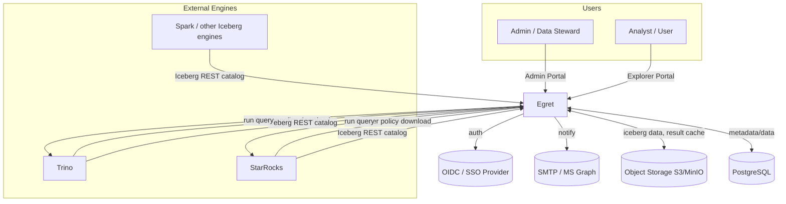

**Key insight:** Egret is both a **client** of the engines (running user queries) and a **server**
the engines call into (downloading Ranger policies, using the Iceberg catalog). This bidirectional
relationship is the most important architectural fact.

### 3.2 Container (Level 2)

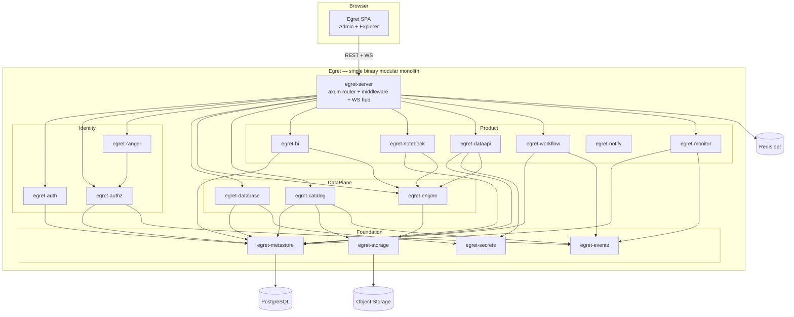

---

## 4. Deployment model

- **Packaging:** one Docker image (the single `egret` binary) + one static frontend image (nginx) — or the binary serves the static SPA directly.
- **Required dependencies:** PostgreSQL, object storage (S3/MinIO).
- **Optional dependencies:** Redis (cache/queue), Kafka/NATS (distributed event bus — defaults to in-proc).
- **CLI binary:** `egret serve` (run the server), `egret migrate` (DB migrations), `egret init` (bootstrap admin/workspace).
- **Helm chart** for K8s; HorizontalPodAutoscaler at scale (the monolith is stateless apart from DB/Redis/object store).
- **Future service split (ADR-01):** `egret-catalog` and `egret-ranger` are the first split candidates because engines call them directly with their own access patterns; the binary supports a "catalog/ranger only" mode via a feature flag / sub-command.

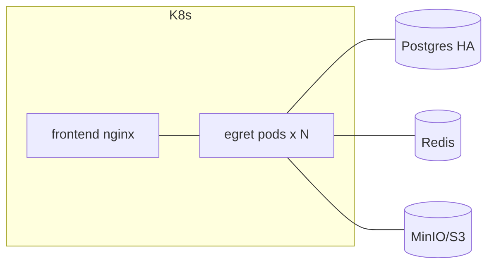

---

## 5. Backend crate map

Cargo workspace under `crates/`. Convention: each crate has **one clear purpose**, communicates via
**traits/interfaces in `egret-core`**, and is independently testable. The `*-server` crate composes
the router.

### 5.1 Foundation

| Crate | Responsibility | Key deps | Public interface |
|---|---|---|---|
| `egret-bin` | Entrypoint, CLI (`serve`/`migrate`/`init`), wiring, graceful shutdown | all | `main()` |
| `egret-server` | axum app: root router, middleware (auth, workspace-context, tracing, CORS, rate-limit), OpenAPI mount, **WebSocket hub** | core, product crates | `build_router(AppState) -> Router` |
| `egret-core` | Domain primitives: ID types, `Error`/`Result`, pagination, `WorkspaceContext`, `Principal`, abstraction traits | — | types + traits |
| `egret-config` | Typed config (serde + figment), env + file, validation | core | `Config::load()` |
| `egret-metastore` | Postgres: sqlx pool, migration runner, base repository, transaction helper | core, sqlx | `Db`, `Repo` traits |
| `egret-secrets` | Envelope-encrypted credentials at rest, KMS-pluggable provider | core, metastore | `SecretStore` trait |
| `egret-storage` | Object store IO abstraction (S3/MinIO/GCS/Azure) — inherits `lakekeeper/crates/io` | core | `ObjectStore` trait |
| `egret-events` | Internal event bus (in-proc broadcast + optional Kafka/NATS); topics `policy.changed`, `catalog.changed`, `query.finished`… | core | `EventBus`, `Event` |

### 5.2 Identity & Access

| Crate | Responsibility | Public interface |
|---|---|---|
| `egret-auth` | OIDC/SSO (`openidconnect`), session/JWT, user/group JIT provisioning, **workspace membership**, portal-level RBAC | `Authenticator`, `SessionService`, middleware |
| `egret-authz` | PDP/PAP: policy model (resource/access/condition), tag-based access, **row-filter & column-masking**, decision API | `PolicyDecisionPoint::check()`, `PolicyAdmin` |
| `egret-ranger` | **Ranger Admin REST-compatible** surface: `service-defs`, `services`, `policies` CRUD, `policies/download/{service}`, `tags/download/{service}`, version polling. Maps Egret↔Ranger model | `ranger_router()` (mounted under `/service`) |

### 5.3 Data plane

| Crate | Responsibility | Public interface |
|---|---|---|
| `egret-database` | Connection lifecycle (Trino/StarRocks): register/test/health/monitor, pool registry, creds via `egret-secrets`, capability metadata | `DatabaseRegistry`, `Connection` |
| `egret-engine` | Query execution: **Trino (REST protocol)** + **StarRocks (MySQL protocol)** connectors, async **JobManager**, result streaming, **result cache/store** (Postgres + object store), cancellation, cost/limit guards | `QueryEngine::submit()`, `Job`, `ResultStore` |
| `egret-catalog` | **Iceberg REST Catalog** (spec-compliant): namespaces/tables/views/commits/loadTable, config endpoint, optional S3 signer. Backed by Postgres metadata + `egret-storage` data. Layered `api/iceberg` + `service` following Lakekeeper | `iceberg_router()` (mounted at `/catalog`), `CatalogStore` |

### 5.4 Application / Product

| Crate | Responsibility | Public interface |
|---|---|---|
| `egret-bi` | Semantic layer: **dataset** (logical table, column, metric, computed), **SQL Lab** saved query, **chart** (viz config → ECharts spec), **dashboard** (layout, cross-filter), querying via `egret-engine`, caching | `DatasetService`, `ChartService`, `DashboardService`, `SqlLabService` |
| `egret-notebook` | Notebook model (cells), **kernel session** Jupyter/Spark (protocol), execution, attaches `sparklabx/kernel` | `NotebookService`, `KernelGateway` |
| `egret-dataapi` | **Data API Builder**: API definitions, **dynamic-SQL template engine** (MyBatis-style: if/foreach/where), param binding, multi-statement + transaction, publish/version/**hot-reload**, **gateway runtime** (token/api-key, IP allow/deny, rate-limit, cache, call-log) | `ApiDefService`, `ApiGateway`, `SqlTemplate` |
| `egret-workflow` | **Automation engine**: DAG model, **triggers** (cron via `tokio-cron-scheduler`, webhook, on-event), **executors** (run-query, send-email, http-request, transform, branch, call-dataapi, export), run engine + history, retry/alert | `WorkflowService`, `WorkflowRunner`, `NodeExecutor` trait |
| `egret-notify` | **SMTP + Microsoft Graph** providers (pluggable), template rendering | `Notifier` trait |
| `egret-monitor` | Query monitoring, **audit log**, usage metrics, Prometheus exporter, admin health rollups | `AuditLog`, `Metrics` |

### 5.5 Crate dependency diagram (simplified)

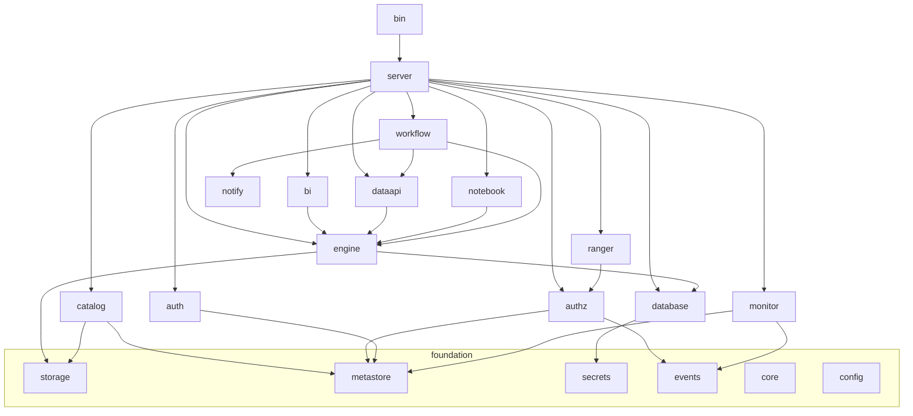

---

## 6. Frontend architecture

A **pnpm workspaces** monorepo, inheriting the sparklabx design system (React + Vite + Tailwind v4 +
Radix UI).

```text
frontend/
├── apps/
│   └── web/                  # single Vite SPA, two route groups
│       ├── src/routes/admin/     # Admin / Governance portal
│       └── src/routes/explore/   # Explorer portal
├── packages/
│   ├── ui/                   # design system extracted from sparklabx (theme tokens, Radix wrappers)
│   ├── api-client/           # generated from OpenAPI + TanStack Query hooks
│   ├── auth/                 # OIDC client, session, workspace switcher
│   ├── charts/               # ECharts wrapper (viz spec → render)
│   ├── sql-editor/           # Monaco + schema autocomplete
│   ├── workflow-canvas/      # React Flow (n8n-style DAG editor)
│   └── notebook/             # cells + Monaco + hyparquet parquet preview
```

### 6.1 App shell & navigation

- **Shared shell:** top bar, **workspace switcher**, theme toggle, user menu. Route guard by role/permission.
- **`/admin/*`** (requires admin/steward role): Databases · Catalog browser · Ranger Policies · Users/Roles/Workspaces · Data API mgmt · Workflows (org-level) · Monitoring/Audit.
- **`/explore/*`** (scoped to the selected workspace): SQL Lab · Datasets · Charts · Dashboards · Notebooks · Data APIs (workspace) · Workflows.

### 6.2 Key libraries

| Purpose | Library | Note |
|---|---|---|
| Data fetching | **TanStack Query** | already in sparklabx |
| Code/SQL editor | **Monaco** | already present |
| Charts | **Apache ECharts** | newly added |
| Workflow canvas | **React Flow** | newly added |
| Parquet preview | **hyparquet** | already present |
| Notebook kernel | **@jupyterlab/services** | already present |
| Auth | **openidconnect (BE)** + MSAL/Google (FE present) | standard OIDC |

### 6.3 Realtime communication

- **WebSocket** (via the `egret-server` WS hub) for: async query status (SQL Lab), live workflow run logs, kernel output streaming. Polling fallback.

---

## 7. Workspace & multi-tenancy model

### 7.1 Two tiers (ADR-12)

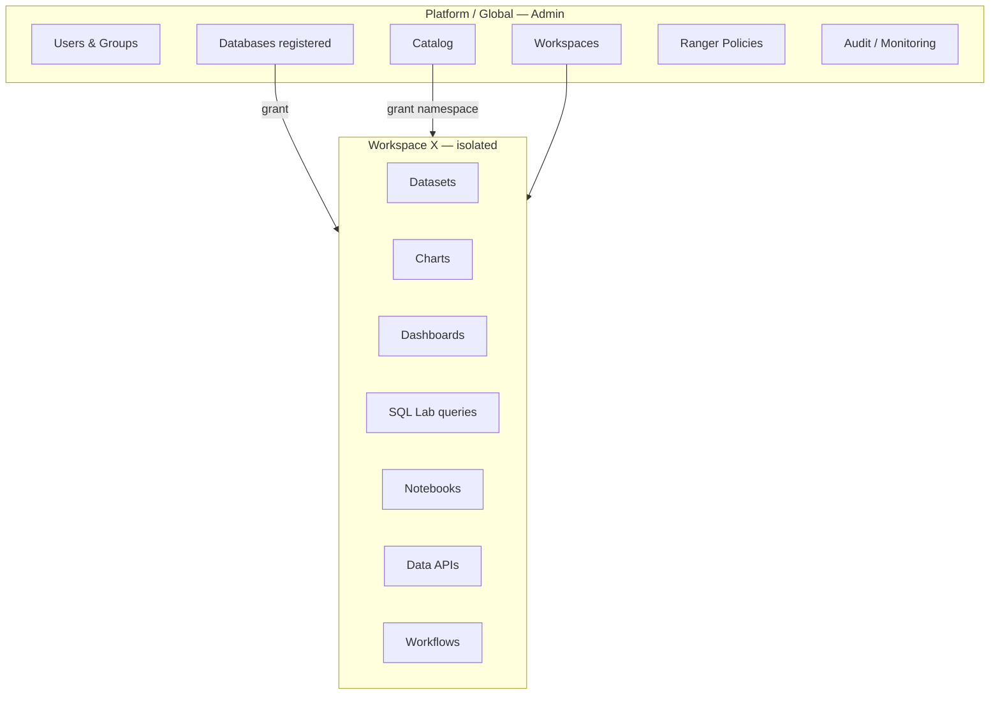

- **Global:** users, workspaces, databases, catalog, Ranger policies, audit are managed by the Admin.
- **Workspace (isolated):** datasets, charts, dashboards, SQL Lab, notebooks, data APIs, workflows — department X **cannot see** department Y's.

### 7.2 Resource allocation

- Databases & catalogs are **registered globally**, then **granted** to a workspace (tables `workspace_database_grant`, `workspace_catalog_grant`).
- Inside a workspace, users can only select databases/namespaces that have been granted.

### 7.3 Isolation = **logical** (metadata + authz)

- Every workspace-scoped entity carries a `workspace_id`; every repository query **must** filter by the `WorkspaceContext` (middleware injects the context; repositories reject unscoped queries).
- **Ranger policies** restrict which schemas/tables/columns a workspace can access at the engine tier — this is the real enforcement layer when queries run on Trino/StarRocks.
- No physical namespace/DB split per workspace (ruled out in ADR-12) → the engine is shared, ops stay simple.

### 7.4 Roles (RBAC)

| Scope | Example role | Permissions |
|---|---|---|
| Platform | `platform_admin` | full control |
| Platform | `data_steward` | manage catalog, policy, databases |
| Workspace | `ws_admin` | manage workspace members & resources |
| Workspace | `ws_editor` | create/edit datasets, charts, dashboards, SQL Lab, data APIs, workflows |
| Workspace | `ws_viewer` | view dashboards, run queries within limits |

> RBAC (egret-auth) decides **access to Egret features/objects**; Ranger/authz (egret-authz) decides
> **access to data** at the engine tier. The two layers are separate and complementary (§8).

---

## 8. AuthN / AuthZ

### 8.1 Authentication (egret-auth)

- **OIDC/SSO** via `openidconnect`: authorization-code + PKCE. JIT provisioning of users/groups from claims.
- Session: httpOnly cookie + (optional) JWT for APIs. Refresh token rotation.
- Service-to-service: API key / token (used by the Data API gateway and engine callbacks).

### 8.2 Two authorization layers

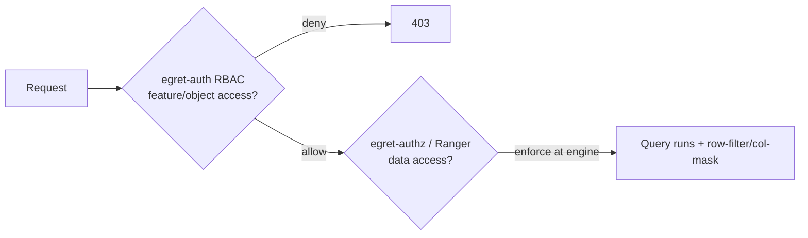

1. **Application layer (RBAC):** who can view/edit a dashboard/dataset/data API — checked in Egret.
2. **Data layer (Ranger/authz):** which schemas/tables/columns may be read, row-filters, column-masks — **enforced at the engine** via the policies it downloads from Egret.

### 8.3 Ranger REST compatibility (egret-ranger)

The native Ranger plugins inside Trino/StarRocks periodically call Egret to download policies. Egret
exposes (mounted under `/service`, following Ranger's `/service/plugins` base):

| Endpoint (Ranger-compatible) | Purpose |
|---|---|
| `GET /service/plugins/definitions` | service-defs (trino, starrocks) |
| `GET/POST/PUT/DELETE /service/plugins/services` | manage service instances |
| `GET/POST/PUT/DELETE /service/plugins/policies` | policy CRUD |
| `GET /service/plugins/policies/download/{serviceName}` | **plugin downloads policies** (supports `lastKnownVersion`, returns 304 if unchanged) |
| `GET /service/tags/download/{serviceName}` | **tag-based policies** |

- **Model mapping:** Egret keeps an internal policy model (resource/access/condition/row-filter/masking) in `egret-authz`; `egret-ranger` serializes it to the Ranger JSON schema (`RangerPolicy`, `ServicePolicies`) when a plugin downloads. Version-based caching enables 304 responses.
- **Benefit:** no need to build/maintain a separate Ranger Admin; Trino/StarRocks use the standard plugin.

### 8.4 Policy authoring (Admin portal)

- Policy creation UI: pick a database (service) → resource (catalog/schema/table/column) → user/group/role → permission (select/...) → conditions (row-filter expression, column-mask type).
- Tag-based policies: attach a tag (e.g. `pii`) → policy by tag.
- Every policy change emits a `policy.changed` event (bumps the version) → plugins download the new version on their next poll.

---

## 9. Data model (Postgres)

Schema is split by module (Postgres schema namespaces or table prefixes). Listed below are the **key
tables** (not full columns — details belong in each subsystem spec). All workspace-scoped product
tables carry `workspace_id` and an index on `(workspace_id, …)`.

### 9.1 Identity & workspace

```text
users(id, external_subject, email, name, status, created_at)
groups(id, name, source)             user_groups(user_id, group_id)
workspaces(id, slug, name, status, settings_jsonb, created_at)
workspace_members(workspace_id, user_id|group_id, role)         -- ws_admin/editor/viewer
roles(id, scope[platform|workspace], name)   role_permissions(role_id, permission)
sessions(id, user_id, expires_at, ...)        api_keys(id, owner, hash, scopes)
```

### 9.2 Database & secrets

```text
databases(id, name, engine[trino|starrocks], host, port, options_jsonb,
          secret_ref, status, created_by)                 -- globally registered
workspace_database_grant(workspace_id, database_id, granted_by)
secrets(id, kind, ciphertext, key_id, created_at)          -- envelope-encrypted
database_health(database_id, checked_at, healthy, latency_ms, detail_jsonb)
```

### 9.3 Authz / Ranger

```text
authz_services(id, name, engine, config_jsonb, policy_version)   -- ~ Ranger service
authz_service_defs(id, name, resources_jsonb, access_types_jsonb)
authz_policies(id, service_id, name, resource_jsonb, items_jsonb,
               row_filters_jsonb, masks_jsonb, enabled, version, updated_at)
authz_tags(id, name)        authz_tag_assignments(tag_id, resource_ref)
policy_audit(id, policy_id, action, actor, at)
```

### 9.4 Catalog (Iceberg)

```text
catalog_namespaces(id, name, properties_jsonb)
catalog_tables(id, namespace_id, name, metadata_location, current_snapshot_id,
               format_version, properties_jsonb)
catalog_table_metadata_log(table_id, metadata_location, created_at)
catalog_views(id, namespace_id, name, metadata_location)
workspace_catalog_grant(workspace_id, namespace_id, granted_by)
catalog_commits(table_id, snapshot_id, parent_id, summary_jsonb, created_at)
```

### 9.5 Engine / query

```text
queries(id, workspace_id, database_id, user_id, sql, status, submitted_at,
        finished_at, rows, bytes_scanned, error, result_ref)    -- result_ref → object store
query_results_cache(hash, database_id, result_ref, expires_at)
```

### 9.6 BI

```text
datasets(id, workspace_id, database_id, kind[table|sql], schema_table|sql,
         columns_jsonb, metrics_jsonb, created_by)
saved_queries(id, workspace_id, database_id, name, sql, created_by)   -- SQL Lab
charts(id, workspace_id, dataset_id, viz_type, config_jsonb)
dashboards(id, workspace_id, name, layout_jsonb, filters_jsonb)
dashboard_charts(dashboard_id, chart_id, position_jsonb)
```

### 9.7 Notebook

```text
notebooks(id, workspace_id, name, kernel_spec, created_by)
notebook_cells(id, notebook_id, idx, cell_type, source, outputs_jsonb)
kernel_sessions(id, notebook_id, status, started_at)
```

### 9.8 Data API

```text
api_defs(id, workspace_id, path, method, database_id, sql_template,
         params_jsonb, version, status[draft|published], cache_ttl)
api_versions(api_def_id, version, snapshot_jsonb, published_at)
api_clients(id, workspace_id, name, key_hash, ip_allow_jsonb, ip_deny_jsonb)
api_client_grants(client_id, api_def_id, rate_limit)
api_call_logs(id, api_def_id, client_id, at, status, latency_ms, rows)
```

### 9.9 Workflow

```text
workflows(id, workspace_id, name, graph_jsonb, enabled, created_by)
workflow_triggers(id, workflow_id, kind[cron|webhook|event], config_jsonb)
workflow_runs(id, workflow_id, status, started_at, finished_at, trigger_jsonb)
workflow_node_runs(run_id, node_id, status, input_jsonb, output_jsonb, error, attempt)
```

### 9.10 Monitor / audit

```text
audit_log(id, actor, action, target_type, target_id, workspace_id, at, detail_jsonb)
usage_metrics(...)    -- rollups
```

---

## 10. Subsystem specifications

Each subsystem states: responsibility, interface, data, integration points, references. Detailed
implementation belongs to a per-phase spec.

### 10.1 Database management (`egret-database`)
- **Function:** register databases (engine, host, creds→secrets), test connection, periodic health check (`database_health`), monitoring (latency, status), capability detection.
- **MVP engines:** Trino, StarRocks. A `Connection` trait allows other JDBC engines later.
- **Integration:** provides connections to `egret-engine`; granted to workspaces.

### 10.2 Query engine (`egret-engine`)
- **Connectors:** Trino via the **REST statement protocol** (`POST /v1/statement` + nextUri polling); StarRocks via the **MySQL protocol** (`sqlx`/mysql_async).
- **JobManager:** async submit, status tracking, result streaming over WS, cancellation, limit enforcement (row/byte/timeout).
- **ResultStore:** cache by hash(sql+db); large results written to object store, metadata in `queries`.
- **Clients:** SQL Lab, dataset preview, chart queries, Data API, the workflow run-query node.

### 10.3 Iceberg REST Catalog (`egret-catalog`)
- **Spec:** Iceberg REST Catalog API — `GET /v1/config`, namespace CRUD, tables (`create/load/commit/drop/rename`), views, `report-metrics`, optional S3 remote signing.
- **Layout (following Lakekeeper):** `api/iceberg` (HTTP handlers) + `service::CatalogStore` (Postgres) + `egret-storage` (data files). Mounted at `/catalog`.
- **Integration:** Trino/StarRocks/Spark configure the REST catalog to point at Egret; namespaces granted per workspace; metadata pointer in `catalog_tables.metadata_location`.

### 10.4 Apache Ranger API (`egret-ranger`) — see §8.3.

### 10.5 BI: SQL Lab / Dataset / Chart / Dashboard (`egret-bi`)
- **SQL Lab:** editor (Monaco) → async submit via the engine → results + save to `saved_queries` → "explore" into a chart.
- **Dataset:** a logical layer over a table or SQL; defines column types, metrics (aggregates), computed columns. The source of charts.
- **Chart:** `viz_type` + `config_jsonb` → build query → render an **ECharts** spec on the FE.
- **Dashboard:** grid layout (`layout_jsonb`), cross-filtering, dashboard-level filters; child charts via `dashboard_charts`.
- **References:** Superset (chart/dashboard/dataset model), Metabase.

### 10.6 Notebook (`egret-notebook`)
- Notebook cells (sql/markdown/python), kernel sessions over **Jupyter/Spark** (reusing `sparklabx/kernel` + `@jupyterlab/services` on the FE), output streamed over WS, parquet preview (hyparquet).

### 10.7 Data API Builder (`egret-dataapi`)
- **Definition:** path/method + `sql_template` (MyBatis-style dynamic SQL: `<if>`, `<foreach>`, `<where>`) + params schema + target database.
- **Lifecycle:** draft → test/debug (trial run) → **publish** (version, hot-reload without downtime) → snapshot in `api_versions`.
- **Gateway runtime:** route match → auth (api-key/token) → IP allow/deny → rate-limit → render SQL → run via the engine (multi-statement + transaction) → transform → cache (Redis, `cache_ttl`) → response → **call-log** + metrics.
- **References:** DBApi (dbapi-controller, dbapi-cluster-gateway).

### 10.8 Workflow Automation (`egret-workflow`)
- **Model:** DAG `graph_jsonb` (nodes + edges).
- **Triggers:** cron (`tokio-cron-scheduler`), webhook (inbound HTTP), on-event (via `egret-events`: query.finished, policy.changed, catalog.changed).
- **Executors (trait `NodeExecutor`):** run-query, **send-email** (egret-notify), http-request, transform (jq/script), branch/condition, call-dataapi, export-file (object store).
- **Run engine:** topological execution, node→node data passing, retry/backoff, alert on failure, persisted `workflow_runs`/`workflow_node_runs`, live log over WS.
- **Example:** daily cron → run-query (report) → transform → send-email.
- **Reference:** n8n.

### 10.9 Notification (`egret-notify`)
- `Notifier` trait: **SMTP** + **Microsoft Graph** providers (pluggable). Template rendering. Used by workflows & alerting (monitor, data API fail-alert).

### 10.10 Monitoring / Audit (`egret-monitor`)
- Audit log of all sensitive actions (policy change, database registration, grant, data API publish…), query monitoring, usage metrics, **Prometheus** exporter `/metrics`, health rollups for the Admin dashboard.

---

## 11. Key sequence flows

### 11.1 OIDC login

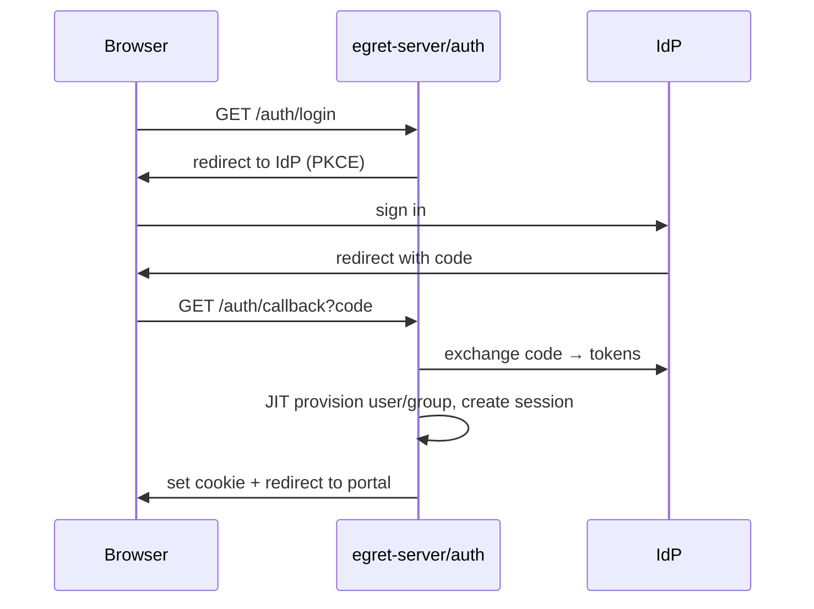

### 11.2 Run a query (SQL Lab)

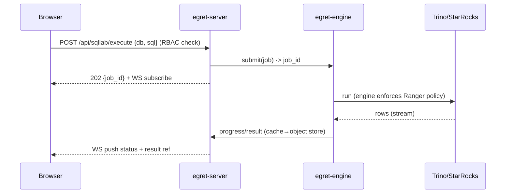

### 11.3 Engine downloads Ranger policy

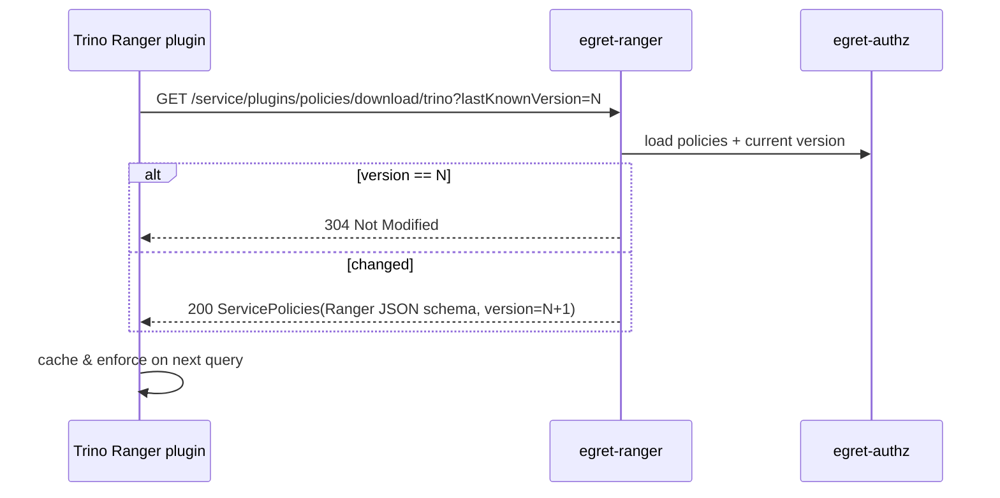

### 11.4 Iceberg commit (engine writes a table)

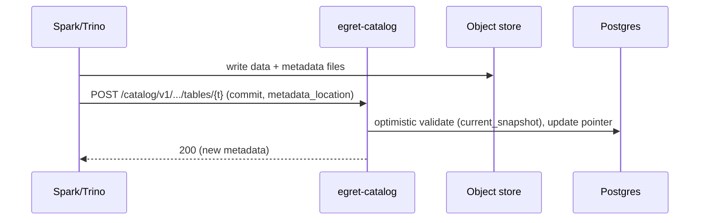

### 11.5 Publish & call a Data API

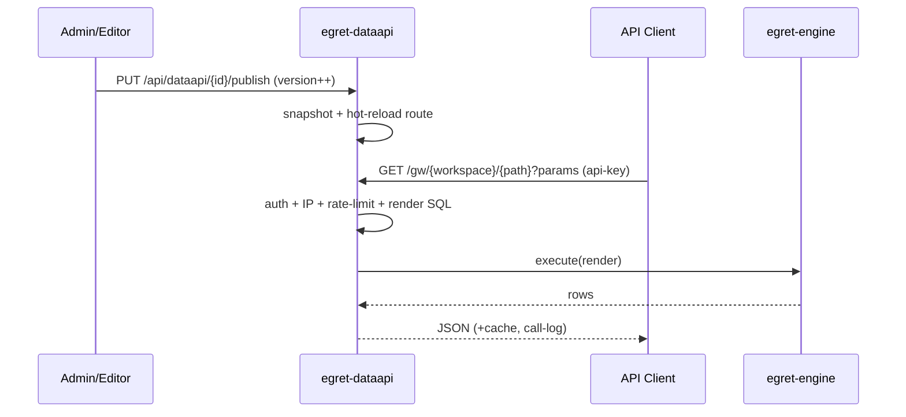

### 11.6 Scheduled workflow run

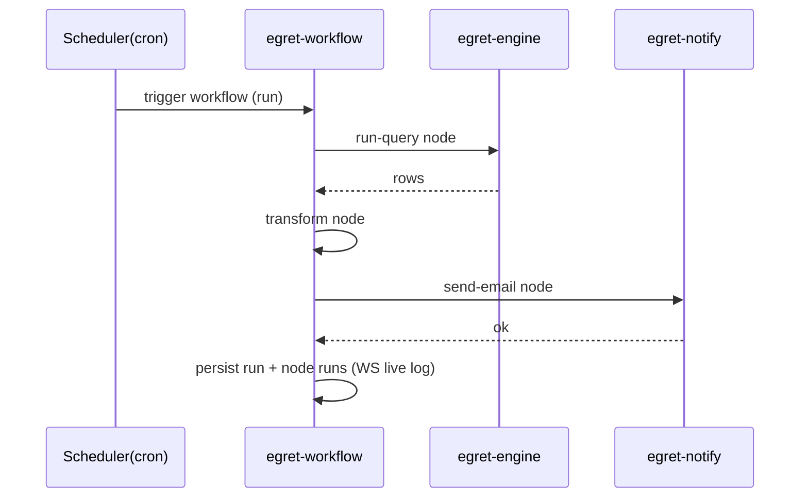

---

## 12. Cross-cutting concerns

- **Config (`egret-config`):** layered (defaults → file → env). Validated at boot, fail-fast.
- **Secrets (`egret-secrets`):** envelope encryption; data keys wrapped by a KMS/master key; decrypted only when a connection is needed.
- **Events (`egret-events`):** in-proc broadcast by default; Kafka/NATS adapter (inheriting `lakekeeper-events-*`) for multi-instance. Drives workflow triggers, cache invalidation, audit.
- **Error handling:** `egret-core::Error` via thiserror; mapped to HTTP problem+json; fail-fast, log with context (tracing spans).
- **Observability:** `tracing` + OpenTelemetry export; Prometheus `/metrics`; structured JSON logs; request-id + workspace-id in spans.
- **Caching:** query results (engine), data API responses, Ranger policy version (304), dataset metadata. Redis or in-proc.
- **Migration:** sqlx migrations; `egret migrate` runs at deploy; backward-compatible.
- **Testing:** per-crate unit tests (mock traits), integration with testcontainers (Postgres/MinIO/Trino), contract tests for Ranger & Iceberg REST (against the spec), Playwright e2e for the SPA.
- **Multi-instance:** the monolith is stateless (state lives in PG/Redis/object store); the workflow scheduler needs leader election (Postgres advisory lock) to avoid duplicate runs.

---

## 13. API surface & OpenAPI

| Prefix | Module | Client |
|---|---|---|
| `/api/auth/*` | auth | SPA |
| `/api/admin/*` | databases, workspaces, users, monitor | Admin SPA |
| `/api/authz/*` | policy authoring | Admin SPA |
| `/service/plugins/*`, `/service/tags/*` | **Ranger compat** | Trino/StarRocks plugin |
| `/catalog/v1/*` | **Iceberg REST** | engines |
| `/api/ws/{workspace}/sqllab/*` | SQL Lab | Explorer SPA |
| `/api/ws/{workspace}/datasets|charts|dashboards/*` | BI | Explorer SPA |
| `/api/ws/{workspace}/notebooks/*` | notebook | Explorer SPA |
| `/api/ws/{workspace}/dataapi/*` | data API mgmt | Explorer/Admin SPA |
| `/gw/{workspace}/*` | **Data API gateway** runtime | API clients |
| `/api/ws/{workspace}/workflows/*` | workflow | Explorer SPA |
| `/ws` | WebSocket hub | SPA |
| `/metrics`, `/healthz` | monitor | ops |

- **OpenAPI** is auto-generated (utoipa) for the `/api/*` groups; the FE `api-client` is generated from it. The `/catalog` & `/service` groups follow external specs (Iceberg/Ranger) and are tested by contract.

---

## 14. Security

- **Least privilege:** RBAC + two-layer Ranger; service tokens have narrow scopes.
- **Credentials at rest:** encrypted (egret-secrets); secrets never logged.
- **Input validation:** validate all input; the **SQL template (dataapi)** allows **parameter binding only**, blocking SQL injection (no raw interpolation; dynamic parts only affect structure, values are always bound).
- **Network:** Ranger/Catalog endpoints are engine-only (mTLS/allowlist depending on deployment).
- **Audit:** every governance action is written to `audit_log`.
- **Rate-limit & IP allow/deny:** at the Data API gateway and auth.
- **Tenant isolation:** middleware enforces `workspace_id`; tested for cross-workspace leakage.
- **Compliance with the global CLAUDE.md:** no committed secrets; conventional commits; pinned dependencies.

---

## 15. Repository layout

```text
egret/
├── Cargo.toml                      # workspace
├── crates/
│   ├── egret-bin/
│   ├── egret-server/
│   ├── egret-core/
│   ├── egret-config/
│   ├── egret-metastore/
│   ├── egret-secrets/
│   ├── egret-storage/
│   ├── egret-events/
│   ├── egret-auth/
│   ├── egret-authz/
│   ├── egret-ranger/
│   ├── egret-database/
│   ├── egret-engine/
│   ├── egret-catalog/
│   ├── egret-bi/
│   ├── egret-notebook/
│   ├── egret-dataapi/
│   ├── egret-workflow/
│   ├── egret-notify/
│   └── egret-monitor/
├── migrations/                     # sqlx migrations
├── frontend/                       # pnpm monorepo (apps/web + packages/*)
├── deploy/                         # Dockerfile, docker-compose, helm/
├── docs/
│   ├── en/                         # English (canonical): architecture/, adr/
│   └── vi/                         # Vietnamese (reference): architecture/, adr/
└── tests/                          # integration / contract / e2e
```

---

## 16. Phased roadmap

> Principle: **foundation first → BI later** (per the roadmap ADR). Each phase is one or more
> dedicated specs (brainstorm → plan → implement).

### Phase 0 — Bootstrap (foundation)
- Cargo workspace + crate skeletons; `egret-core`, `egret-config`, `egret-metastore`, `egret-server`.
- CI, migration runner, dev Docker/compose (Postgres + MinIO + Trino + StarRocks).
- FE skeleton: extract `packages/ui` from sparklabx, app shell + workspace switcher.

### Phase 1 — Foundation (auth, workspace, database)
- `egret-auth`: OIDC/SSO, session, RBAC, workspace membership.
- `egret-database`: register/test/health for Trino & StarRocks; `egret-secrets`.
- Admin portal: users, workspaces, databases. Explorer shell.
- **Milestone:** SSO login, create a workspace, register + grant a database.

### Phase 2 — Catalog & Ranger (governance core)
- `egret-storage`, `egret-catalog` (Iceberg REST), `egret-authz` + `egret-ranger`.
- Admin: catalog browser, policy authoring.
- **Milestone:** Trino/StarRocks use Egret as the Iceberg catalog + download Ranger policies to enforce.

### Phase 3 — Query & SQL Lab & Dataset
- `egret-engine` (Trino REST + StarRocks MySQL, async, result store), `egret-bi` (sqllab + dataset).
- Explorer: SQL Lab, datasets.
- **Milestone:** async queries with caching, saved queries, dataset creation.

### Phase 4 — Chart & Dashboard & Notebook
- `egret-bi` (ECharts charts + dashboards), `egret-notebook`.
- Explorer: charts, dashboards, notebooks.
- **Milestone:** build a dashboard from a dataset; notebook runs a kernel.

### Phase 5 — Data API Builder
- `egret-dataapi`: template engine, gateway, client mgmt, call-log.
- **Milestone:** publish SQL→API, call via api-key with rate-limit & cache.

### Phase 6 — Workflow Automation
- `egret-workflow` + `egret-notify`, FE workflow canvas (React Flow).
- **Milestone:** cron → run-query → send-email works, with run history.

### Phase 7 — Monitoring, hardening, scale
- Full `egret-monitor`, audit, Prometheus, Helm, leader-election scheduler, distributed event bus.

---

## 17. Open questions / future

- At what scale do we split `egret-catalog`/`egret-ranger` into separate services? (ADR-01 leaves it open.)
- Additional engines (BigQuery, ClickHouse, Postgres-as-source) — the trait is ready, prioritized later.
- A caching layer for dashboards (materialized) & result-based alerting (Superset-style alerts).
- Advanced row-level security & dynamic data-masking policy templates.
- Embedded analytics / public dashboard sharing.
- Versioning & migration for datasets/charts when the source schema changes.

---

## 18. Appendix: references

| Repo (in `data-portal/`) | Used for |
|---|---|
| `lakekeeper/` | Iceberg REST catalog, storage IO, authz, events (Rust patterns) |
| `ranger/` | Ranger REST API schema & download endpoints |
| `superset/` | dataset/chart/dashboard model, ECharts, websocket |
| `metabase/` | BI UX, query/dataset model |
| `sparklabx/` | **frontend design system/theme**, notebook, kernel, parquet preview |
| `dbapi/` | Data API Builder (dynamic SQL, gateway, client mgmt) |
| `n8n/` (external) | workflow automation model |

---

*End of foundational document v0.1. Update via PR; record major changes as new ADRs under `docs/en/adr/`.*
