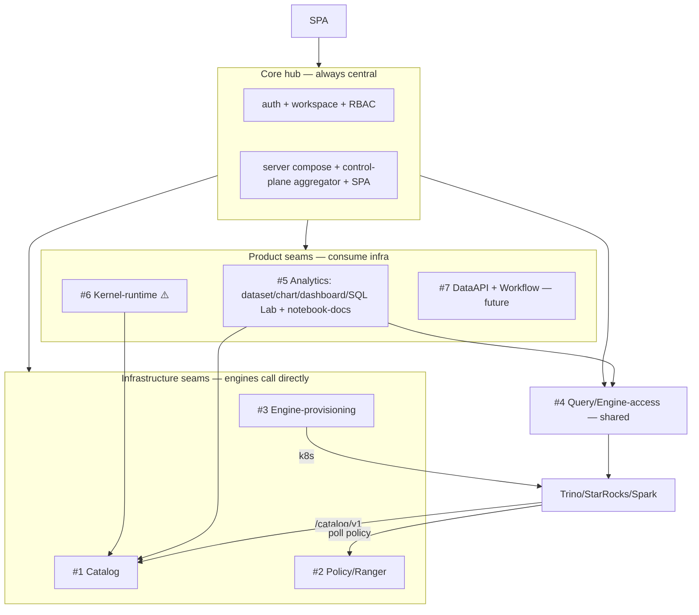

# Egret — Service-Ready Architecture Redesign (Effort A)

> **Status:** Design (approved to spec) · **Date:** 2026-07-08 · **Version:** 1.0
> **Scope:** Restructure the modular monolith so seven bounded contexts become **service-extractable later**, while staying **one binary today** (deployment unchanged). This is "Effort A" from the [whole-project audit](./2026-07-08-project-review-audit.md).
> **Non-goal:** Actually splitting into services now, network RPC, hexagonal-rewriting healthy crates, or changing ops/deployment. See [§7 Non-goals](#7-non-goals-yagni).
> **Companion effort:** "Effort B" (unified authorization) is a **separate** design; this doc only prepares the seams B plugs into. See [§6 Interplay with Effort B](#6-interplay-with-effort-b).

---

## 1. Goal & principle

The tool has grown past its documented architecture (audit §7). Rather than split into microservices — which we don't need operationally yet — we restructure the **internal boundaries** so that any of them *can* be extracted into its own service in the future with **near-zero call-site churn**.

The single most expensive coupling to undo after a split is a **shared database**. Therefore the redesign future-proofs the two things that are cheap to build now and expensive to retrofit later: **(a) data ownership per boundary** and **(b) a contract (interface) at each boundary**. Communication stays in-process today; only the wiring in the composition root knows whether a seam is local or remote.

**End-state chosen:** *service-ready modular monolith* — prepare all seams, split none now.

---

## 2. Target seam topology

Seven service-extractable bounded contexts around a central core hub. Two *kinds* of boundary: **infrastructure** seams (external engines call them directly — the ADR-01 split candidates) and **product** seams (user-facing, they consume the infrastructure).

| # | Seam | Kind | Today's crates → new home |
|---|---|---|---|
| — | **Core hub** (not split) | center | `egret-auth` + `egret-workspace` (RBAC) + `egret-server` + `egret-bin` |
| 1 | **Catalog** | infra, engine-facing | `egret-catalog-engine` + machine-idp + catalog-client store |
| 2 | **Policy/Ranger** | infra, engine-facing | `egret-authz` + `egret-ranger` (merged) |
| 3 | **Engine-provisioning** | infra, operator-style | `egret-orchestrator` + `controlplane/engines.rs` |
| 4 | **Query / Engine-access** | shared data-plane | `egret-engine` + `egret-database` (dedup connectors) |
| 5 | **Analytics** | product, user-facing | `egret-bi` + `egret-notebook` (docs) |
| 6 | **Kernel-runtime** ⚠️ stateful | product | `egret-kernel` |
| 7 | **DataAPI + Workflow** | product, future | (not built — scaffold the seam) |



> `egret-engine` (#4) is a **shared** data-plane consumed by Analytics/DataAPI/Notebook — a service in its own right, not inside Analytics. The audit found `egret-database` **duplicates** engine's Trino/StarRocks connectors; that dedup happens when this seam is extracted (§5 E4).

---

## 3. The "service-ready seam" recipe (three parts)

Every seam is made extractable by the same three ingredients. This is the heart of the design.

### 3.1 Contract crate `egret-<seam>-api`
A **leaf crate** containing only DTOs + a `Port` trait — no logic, no heavy deps, so anyone can depend on it cheaply.

```rust
// egret-catalog-api  (leaf)
#[async_trait]
pub trait CatalogPort {
    async fn provision_warehouse(&self, req: ProvisionWarehouse) -> Result<WarehouseRef>;
    async fn grants_for_role(&self, wh: WarehouseId, role: &str) -> Result<Vec<Grant>>;
}
// DTOs derive serde + utoipa::ToSchema  (see §4.4)
```
- **Today:** the seam crate implements the trait; `egret-bin` wires the in-process impl → calls are zero-cost function calls.
- **At split:** write a `CatalogHttpClient` implementing the *same* trait; (de)serialize the *same* DTOs. **No call-site changes; no FE changes.** The composition root is the only place that knows local-vs-remote.

**Trait-seam convention (formalized):** the provisioner traits currently defined in `egret-controlplane` (`EngineProvisioner`, `WarehouseProvisioner`, `WarehouseBrowser`) and in machine-idp (`ClientVerifier`) **move into their contract crate** (e.g. `EngineProvisioner` → `egret-engine-mgmt-api`). Implementers stay in `egret-bin` (keeps the crate DAG acyclic) but now depend on a leaf interface crate instead of a 7k-LOC god crate.

### 3.2 Owned schema (data ownership)
Each seam **owns its tables** in a dedicated Postgres schema-namespace. Rules:
1. **Within-seam:** keep FKs (integrity).
2. **Cross-seam:** **keep the FK now but annotate `-- SEAM-CROSSING`; drop at real split.** In code, **no `JOIN` across seam schemas** — read another seam's data **only through its Port**.
3. **`workspace_id`** in every product seam is a **seam-crossing reference** — an annotated FK now (rule 2), a soft ref at split. No cross-seam JOIN; validity is guaranteed by the gateway-injected `WorkspaceContext`, no round-trip.

**Connection pool — unchanged ops now:** one Postgres, one pool; each repo scoped to its schema via `search_path` (the mechanism lakekeeper already uses). At a real split, each service gets its own pool/DB — repo code is unchanged because it only ever touched its own schema.

Schema-ownership map:

| Schema | Seam | Tables |
|---|---|---|
| `iam` | Core hub | users, groups, user_groups, sessions, roles, role_permissions, platform_role_assignments, workspace_members, workspaces, oidc_refresh_tokens |
| `catalog` | #1 | warehouses, catalog_roles, catalog_grants, catalog_clients, oidc_signing_keys · (+ isolated `lakekeeper` schema) |
| `policy` | #2 | authz_service_defs, authz_services, authz_policies, policy_audit |
| `engine_mgmt` | #3 | engines, engine_catalogs |
| `query` | #4 | databases, queries |
| `analytics` | #5 | datasets, dataset_columns, dataset_metrics, charts, dashboards, dashboard_cards, dashboard_tabs, folders, bookmarks, saved_queries, notebooks, notebook_cells, notebook_engine_access |
| `kernel` | #6 | kernels, notebook_kernels |
| `secrets`, `storage` | Foundation (shared) | secrets, workspace_secrets · storage_connections |
| `audit` | cross-cutting | **`audit_log` (new)** — populated by Effort B |

Cross-seam FKs to mark `-- SEAM-CROSSING`: `engines.warehouse_id`→`catalog.warehouses`, `engines.authz_service_id`→`policy.authz_services`, `datasets.database_id`→`query.databases`, all `*.workspace_id`→`iam.workspaces`, `databases.secret_id`/`warehouses.storage_conn_id`→foundation.

### 3.3 Event bus `egret-events`
Build the (doc-planned, unbuilt) internal bus: in-proc broadcast now, Kafka/NATS adapter later. Used for async cross-seam signals **instead of one seam reaching into another's internals**. Minimum topics: `workspace.deleted` (each seam prunes its rows), `warehouse.provisioned`/`warehouse.deleted`, `policy.changed` (engine reload + version bump for 304), `catalog.changed`, `query.finished`.

### 3.4 Composition root
`egret-bin` is the **only** place that knows in-proc vs remote: it selects the impl (local struct vs HTTP client) behind each Port and hands prebuilt routers to `egret-server`, which composes them exactly as today. **One binary; deployment unchanged.**

---

## 4. Breaking up `egret-controlplane` + cross-cutting standardization

### 4.1 God-crate breakup (the enabling refactor)
`egret-controlplane` (7.3k LOC, 6 bounded contexts, held together by a 13-field `CpState` + the `require_platform_admin` gate) is what blocks seam extraction. Each domain module leaves for its seam behind a Port; controlplane shrinks to a **thin admin-router aggregator** that mounts each seam's `admin_router()` under `/api/control-plane/*` and applies the platform-admin gate — **no domain logic**. `CpState` disappears; each router carries its own state.

| Module (LOC) | New home |
|---|---|
| `engines.rs` (3,208) | #3 Engine-provisioning (`egret-orchestrator` behind `EngineMgmtPort`); **collapse the two parallel engine-spec models**, drop `build_provision_req` |
| `warehouses.rs` (1,111) | #1 Catalog (`egret-catalog-engine` behind `CatalogPort`) |
| `policies/` (669+564) | #2 Policy/Ranger (`egret-authz`+`egret-ranger` merged) |
| `access/mod.rs` (622) | Core hub → `egret-auth` (owns roles/permissions) |
| `storage.rs` (~225) | `egret-storage`; also move `egret-catalog`'s `storage_conn.rs` here + catalog-client store to seam #1 (fixes egret-catalog's muddy identity) |
| `secrets.rs` (~224) | `egret-secrets` |
| `monitor.rs` (389) | new thin `egret-monitor` |
| `auth.rs` gate | ⚠️ **move to `egret-auth`** so seams can gate without depending on controlplane — **relocation only; redesigning the gate is Effort B** |

### 4.2 Error → HTTP unified (kills the 7× copy)
Move `egret_core::Error → IntoResponse` into `egret-core`; provide a generic `ApiError<D> { Auth(core::Error), Domain(D) }` (one shared `IntoResponse`), each seam supplies only its `Domain` arm. **Give `egret-catalog-engine` a real domain error + `IntoResponse`** (currently `anyhow`-only → opaque 500s; least-tested crate wrapping a load-bearing dep).

### 4.3 Connector dedup + unified result type (seam #4)
Extract `egret-engine`'s `Connector` for reuse; `egret-database` calls `Connector::ping/describe` instead of re-implementing the Trino `/v1/statement` + StarRocks `mysql_async` clients (both currently re-declaring the `prefer_socket(false)` gotcha). Unify a single **`TabularResult { columns, rows, types }`** in core, replacing the 4 parallel columns+rows representations; BI consumes it directly.

### 4.4 OpenAPI/utoipa as the single source of truth
The key that makes in-proc↔remote swap cheap: **contract-crate DTOs derive `serde` + `utoipa::ToSchema`** → same types are the in-proc contract, the future HTTP payload, and the OpenAPI schema. Each seam emits an OpenAPI doc; the FE **api-client is generated** (openapi-typescript/orval), replacing the hand-written 933-line `controlPlane.ts` and hand-declared DTOs (the FE's biggest drift source).

### 4.5 Shared token primitive
Consolidate the three disjoint token schemes (kernel `egk_`, notebook JWT, catalog machine JWT) into one mint+hash+verify helper in **`egret-core`**. Effort B's per-user catalog delegation builds on this.

### 4.6 Observability + audit hook
Add `request_id` + `workspace_id` + `seam` to tracing spans (seamless cross-service traces after a split). Define one `audit_log` write convention at the aggregator/middleware layer; Effort B fills the content.

---

## 5. Execution — strangler sequence

No big-bang. Each seam is its own epic (brainstorm → spec → plan → build). This doc is the root target-architecture spec; each epic gets its own detailed spec/plan.

| Epic | Content | Rationale |
|---|---|---|
| **E0 — Foundation** | §4.2–4.6 cross-cutting (error→core, `ApiError`, token-helper, `egret-events`, OpenAPI/utoipa + FE codegen scaffold); **move the auth gate into `egret-auth`**; stand up `egret-controlplane` as thin aggregator (admin-router registry); **revise the architecture doc to v0.3**. | Everything depends on it. No domain logic touched. |
| **E1 — Engine-provisioning** ⭐ | **Template seam**: create `egret-engine-mgmt-api`, move `engines.rs` (3.2k) out of controlplane into orchestrator behind the Port, **collapse the spec models**, `ALTER … SET SCHEMA engine_mgmt`. | Cleanest (orchestrator is a 0-dep island), frees the largest controlplane module, few downstream readers → proves the full 3-part recipe end-to-end. |
| **E2 — Policy/Ranger** | Merge `egret-authz`+`egret-ranger`, `egret-policy-api`, move `policies/` out of controlplane, `SCHEMA policy`, **fix the anonymous serving-surface auth**. | Small, stateless, engine-facing → early win #2. |
| **E3 — Catalog** | `egret-catalog-api`, move `warehouses.rs` out of controlplane, catalog-client store out of `egret-catalog`, storage-conn → `egret-storage`, align machine-idp, `SCHEMA catalog`. **Structure only — authz semantics deferred to Effort B.** | Untangles egret-catalog's identity; prepares ground for B. |
| **E4 — Query/Engine-access** | Dedup connectors (§4.3), `egret-engine-api` + `TabularResult` in core, `SCHEMA query`, fix `databases.workspace_id NOT NULL`. | Needed before Analytics decouples; realizes §4.3. |
| **E5 — Analytics + Kernel** | `egret-analytics-api`; split `notebook-docs` (Analytics) vs `kernel-runtime` (own stateful seam), `SCHEMA analytics` + `kernel`; fix the two OKLCH `ChartTable.tsx` bugs; FE `can()` codegen deferred to B. | Largest product cluster; depends on the Query contract (E4). |
| **E6 — DataAPI/Workflow** | **Scaffold the seam/contract** when the Engineering pillar is built. | Not built yet → defer; no premature work. |

**Per-seam Definition of Done:** ① `egret-<seam>-api` contract crate (DTOs derive `ToSchema`); ② domain logic out of controlplane, `admin_router()` registered on the aggregator; ③ tables `ALTER SET SCHEMA`, cross-seam FKs annotated `-- SEAM-CROSSING`; ④ OpenAPI emitted + FE client regenerated; ⑤ event wiring (`workspace.deleted` prune, …); ⑥ full local CI green (BE fmt+clippy+test AND FE lint/typecheck/test/build — GitHub CI is out of quota per project practice).

---

## 6. Interplay with Effort B (unified authorization)

Effort B redesigns authorization *semantics* (merge the two authorizers, object-level scoping, per-user catalog delegation, real `audit_log`). It should start **after E0** (the gate lives in `egret-auth`) and **after E2 + E3** (Policy and Catalog are structurally extracted), because B reworks authz *across* those seams. So: run A through ~E3, then B can proceed in parallel. The two plug-in points for B are the **token helper (E0)** and the **catalog contract (E3)**.

---

## 7. Non-goals (YAGNI)

- No real HTTP clients / RPC — traits stay in-process.
- No hexagonal rewrite of already-healthy crates (`egret-bi`, `egret-engine`).
- No deployment/ops change — one binary, one Postgres, one pool.
- No Kafka/NATS — event bus is in-proc broadcast only.
- No dropping of cross-seam FKs now — annotate and defer to a real split.

---

## 8. Decisions locked

1. **Service-ready modular monolith** — one binary, 7 extractable seams (§2).
2. Seam recipe: **contract-crate (Port+DTO) + owned-schema + event bus**, strangler execution (§3).
3. `egret-controlplane` → **thin aggregator**; domain logic to seams (§4.1).
4. Data: tables into **per-seam schemas**, **keep FKs annotated `SEAM-CROSSING`** (drop at split), **no cross-seam JOIN**, one pool (§3.2).
5. Cross-cutting: error→core, connector dedup + `TabularResult`, token-helper in **`egret-core`**, **OpenAPI codegen** for FE, `egret-events` (§4).
6. Execution: **E0 → E1 (template) → E2 → E3 → E4 → E5 → E6 (deferred)** (§5).

---

*Design v1.0 (2026-07-08). Baseline for the Effort-A epics E0–E6. Effort B (authorization) is a separate design that plugs into E0 + E3.*
