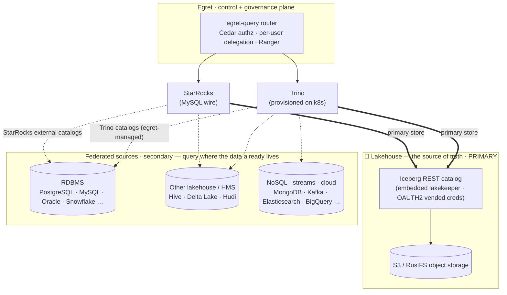
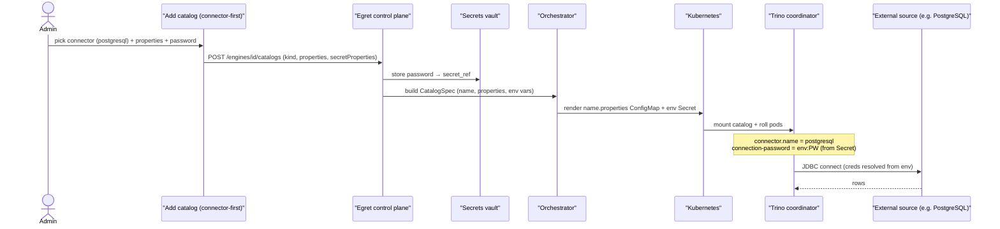
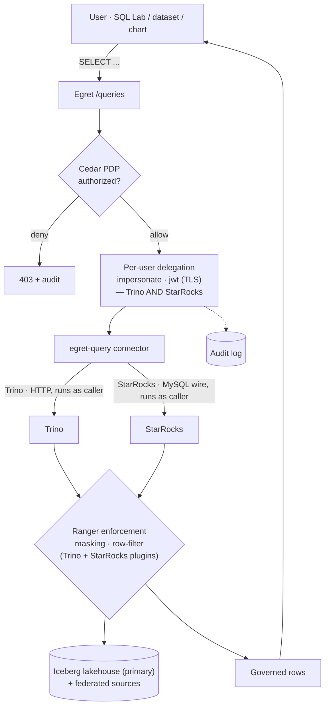
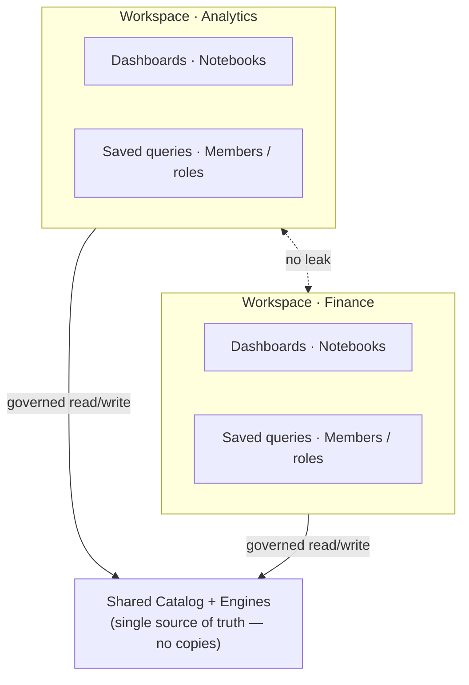
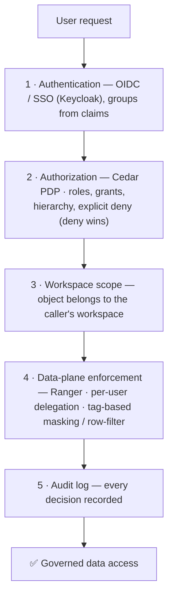

# Platform overview: data plane, governance and isolation

Deep dive moved out of the repository README. It describes how the query engines read your data, how federated catalogs and credentials work, the governed query lifecycle, workspace isolation and the security layers. For the day-to-day product, see the [documentation site](https://egret-data.github.io/docs/); for the whole system, the [architecture design](2026-06-17-egret-architecture-design.md).

---

## Data plane — how Trino & StarRocks read your data (beyond S3)

Egret's data foundation is an **Iceberg lakehouse** — a shared **Iceberg REST catalog** (embedded
[lakekeeper](https://github.com/lakekeeper/lakekeeper)) on S3/RustFS. That lakehouse is the **primary
store**: Egret's own tables live there, and it is where both engines read and write. But the platform
is **not** limited to it — through **query federation**, both **Trino** and **StarRocks** can also
read data *in place* from external systems (relational databases, other lakehouse formats, NoSQL,
streams, cloud warehouses) without copying it in.

### Data-plane topology

The **Iceberg lakehouse on S3/RustFS is the primary store** (the source of truth). Both engines read
it over the **bold** paths; external systems are queried in place as **secondary** federation
(dotted). Only representative sources are drawn — the full connector list is in the table below.

- **Iceberg = primary.** The embedded catalog (`iceberg` connector, `rest` type) is auto-wired at
  provision time with **OAUTH2 vended credentials** — engines never hold long-lived S3 keys. This is
  where Egret's own tables are written and read.
- **Both engines federate.** **Trino** reaches external systems through **egret-managed catalogs**
  (the Add-catalog flow below); **StarRocks** brings its **own external catalogs** (Hive, Iceberg,
  JDBC, …). Federation lets a query join lake data with a live RDBMS or stream **without copying it in**.

### Adding a federated catalog — the credential flow

Any non-warehouse source is added through the **connector-first "Add catalog"** form. Egret stores
the catalog as an `EngineCatalog` row (`kind` = the Trino `connector.name`), keeps connection
**secrets in the vault**, and the orchestrator renders a `<name>.properties` file whose secret-backed
keys are injected from the pod's env Secret as `${ENV:VAR}` — **plaintext passwords never touch the
ConfigMap**.

### Supported connectors (Trino, curated in the catalog wizard)

For **Trino** engines, Egret ships a curated, docs-backed picker for common connectors — plus a
**custom connector-name** escape hatch for anything Trino supports. The families below are
representative highlights, not the whole list:

| Family | Connectors (examples) |
|---|---|
| **Lakehouse / files** | **Iceberg** (Hive · Glue · JDBC · REST · Nessie metastore), Hive, Delta Lake, Hudi |
| **Relational (JDBC)** | PostgreSQL, MySQL, MariaDB, SQL Server, Oracle, Redshift, Snowflake, ClickHouse, … |
| **NoSQL / search** | MongoDB, Cassandra, Elasticsearch, OpenSearch, Redis |
| **Streaming** | Kafka, Kinesis |
| **Cloud / API** | BigQuery, Google Sheets |
| **Observability / misc** | Prometheus, JMX, Memory, TPC-H, TPC-DS |

> **StarRocks** reaches the same kinds of sources through its **own external catalogs** (Iceberg,
> Hive, JDBC/MySQL/PostgreSQL, Delta, …); those are configured on the StarRocks side, and Egret
> queries the result. **Object stores are S3-compatible** (AWS S3, RustFS, or any S3-API store via a
> custom `s3.endpoint`); lakehouse connectors can point at their own metastores/buckets, independent
> of Egret's embedded catalog.

### Governed query lifecycle

Federation never bypasses governance — every query is authorized, run **as the calling user**, and
audited:

- **Per-user delegation (both engines)** — the query runs under the **caller's** identity, not a
  shared service account. **Trino and StarRocks both** support `impersonate` (a trusted delegator
  over TLS) and `jwt` (the caller's own short-lived JWT over TLS, OIDC users). Each engine then
  enforces **that user's** policies via its **Ranger** plugin (column masking, row-level filters) —
  Egret serves the Ranger-compatible policy download for both.

---

## Multi-workspace isolation

A **workspace** is a self-contained sandbox for a team or project. Dashboards, datasets, charts,
notebooks, saved queries, database connections and API definitions live *inside* a workspace and
never leak across the boundary. The shared **catalog** and **engines** sit underneath, so isolation
never means duplicating the data.

- **Isolated:** content in Workspace A is invisible to Workspace B.
- **Shared underneath:** both draw from one catalog — no copies, no drift.
- **Scoped access:** each workspace has its own members, roles and grants.

---

## Security-first, by design

Access is never an afterthought. Every request passes through layered controls before it reaches
data — and every decision is recorded.

- **One authorizer** — Cedar is the single policy decision point (template-per-role + linked
  policy-per-grant, deny-wins).
- **OIDC / SSO** — enterprise identity via Keycloak; groups come from token claims.
- **Data-plane governance** — Ranger-compatible policy download for Trino/StarRocks, per-user
  delegated queries, tag-based **column masking** and **row-level filters**.
- **Classification & ABAC** — data classification tags gate access; attribute/clearance-based rules
  (Cedar) for BI objects.
- **Auditable** — a real audit log captures who accessed what, when, and whether it was allowed.

### Identity, secrets & isolation

Security-first also means **owning identity end-to-end** and **never trusting a shared credential**:

- **Machine-IdP token broker** — Egret mints **per-user, short-lived engine tokens** from its own
  embedded identity provider (`aud: engine`, signed by Egret's JWKS). Engines trust Egret's issuer
  directly, so there are **no long-lived engine passwords**, and even **local / non-OIDC users** get
  scoped, delegated access. SSO stays authentication-only + JIT provisioning.
- **SSO back-channel logout** — an OIDC logout token from Keycloak (RS256, JWKS-verified) revokes
  **all** of that user's sessions server-side, so a central sign-out really ends access everywhere.
- **Session & account lifecycle** — admin password reset, immediate lockout via **session
  revocation**, hard-delete with **content re-assignment** (no orphaned dashboards), and a
  **last-admin guard** that stops the platform from being locked out of itself.
- **Typed secrets vault** — Kubernetes-style typed, multi-field secrets (`Opaque` / `kubernetes.io/tls`
  / `basic-auth`) back every connector, storage and TLS credential. Secrets are injected into pods as
  env references — **plaintext never lands in a ConfigMap** — and ingress TLS is served from
  operator-provided certificates.
- **Runtime isolation** — each notebook runs in a **hardened, per-user × per-workspace pod** (non-root
  `uid 1000`, all Linux capabilities dropped, a locked-down `NetworkPolicy`, minimal RBAC) and writes
  to a **private Iceberg namespace** via a namespace-scoped token — never a shared kernel.

---
