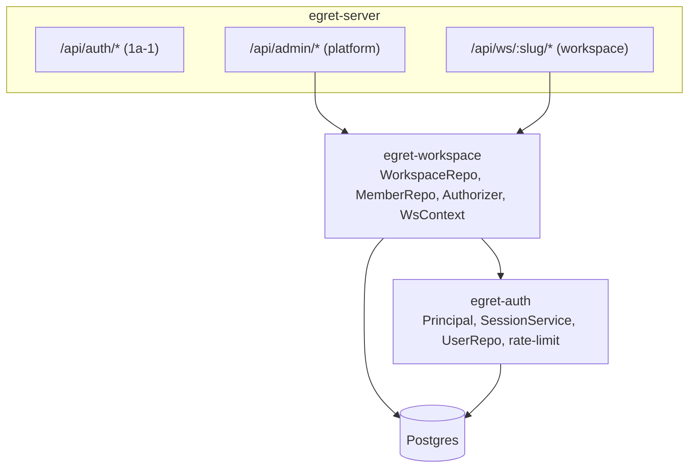

# Phase 1a-2 — Workspace & RBAC Design Spec

> **Status:** Approved design · **Date:** 2026-06-17 · **Version:** 0.1
> Canonical (English). Vietnamese reference: [`docs/vi/specs/2026-06-17-phase-1a-2-workspace-rbac-design.md`](../../vi/specs/2026-06-17-phase-1a-2-workspace-rbac-design.md).
> Builds on [Phase 1a identity spec](2026-06-17-phase-1a-identity-design.md) (§5, §10, §11) and the shipped [Phase 1a-1 AuthN & Session](../plans/2026-06-17-phase-1a-1-authn-session.md).

---

## 1. Goal & scope

Add the workspace entity, membership, and role-based access control (RBAC) on top of the Phase 1a-1 identity foundation, plus the security hardening deferred from 1a-1. Backend/API only.

**In scope**
- `egret-workspace` crate: workspace CRUD, membership (user/group), RBAC `Authorizer`, workspace-context extractor.
- **Union (most-permissive) permission semantics** across all of a principal's roles (direct + group).
- Group-derived roles: platform roles (in `egret-auth`) and workspace roles (in `Authorizer`).
- Admin routes (`/api/admin/workspaces`, `/api/admin/users` + platform-role assignment) and workspace routes (`/api/ws/{slug}/members`), enforced by `Authorizer`.
- `map_idp_claims_to_roles` helper (defined here; consumed by 1a-3 OIDC).
- Hardening: in-memory login rate-limiting, dummy argon2 verify (anti-timing), `egret init --force`, dead-code cleanup.

**Out of scope (deferred)**
- OIDC/SSO login + JIT group population → **1a-3**.
- Admin/Explorer SPA → **0b**.
- Custom/editable roles & permission-catalog management API → future (roles are fixed/seeded; see §4).
- Data-plane authz (Ranger/row-filter) → Phase 2.

## 2. Decisions (validated against Metabase & Superset)

| Decision | Choice | Reference evidence |
|---|---|---|
| Multi-role permission combination | **Union / most-permissive** across all roles (direct + group) | Metabase combines group permissions "most-permissive" (`permissions/` — `most-permissive`/`coalesce-most`/`union`); Superset gathers a user's PVMs as the **union over all roles** (`security/manager.py` filters `role.id IN user_roles`). |
| Group → role resolution | **Yes, now** (user + group) for both platform and workspace roles | Both resolve effective permissions through group/role membership. |
| Roles & permissions | **Fixed / seeded** (5 roles, fixed permission catalog); only role *assignment* is via API | Both refs support custom roles; fixed is a deliberate MVP simplification. Custom roles noted as a future extension. |
| Workspace URL resolution | **Slug** (`/api/ws/{slug}/*`) | Human-friendly; `workspaces.slug` is unique. |
| Login rate-limit | **In-memory, per-process** (IP+email) | No Redis dependency yet; sufficient for single-instance MVP. |

> `WorkspaceContext.workspace_role` (single string) is **display-only** (the highest-precedence role for UX). **Enforcement is always union** via `Authorizer`, never a single-role precedence check.

## 3. Architecture



- `egret-workspace` **depends on** `egret-auth` (uses the `Auth`/`Principal` extractor and `UserRepo`). `egret-auth` does **not** depend on `egret-workspace` (no cycle).
- New crate modules: `model.rs`, `workspaces.rs`, `members.rs`, `rbac.rs` (Authorizer), `context.rs` (WsContext extractor), `mapping.rs` (IdP claim mapping), `routes.rs` (admin + ws routers), `lib.rs`.
- Mutating admin/ws routes sit behind the existing `csrf_layer` (1a-1); GET routes are CSRF-exempt by the middleware's method check.

## 4. RBAC model & `Authorizer`

**Roles (seeded in migration `0003`, fixed):** `platform_admin`, `data_steward` (platform); `ws_admin`, `ws_editor`, `ws_viewer` (workspace). **Permission catalog (fixed):**

| Scope | Permission | Seeded to |
|---|---|---|
| platform | `workspace:create/read/update/archive` | platform_admin |
| platform | `user:read` | platform_admin, data_steward |
| platform | `user:assign_role` | platform_admin |
| platform | `workspace:read` | data_steward |
| workspace | `workspace:manage_members` | ws_admin |

`ws_editor`/`ws_viewer` carry no permissions yet (the catalog grows in later phases).

**`Authorizer` (`rbac.rs`):**
```rust
pub struct Authorizer { db: Db }
impl Authorizer {
    /// Union of platform permissions across the user's platform roles (direct + group).
    pub async fn platform_permissions(&self, user_id: UserId) -> Result<HashSet<String>>;
    /// Union of workspace permissions across the principal's workspace roles for `ws` (direct + group).
    pub async fn workspace_permissions(&self, user_id: UserId, ws: WorkspaceId) -> Result<HashSet<String>>;

    pub async fn require_platform(&self, p: &Principal, perm: &str) -> Result<()>; // Err(Forbidden)
    pub async fn require_workspace(&self, ctx: &WorkspaceContext, perm: &str) -> Result<()>;
}
```
- `require_platform`: `Ok` iff `perm ∈ platform_permissions(p.user_id)`. (`platform_admin` is seeded with every platform permission, so it always passes — no special-casing.)
- `require_workspace`: `Ok` if `ctx.principal.is_platform_admin()` (bypass), else iff `perm ∈ workspace_permissions(user, ctx.workspace_id)`.

**Group resolution SQL (workspace, union):**
```sql
SELECT DISTINCT rp.permission
FROM workspace_members wm
JOIN roles r ON r.scope = 'workspace' AND r.name = wm.role
JOIN role_permissions rp ON rp.role_id = r.id
WHERE wm.workspace_id = $1
  AND ( (wm.principal_type = 'user'  AND wm.principal_id = $2)
     OR (wm.principal_type = 'group' AND wm.principal_id IN
            (SELECT group_id FROM user_groups WHERE user_id = $2)) );
```

**Platform roles incl. groups (`egret-auth::SessionService` change):** `validate`'s `platform_roles` query gains a group branch so `Principal.platform_roles` is complete:
```sql
SELECT DISTINCT r.name
FROM platform_role_assignments pra JOIN roles r ON r.id = pra.role_id
WHERE (pra.principal_type = 'user'  AND pra.principal_id = $1)
   OR (pra.principal_type = 'group' AND pra.principal_id IN
          (SELECT group_id FROM user_groups WHERE user_id = $1));
```

## 5. Workspace entity (`workspaces.rs`, `routes.rs`)

```rust
pub struct WorkspaceRepo { db: Db }
impl WorkspaceRepo {
    pub async fn create(&self, slug: &str, name: &str, created_by: UserId) -> Result<Workspace>;
    pub async fn list(&self, page: Pagination) -> Result<Vec<Workspace>>;
    pub async fn get_by_slug(&self, slug: &str) -> Result<Option<Workspace>>;
    pub async fn update(&self, id: WorkspaceId, name: &str) -> Result<()>;
    pub async fn archive(&self, id: WorkspaceId) -> Result<()>;
}
```

**Routes (platform-scoped, `Authorizer.require_platform`):**
| Method | Path | Permission |
|---|---|---|
| POST | `/api/admin/workspaces` | `workspace:create` |
| GET | `/api/admin/workspaces` | `workspace:read` |
| GET | `/api/admin/workspaces/{id}` | `workspace:read` |
| PUT | `/api/admin/workspaces/{id}` | `workspace:update` |
| DELETE | `/api/admin/workspaces/{id}` (archive) | `workspace:archive` |

- `slug` validated: lowercase `[a-z0-9-]`, unique → `Conflict` on duplicate.

## 6. Membership (`members.rs`, `routes.rs`)

```rust
pub struct MemberRepo { db: Db }
impl MemberRepo {
    pub async fn add(&self, ws: WorkspaceId, ptype: &str, pid: Uuid, role: &str, by: UserId) -> Result<()>;
    pub async fn remove(&self, ws: WorkspaceId, ptype: &str, pid: Uuid) -> Result<()>;
    pub async fn list(&self, ws: WorkspaceId) -> Result<Vec<WorkspaceMember>>;
}
```
- `role` validated against the seeded workspace roles (`ws_admin|ws_editor|ws_viewer`) → `InvalidInput` otherwise.

**Routes (workspace-scoped, `Authorizer.require_workspace(ctx, "workspace:manage_members")`):**
| Method | Path |
|---|---|
| GET | `/api/ws/{slug}/members` |
| POST | `/api/ws/{slug}/members` |
| DELETE | `/api/ws/{slug}/members/{principal_type}/{principal_id}` |

**Platform user admin (`require_platform`):**
| Method | Path | Permission |
|---|---|---|
| GET | `/api/admin/users` | `user:read` |
| GET | `/api/admin/users/{id}` | `user:read` |
| PUT | `/api/admin/users/{id}/platform-roles` | `user:assign_role` |

`PUT .../platform-roles` replaces the user's `platform_role_assignments` with the supplied set of platform role names (validated against seeded platform roles).

## 7. Workspace-context extractor (`context.rs`)

`WsContext(pub WorkspaceContext)` — an axum `FromRequestParts<S>` extractor (where `WorkspaceRepo`, `Authorizer`, `SessionService` are `FromRef<S>`):
1. Authenticate via the `Auth` extractor → `Principal`.
2. Read the `slug` path param.
3. `WorkspaceRepo.get_by_slug` → `NotFound` (404) if missing or `status='archived'`.
4. Membership check: `platform_admin` (bypass) **or** the principal has ≥1 workspace role (direct or group) in this workspace; else `Forbidden` (403).
5. Build `WorkspaceContext { workspace_id, principal, workspace_role }` where `workspace_role` is the highest-precedence role for display (`ws_admin` > `ws_editor` > `ws_viewer`, or `"platform_admin"`).

## 8. IdP claim → role mapping (`mapping.rs`)

```rust
pub struct IdpRoleMapping { pub claim: String, pub value: String, pub role: String, pub scope: String }
/// Pure function: given OIDC claims (as a JSON value) and configured rules, produce the
/// platform role assignments to apply. Consumed by 1a-3 OIDC JIT; unit-tested here.
pub fn map_idp_claims_to_roles(claims: &serde_json::Value, rules: &[IdpRoleMapping]) -> Vec<String>;
```
Rules come from `egret-config` (`[[idp_role_mapping]]`, already specced in §12 of the identity spec — added in 1a-3 when OIDC lands; the function and its tests land now).

## 9. Hardening (folded in from 1a-1)

- **Login rate-limit (in-memory):** a `RateLimiter` in `egret-core` (`egret_core::ratelimit`; it lived in `egret-auth` until the machine-IdP token endpoint needed it too) keyed by `ip:email`, sliding window. On exceeding `login_max_attempts` within `login_window_secs`, reject with `429 Too Many Requests` for `login_lockout_secs`. Stored in `AuthState`. Backed by `Mutex<HashMap<String, Vec<Instant>>>` (std `Instant`); pruned on access. Resets on restart (acceptable for MVP; Redis-backed when multi-instance).
- **Dummy verify (anti-timing):** when no user is found (or the user has no password hash), still run `verify_password` against a fixed precomputed argon2 hash before returning `Unauthorized`, equalizing response time.
- **`egret init --force`:** `Command::Init { force: bool }`; with `--force`, create an additional `platform_admin` even if one exists (without `--force`, the existing idempotent refuse-only behaviour is kept).
- **Dead-code cleanup:** remove the unused `model::Session` struct; keep `model::Provider` (consumed by 1a-3 OIDC provisioning).

## 10. Data model

No new tables (the schema is in migration `0003`). Add one index migration:

**`migrations/0004_rbac_indexes.sql`**
```sql
CREATE INDEX workspace_members_principal_idx ON workspace_members (principal_type, principal_id);
```
(`user_groups(user_id, ...)` PK already covers the group-lookup subquery; `platform_role_assignments` PK covers its lookups.)

## 11. Configuration additions (`egret-config`)

```toml
[rate_limit]
login_max_attempts = 5
login_window_secs = 300
login_lockout_secs = 300
```

## 12. State wiring (`egret-server`)

Extend `AppState` with `workspace: Option<WorkspaceState>` where
```rust
pub struct WorkspaceState { pub workspaces: WorkspaceRepo, pub members: MemberRepo,
                            pub authz: Authorizer, pub users: UserRepo, pub sessions: SessionService }
```
(`FromRef<WorkspaceState>` for `WorkspaceRepo`/`Authorizer`/`SessionService` so the extractors resolve.) `build_router` mounts the admin + ws routers under `csrf_layer`; `egret-bin serve` builds `WorkspaceState`. The login rate-limiter is added to the existing `AuthState`.

## 13. Error handling & security

- Reuse the `AuthError`→HTTP mapping from 1a-1; add `429` for rate-limit (extend the mapping or return a tuple from the login handler).
- `Forbidden`→403 for failed permission checks; `NotFound`→404 for missing/archived workspace; `Conflict`→409 for duplicate slug; `InvalidInput`→400 for bad role/slug.
- Authorization is **deny-by-default**: every admin/ws handler calls an explicit `require_*` before acting.
- Union semantics never *reduce* access incorrectly: a principal denied by one role but allowed by another is **allowed** (most-permissive), matching the references.

## 14. Testing

- **Unit:** permission **union** across multiple roles; `require_platform`/`require_workspace` allow/deny; display-role precedence; rate-limiter counter (allow N, block N+1, reset after window — injected clock or short window); `map_idp_claims_to_roles`; slug validation.
- **DB-integration (testcontainers / DATABASE_URL-gated):** workspace CRUD + slug uniqueness; membership add/remove/list; Authorizer union with a **user assigned via a group** (seed user→group→workspace_members(group) and assert the permission resolves); SessionService platform roles via group.
- **HTTP/handlers (axum oneshot, DB-gated):** admin route 403 without permission / 200 with; create workspace then add member; `/api/ws/{slug}/members` 403 for a non-member, 200 for `ws_admin`; archived workspace → 404; rate-limited login → 429.
- Offline-green preserved (DB tests self-skip without `DATABASE_URL`); CI runs them against Postgres.

## 15. Decomposition for the plan

Suggested bite-sized tasks: (1) `0004` index + `egret-workspace` scaffold + `model.rs`; (2) `WorkspaceRepo` + DB tests; (3) `MemberRepo` + DB tests; (4) `Authorizer` (union, group resolution) + DB tests; (5) `SessionService` platform-roles group branch; (6) `WsContext` extractor; (7) admin workspace routes + enforcement; (8) admin user routes + platform-role assignment; (9) ws member routes; (10) rate-limiter + dummy-verify in login; (11) `egret init --force` + dead-code cleanup; (12) config + state wiring + full verification.

## 16. References

- Metabase: `metabase/src/metabase/permissions/` (most-permissive / union combination of group permissions).
- Superset: `superset/superset/security/manager.py` (union of PVMs over a user's roles; `add_role`/`copy_role` for custom roles).
- Egret: [Phase 1a identity spec](2026-06-17-phase-1a-identity-design.md) §5/§10/§11; [Phase 1a-1 plan](../plans/2026-06-17-phase-1a-1-authn-session.md).
