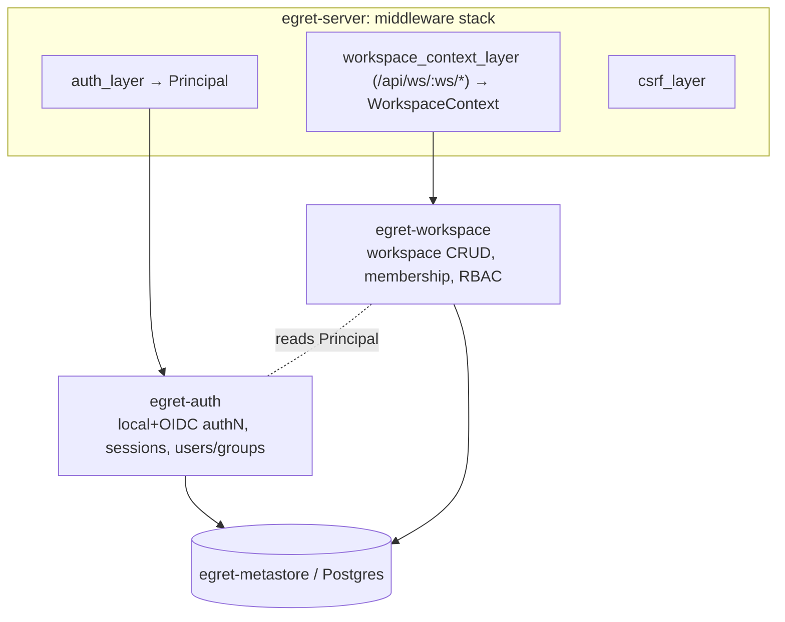
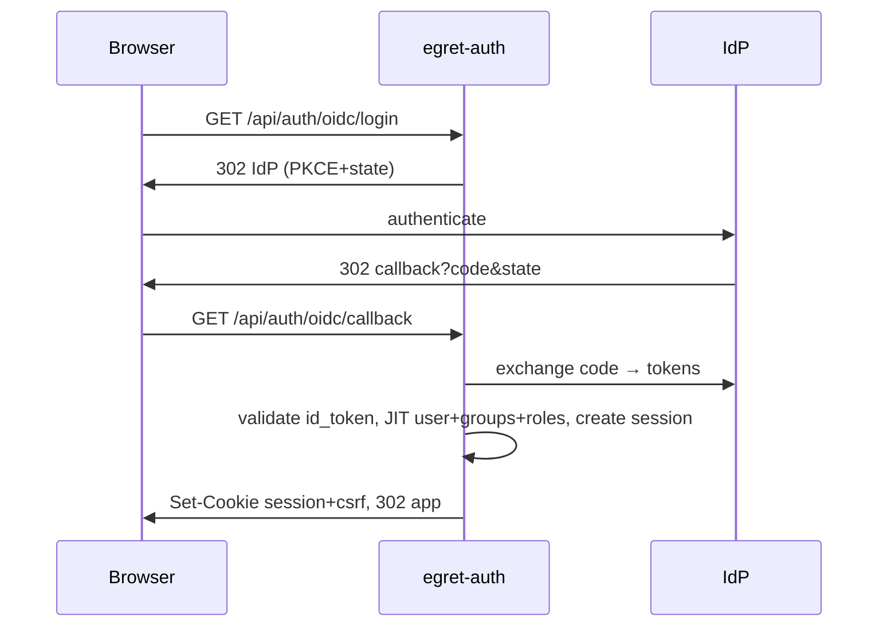

# Phase 1a — Identity (Auth, Session, Workspace, RBAC) Design Spec

> **Status:** Approved design · **Date:** 2026-06-17 · **Version:** 0.1
> Canonical (English). Vietnamese reference: [`docs/vi/specs/2026-06-17-phase-1a-identity-design.md`](../../vi/specs/2026-06-17-phase-1a-identity-design.md).
> Implements Phase 1 (identity portion) of the [Master Architecture Design](../architecture/2026-06-17-egret-architecture-design.md) — see §7 (workspace), §8 (authN/authZ), §9 (data model).

---

## 1. Goal & scope

Build the identity foundation every other Egret feature depends on: authentication (local + OIDC/SSO), server-side sessions, the workspace entity + membership, and role-based access control (RBAC). This is **backend/API only** — the Admin SPA is Phase 0b; data-plane authorization (Ranger/`egret-authz`) is Phase 2.

**In scope**
- Local password authentication (bootstrap admin via `egret init`) + OIDC/SSO authorization-code + PKCE.
- Server-side sessions in Postgres, httpOnly cookie, two-tier expiry, rotation, revocation.
- CSRF protection via double-submit token.
- Workspace CRUD (platform-admin) + membership (user/group, with role).
- RBAC: roles + permissions (platform & workspace scope), seeded roles, configurable IdP-claim→role mapping plus manual assignment.
- Auth middleware (`Principal`) + workspace-context middleware (`WorkspaceContext`) + permission guards.

**Out of scope (deferred)**
- Database registration / secrets / connection health → **Phase 1b**.
- Admin/Explorer SPA → **Phase 0b**.
- Data-plane authz, row-filter/column-mask, Ranger REST → **Phase 2**.
- JWT / API-key service-to-service auth → when `egret-dataapi`/engine callbacks need it.
- Local user self-registration, password reset email, multiple simultaneous IdPs → future (YAGNI).

## 2. Decisions (validated against Metabase & Superset)

The choices below were validated by inspecting the reference repos in `data-portal/`:

| Decision | Choice | Reference evidence |
|---|---|---|
| Session model | **Server-side session in Postgres + httpOnly cookie** | Metabase `core_session` table + `metabase.SESSION` cookie / `X-Metabase-Session` header. Superset can enable `SESSION_SERVER_SIDE`. |
| Cookie attributes | **httpOnly + SameSite=Lax + Secure (prod)** | Superset `SESSION_COOKIE_HTTPONLY=True`, `SESSION_COOKIE_SAMESITE="Lax"`, `SESSION_COOKIE_SECURE`. |
| Session expiry | **Two-tier: absolute max-age + idle timeout (sliding)** | Metabase `max-age-minutes` + `session-timeout-seconds`. |
| Password hashing | **argon2id** | Both refs use bcrypt; argon2id chosen as the current OWASP-recommended upgrade. |
| CSRF | **Double-submit CSRF token** | Superset Flask-WTF `WTF_CSRF_ENABLED=True`. |
| AuthN methods | **Local (AUTH_DB-style) + OIDC/SSO** | Superset `AUTH_TYPE=AUTH_DB` + `AUTH_OAUTH/AUTH_OID`. |
| RBAC | **Roles + permissions; manual assignment + IdP-claim mapping** | Superset FAB roles (`Admin/Alpha/Gamma`) + `AUTH_ROLES_MAPPING`. |
| API keys | **Deferred (separate concern)** | Metabase has a dedicated `api_key` model separate from sessions. |

## 3. Architecture

Two new crates (Approach A — clean "who are you" vs "what can you do where" split):



- **`egret-auth`** — authentication, session lifecycle, user/group identity. Produces a `Principal`.
- **`egret-workspace`** — workspace entity, membership, RBAC roles/permissions, authorization. Produces a `WorkspaceContext` and enforces permissions.
- Both persist via `egret-metastore`; both mount routers into `egret-server`. `WorkspaceContext` and `Principal` live in `egret-core` (already defined in Phase 0a — extend as needed).

**Middleware order (outer→inner):** `csrf_layer` → `auth_layer` (sets `Principal`, skips `/api/auth/login`, `/api/auth/oidc/*`, `/healthz`) → route. For `/api/ws/{workspace}/*`, `workspace_context_layer` runs after auth to resolve membership and build `WorkspaceContext`.

## 4. Crate `egret-auth`

**Responsibilities:** local + OIDC authentication, JIT user/group provisioning, session create/validate/rotate/revoke, cookie issue/parse, the `auth_layer` middleware.

**Public interface (sketch):**
```rust
pub enum Provider { Local, Oidc }

pub struct User { pub id: UserId, pub provider: Provider, pub email: String,
                  pub name: String, pub status: UserStatus /* active|disabled */ }

#[async_trait] pub trait Authenticator {
    async fn authenticate(&self, email: &str, password: &str) -> Result<User>; // local
}
pub struct LocalAuthenticator { /* argon2 verify against users.password_hash */ }

pub struct OidcService { /* openidconnect client */ }
impl OidcService {
    pub fn authorize_url(&self) -> (Url, CsrfStateToken, PkceVerifier); // store state+verifier
    pub async fn exchange(&self, code: &str, state, verifier) -> Result<OidcClaims>;
}
pub fn provision_from_claims(claims: &OidcClaims) -> ProvisionedUser; // JIT user+groups

pub struct SessionService { /* db pool */ }
impl SessionService {
    pub async fn create(&self, user_id: UserId, ua: &str, ip: &str) -> Result<Session>;
    pub async fn validate(&self, token: &str) -> Result<Option<Principal>>; // checks both expiries, slides idle
    pub async fn revoke(&self, token: &str) -> Result<()>;
    pub async fn revoke_all_for_user(&self, user_id: UserId) -> Result<()>;
}
```

**Routes:**
| Method | Path | Purpose | CSRF |
|---|---|---|---|
| POST | `/api/auth/login` | local email+password → set session cookie | exempt (no session yet; rate-limited) |
| GET | `/api/auth/oidc/login` | redirect to IdP (PKCE+state) | exempt |
| GET | `/api/auth/oidc/callback` | exchange code, JIT provision, set session | exempt |
| POST | `/api/auth/logout` | revoke session, clear cookie | required |
| GET | `/api/auth/me` | current `Principal` (user + roles + workspaces) | n/a (GET) |

## 5. Crate `egret-workspace`

**Responsibilities:** workspace CRUD, membership, RBAC roles/permissions, the `Authorizer`, IdP-claim→role mapping application, the `workspace_context_layer` middleware.

**Public interface (sketch):**
```rust
pub struct Workspace { pub id: WorkspaceId, pub slug: String, pub name: String,
                       pub status: WorkspaceStatus /* active|archived */ }

pub enum Scope { Platform, Workspace }
pub struct Role { pub id: RoleId, pub scope: Scope, pub name: String }
pub struct Permission(pub String); // e.g. "workspace:create", "workspace:manage_members"

pub struct Authorizer { /* db pool / cached role→perms */ }
impl Authorizer {
    pub async fn platform_perms(&self, p: &Principal) -> Result<HashSet<Permission>>;
    pub async fn workspace_role(&self, p: &Principal, ws: WorkspaceId) -> Result<Option<String>>;
    pub async fn require_platform(&self, p: &Principal, perm: &str) -> Result<()>;   // Err = Forbidden
    pub async fn require_workspace(&self, ctx: &WorkspaceContext, perm: &str) -> Result<()>;
}

// applied at login/JIT; mapping rules come from egret-config
pub fn map_idp_claims_to_roles(claims: &OidcClaims, rules: &[IdpRoleMapping]) -> Vec<RoleAssignment>;
```

**Routes:**
| Method | Path | Permission |
|---|---|---|
| POST/GET/PUT/DELETE | `/api/admin/workspaces[/{id}]` | `workspace:create/read/update/archive` (platform) |
| GET | `/api/admin/users[/{id}]` | `user:read` (platform) |
| PUT | `/api/admin/users/{id}/platform-roles` | `user:assign_role` (platform) |
| GET/POST/DELETE | `/api/ws/{workspace}/members[/{principal}]` | `workspace:manage_members` (workspace) |

## 6. Data model (migrations)

Two migration files extend the Phase 0a baseline.

**`migrations/0002_identity.sql`**
```text
users(id uuid pk, provider text[local|oidc], external_subject text null, email citext unique,
      name text, password_hash text null, status text[active|disabled] default 'active',
      created_at timestamptz, last_login_at timestamptz null)
groups(id uuid pk, name text unique, source text[local|oidc])
user_groups(user_id fk, group_id fk, primary key(user_id, group_id))
sessions(id uuid pk, token_hash text unique, user_id fk, created_at timestamptz,
         absolute_expires_at timestamptz, idle_expires_at timestamptz,
         last_seen_at timestamptz, user_agent text, ip text)
```
> `sessions.token_hash` stores a hash of the opaque session token (the raw token lives only in the cookie), so a DB leak does not expose live sessions. Index `sessions(token_hash)` and `sessions(user_id)`.

**`migrations/0003_workspace_rbac.sql`**
```text
workspaces(id uuid pk, slug text unique, name text, status text[active|archived] default 'active',
           settings jsonb default '{}', created_by fk users, created_at timestamptz)
workspace_members(workspace_id fk, principal_type text[user|group], principal_id uuid,
                  role text, added_by fk users, added_at timestamptz,
                  primary key(workspace_id, principal_type, principal_id))
roles(id uuid pk, scope text[platform|workspace], name text, description text,
      unique(scope, name))
role_permissions(role_id fk, permission text, primary key(role_id, permission))
platform_role_assignments(principal_type text[user|group], principal_id uuid, role_id fk,
                          primary key(principal_type, principal_id, role_id))
```
**Seed (in migration):** roles `platform_admin`, `data_steward` (platform); `ws_admin`, `ws_editor`, `ws_viewer` (workspace), each with a starter permission set. The permission catalog **grows per phase**; Phase 1a seeds only the identity/workspace permissions listed in §5.

## 7. Authentication flows

**`egret init` (bootstrap):** creates one local `users` row (`provider=local`, password argon2-hashed; password prompted or generated and printed once) and assigns the `platform_admin` role via `platform_role_assignments`. Idempotent: refuses if a platform_admin already exists unless `--force`.

**Local login:** `POST /api/auth/login {email,password}` → `LocalAuthenticator` verifies argon2 hash → `SessionService.create` → set `egret_session` cookie + issue CSRF token cookie → 200 with `Principal`. Rate-limited per IP+email.

**OIDC login:** `GET /api/auth/oidc/login` → build authorize URL (PKCE verifier + state stored server-side, short-lived) → 302 to IdP. `GET /api/auth/oidc/callback?code&state` → validate state → exchange code → validate ID token → `provision_from_claims` (JIT upsert user + groups, apply IdP role mappings) → create session → set cookies → redirect to app.

**Session validation (every request):** `auth_layer` reads `egret_session` cookie → `SessionService.validate` checks `absolute_expires_at` and `idle_expires_at`; if valid, slides `idle_expires_at`/`last_seen_at` and yields `Principal`; else 401 + clears cookie.

**Logout:** `POST /api/auth/logout` → revoke session row → clear cookies.



## 8. Session management

- **Token:** opaque random (≥256-bit); cookie stores raw token, DB stores `token_hash` (sha-256).
- **Cookie:** `egret_session`, `HttpOnly`, `SameSite=Lax`, `Secure` (configurable; on in prod), `Path=/`.
- **Expiry (two-tier):** `absolute_expires_at = created_at + absolute_ttl` (hard cap, not extended); `idle_expires_at = now + idle_ttl` (slid forward on each validated request). Session valid iff `now < absolute_expires_at AND now < idle_expires_at`.
- **Rotation:** issue a fresh session (new token + row) on successful login; never reuse a pre-auth token (session-fixation defense).
- **Revocation:** logout deletes the row; `revoke_all_for_user` supports forced logout (e.g. on disable).

## 9. CSRF (double-submit token)

- On session creation, set a second cookie `egret_csrf` (random token, **not** httpOnly so JS can read it).
- The SPA echoes it in an `X-Egret-CSRF` header on every mutating request (POST/PUT/PATCH/DELETE).
- `csrf_layer` rejects mutating requests where the header is missing or ≠ the cookie value. Safe methods (GET/HEAD/OPTIONS) and the pre-auth login/oidc routes are exempt.
- Combined with `SameSite=Lax`, this is defense-in-depth matching Superset's posture.

## 10. RBAC

- **Model:** `roles(scope, name)` → `role_permissions(permission)`. Principals get **platform** roles via `platform_role_assignments` (user or group) and **workspace** roles via `workspace_members.role`.
- **Permission strings:** `domain:action` (e.g. `workspace:create`, `user:assign_role`, `workspace:manage_members`). The catalog is a Rust const set, validated against seeded `role_permissions`.
- **Resolution:** a principal's effective platform permissions = union over their direct + group platform role assignments. Workspace permissions = permissions of their `workspace_members.role` for that workspace.
- **Enforcement:** handlers take an `Authorizer` and call `require_platform`/`require_workspace`; failure → `Error::Forbidden` (403). Implemented as axum extractors so guards are declarative.
- **IdP-claim mapping:** `egret-config` holds rules `claim/value → role@scope`; applied during OIDC JIT to set platform role assignments and/or default workspace memberships. Manual assignment via the admin routes always works regardless of mapping.

## 11. Workspace-context middleware

For routes under `/api/ws/{workspace}/*`: resolve `{workspace}` (slug or id) → load workspace (404 if missing/archived) → check the `Principal` is a member (direct or via group), or is `platform_admin` → build `WorkspaceContext { workspace_id, principal, workspace_role }` and inject. Non-members → 403. Repositories for workspace-scoped data require this context (enforced in later phases).

## 12. Configuration additions (`egret-config`)

```toml
[oidc]                     # all optional; OIDC disabled if issuer_url unset
enabled = false
issuer_url = ""
client_id = ""
client_secret = ""
redirect_url = "http://localhost:8080/api/auth/oidc/callback"
scopes = ["openid", "email", "profile", "groups"]

[session]
cookie_name = "egret_session"
absolute_ttl_hours = 24
idle_ttl_minutes = 60
secure = false             # true in prod

[csrf]
cookie_name = "egret_csrf"
header_name = "X-Egret-CSRF"

[[idp_role_mapping]]       # repeatable
claim = "groups"
value = "data-platform-admins"
role = "platform_admin"
scope = "platform"
```
`egret init` reads `[bootstrap]` (optional `admin_email`) or takes flags.

## 13. Error handling & security

- Reuse `egret-core::Error`; map `Unauthorized→401`, `Forbidden→403`, `NotFound→404`, `InvalidInput→400`, `Conflict→409`; everything else 500 (no internal detail leaked).
- argon2id with sane params; never log passwords, tokens, `client_secret`, or `password_hash`.
- Login rate-limiting (per IP+email) to blunt credential stuffing; constant-time-ish verify path (argon2 verify) to avoid user-enumeration via timing where feasible; uniform error message for bad email vs bad password.
- OIDC: validate `state`, `nonce`, issuer, audience, signature, expiry.
- All cookies `HttpOnly` (except the CSRF cookie by design) + `Secure` in prod.

## 14. Testing strategy

- **Unit:** argon2 hash/verify; CSRF compare; permission resolution (`Authorizer`); IdP claim→role mapping; session expiry logic (absolute vs idle) with injected clock.
- **Integration (testcontainers Postgres):** session create/validate/slide/expire/revoke; workspace + membership repos; role seeding & permission queries; migrations apply.
- **OIDC:** mock the IdP token/userinfo endpoints (e.g. `wiremock`) and assert JIT provisioning + role mapping; no real IdP needed.
- **HTTP/handlers:** axum `oneshot` with a fake `Authenticator` and test Postgres — login sets cookies, protected route rejects without session, CSRF rejects mutating request without header, workspace route rejects non-member, platform route rejects without permission.
- All non-DB tests pass offline; DB/OIDC-mock tests run in CI (Postgres service) — consistent with Phase 0a's offline-green rule.

## 15. Decomposition for implementation

The plan should produce these as bite-sized TDD tasks, roughly:
1. Migrations `0002`/`0003` + seed (+ migrator test).
2. `egret-auth` crate scaffold + argon2 password hash/verify.
3. `SessionService` (create/validate/slide/expire/revoke) over Postgres.
4. Cookie + CSRF helpers; `auth_layer` + `csrf_layer`.
5. Local login/logout/me routes.
6. OIDC service (authorize/exchange/JIT) + login/callback routes (mock-tested).
7. `egret-workspace`: workspace CRUD + membership repos/routes.
8. RBAC: roles/permissions, `Authorizer`, extractors, IdP mapping.
9. `workspace_context_layer`.
10. `egret init` bootstrap command.
11. Wire routers + middleware into `egret-server`; config additions.

## 16. References

- Metabase: `metabase/src/metabase/server/middleware/session.clj` (`core_session`, two-tier timeout, `X-Metabase-Session`), `metabase/src/metabase/util/password.clj` (bcrypt), `api_keys/models/api_key.clj` (separate API keys).
- Superset: `superset/superset/config.py` (`AUTH_TYPE=AUTH_DB`, `WTF_CSRF_ENABLED`, `SESSION_COOKIE_*`, `SESSION_SERVER_SIDE`, `AUTH_ROLES_MAPPING`), `superset/security/manager.py` (FAB `SecurityManager`), `superset/security/guest_token.py` (JWT for embedding).
- Architecture: [Master design](../architecture/2026-06-17-egret-architecture-design.md) §7, §8, §9.
