# Egret — Tài liệu Kiến trúc Tổng thể (Master Architecture Design)

> **Trạng thái:** Bản tham khảo tiếng Việt · **Ngày:** 2026-06-17 · **Phiên bản:** 0.1
> ⚠️ **Bản gốc (source-of-truth) là tiếng Anh:** [`docs/en/architecture/2026-06-17-egret-architecture-design.md`](../../en/architecture/2026-06-17-egret-architecture-design.md).
> Đây là **bản dịch tham khảo**. Khi có khác biệt, ưu tiên bản tiếng Anh.
> Các quyết định lớn được ghi lại ở mục [§2 Quyết định kiến trúc](#2-quyết-định-kiến-trúc-adr-tóm-tắt).

---

## Mục lục

1. [Mục tiêu & phạm vi](#1-mục-tiêu--phạm-vi)
2. [Quyết định kiến trúc (ADR tóm tắt)](#2-quyết-định-kiến-trúc-adr-tóm-tắt)
3. [Tổng quan hệ thống (C4)](#3-tổng-quan-hệ-thống-c4)
4. [Mô hình triển khai](#4-mô-hình-triển-khai)
5. [Bản đồ crate backend](#5-bản-đồ-crate-backend)
6. [Kiến trúc frontend](#6-kiến-trúc-frontend)
7. [Mô hình Workspace & Multi-tenancy](#7-mô-hình-workspace--multi-tenancy)
8. [AuthN / AuthZ](#8-authn--authz)
9. [Data model (Postgres)](#9-data-model-postgres)
10. [Đặc tả subsystem](#10-đặc-tả-subsystem)
11. [Sequence flows chính](#11-sequence-flows-chính)
12. [Cross-cutting concerns](#12-cross-cutting-concerns)
13. [API surface & OpenAPI](#13-api-surface--openapi)
14. [Bảo mật](#14-bảo-mật)
15. [Bố cục repository](#15-bố-cục-repository)
16. [Roadmap theo phase](#16-roadmap-theo-phase)
17. [Câu hỏi mở / tương lai](#17-câu-hỏi-mở--tương-lai)
18. [Phụ lục: nguồn tham khảo](#18-phụ-lục-nguồn-tham-khảo)

---

## 1. Mục tiêu & phạm vi

Egret là một **data portal** thống nhất, gộp năng lực của Metabase/Superset (BI & explorer),
Lakekeeper (Iceberg REST catalog), Apache Ranger (centralized access policy), DBApi (data API
builder) và n8n (workflow automation) vào **một sản phẩm viết bằng Rust**, với frontend kế thừa
design system của sparklabx.

### 1.1 Hai portal trong một tool

| Portal | Đối tượng | Năng lực chính |
|---|---|---|
| **Admin / Data Governance** | Admin, data steward | Quản lý database, Iceberg catalog, Ranger policies, users/roles/workspaces, Data API, workflow ở mức tổ chức, monitoring/audit |
| **Explorer** | User / analyst | SQL Lab, dataset, chart, dashboard, notebook, Data API của workspace, workflow tự động hoá — **cô lập theo workspace** |

### 1.2 Năng lực (capabilities)

- **Database management** — đăng ký, test, health, monitor database. Giai đoạn đầu tập trung **Trino** & **StarRocks**.
- **Apache Ranger API** — expose Ranger Admin REST tương thích để plugin Ranger gốc của Trino/StarRocks tải policy về áp dụng.
- **Iceberg REST Catalog** — cung cấp REST catalog (Iceberg spec) cho các engine (Trino, StarRocks, Spark…) tích hợp. Tham khảo Lakekeeper.
- **Explorer / BI** — SQL Lab, dataset, chart, dashboard, notebook (tham khảo Metabase/Superset/sparklabx).
- **Data API Builder** — cấu hình HTTP API từ SQL (dynamic SQL kiểu MyBatis). Tham khảo DBApi.
- **Workflow Automation** — luồng tự động hoá kiểu n8n (schedule, gửi mail, gọi API…).
- **Multi-workspace** — cô lập dự án/phòng ban ở phía Explorer.
- **OIDC / SSO** — đăng nhập tích hợp.

### 1.3 Ngoài phạm vi (giai đoạn đầu — YAGNI)

- Engine truy vấn riêng (Egret **không** tự chạy query; ủy thác cho Trino/StarRocks).
- Connector ngoài Trino/StarRocks (kiến trúc để mở rộng, nhưng MVP chỉ 2 engine này).
- Tự host kernel notebook (tái dùng Jupyter/Spark kernel của sparklabx qua giao thức).
- Real-time collaboration multi-cursor (sau).

---

## 2. Quyết định kiến trúc (ADR tóm tắt)

| # | Quyết định | Lựa chọn | Lý do |
|---|---|---|---|
| ADR-01 | Hình dạng backend | **Modular monolith** — 1 Rust workspace nhiều crate, 1 binary | Dễ deploy/phát triển sớm, vẫn tách module rõ; theo mô hình Lakekeeper. Crate `catalog`/`ranger` thiết kế để tách service sau nếu cần |
| ADR-02 | Frontend | **1 SPA**, 2 route-group (Admin/Explorer) gate bằng role | Share component & theme tối đa; vận hành đơn giản |
| ADR-03 | Ranger | **Tương thích Ranger Admin REST** | Plugin Ranger gốc của Trino/StarRocks fetch trực tiếp, không phải sửa plugin |
| ADR-04 | Metadata store | **PostgreSQL** (sqlx, compile-time checked) | Nguồn sự thật; theo Lakekeeper/Superset/Metabase |
| ADR-05 | Object storage | **S3-compatible (MinIO)**, abstraction pluggable | Lưu data Iceberg + result cache; kế thừa `lakekeeper/crates/io` |
| ADR-06 | Cache/queue | **Redis (tùy chọn)**, fallback Postgres | Session, async job, rate-limit |
| ADR-07 | HTTP runtime | **axum + tokio + tower** | Chuẩn hệ sinh thái; Lakekeeper dùng axum |
| ADR-08 | API contract | **OpenAPI qua utoipa** | Sinh client FE tự động |
| ADR-09 | Charting | **Apache ECharts** | Phong phú; Superset dùng ECharts |
| ADR-10 | Workflow canvas | **React Flow** (FE) + engine Rust | Chuẩn cho DAG editor kiểu n8n |
| ADR-11 | Email | **SMTP + Microsoft Graph** (pluggable) | Tận dụng Microsoft-Graph-SMTP-Relay |
| ADR-12 | Workspace isolation | **Global register → grant**; **cách ly logic** (row-level `workspace_id` + ranger policy) | Governance tập trung, engine dùng chung, linh hoạt |
| ADR-13 | Secrets | **Envelope encryption** trong Postgres, KMS-pluggable | Bảo vệ credential at-rest |

> Mỗi ADR sẽ có file chi tiết trong `docs/adr/` khi đi vào implement.

---

## 3. Tổng quan hệ thống (C4)

### 3.1 Context (Level 1)

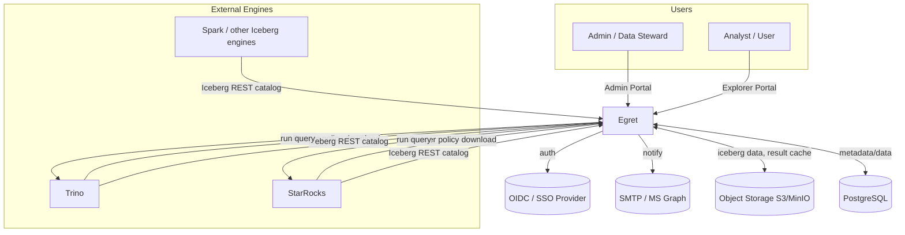

**Điểm mấu chốt:** Egret vừa là **client** của engine (chạy query người dùng) vừa là **server** mà
engine gọi vào (tải Ranger policy, dùng Iceberg catalog). Đây là quan hệ hai chiều quan trọng nhất.

### 3.2 Container (Level 2)

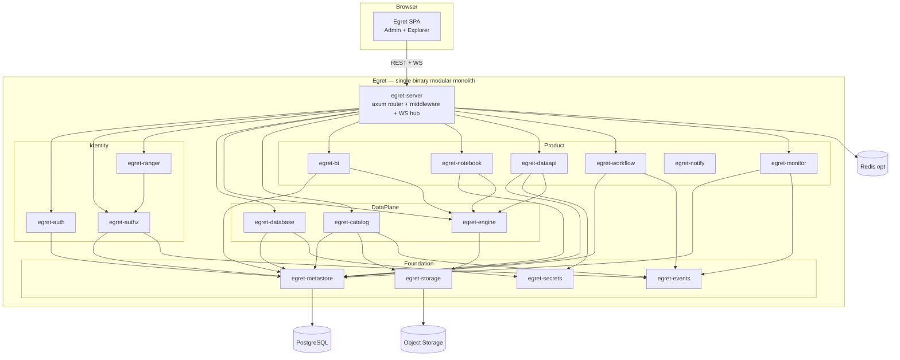

---

## 4. Mô hình triển khai

- **Đóng gói:** 1 Docker image (single binary `egret`) + 1 image frontend tĩnh (nginx) — hoặc binary phục vụ luôn static SPA.
- **Phụ thuộc bắt buộc:** PostgreSQL, Object storage (S3/MinIO).
- **Phụ thuộc tùy chọn:** Redis (cache/queue), Kafka/NATS (event bus phân tán — mặc định in-proc).
- **CLI binary:** `egret serve` (chạy server), `egret migrate` (DB migration), `egret init` (bootstrap admin/workspace).
- **Helm chart** cho K8s; HorizontalPodAutoscaler ở phase scale (monolith stateless trừ DB/Redis/object store).
- **Tách service tương lai (ADR-01):** `egret-catalog` và `egret-ranger` là ứng viên tách trước vì engine gọi trực tiếp với pattern truy cập riêng; binary hỗ trợ chạy "chế độ chỉ catalog/ranger" qua feature flag/sub-command.

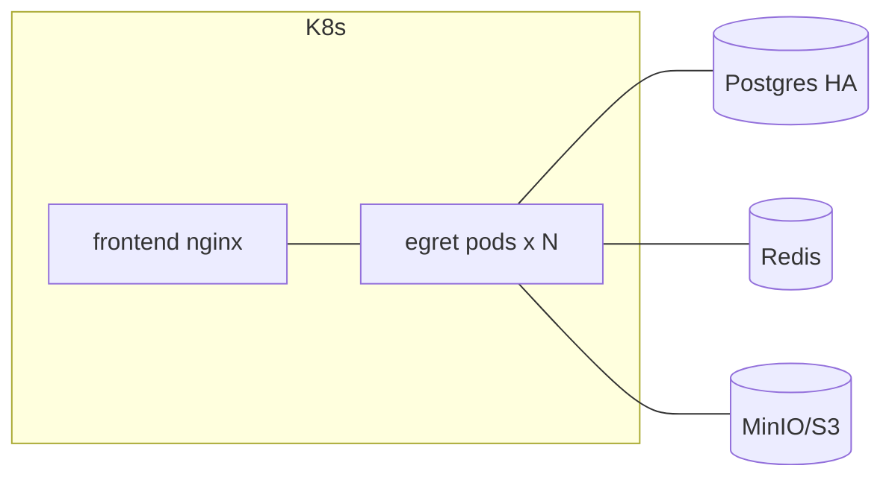

---

## 5. Bản đồ crate backend

Workspace Cargo `crates/`. Quy ước: mỗi crate có **một mục đích rõ**, giao tiếp qua **trait/interface
trong `egret-core`**, có thể test độc lập. Crate `*-server` tổng hợp router.

### 5.1 Foundation

| Crate | Trách nhiệm | Phụ thuộc chính | Public interface |
|---|---|---|---|
| `egret-bin` | Entrypoint, CLI (`serve`/`migrate`/`init`), wiring, graceful shutdown | tất cả | `main()` |
| `egret-server` | axum app: router gốc, middleware (auth, workspace-context, tracing, CORS, rate-limit), OpenAPI mount, **WebSocket hub** | core, các crate product | `build_router(AppState) -> Router` |
| `egret-core` | Domain primitives: ID types, `Error`/`Result`, pagination, `WorkspaceContext`, `Principal`, các trait abstraction | — | types + traits |
| `egret-config` | Config typed (serde + figment), env + file, validate | core | `Config::load()` |
| `egret-metastore` | Postgres: pool sqlx, migration runner, repository base, transaction helper | core, sqlx | `Db`, `Repo` traits |
| `egret-secrets` | Envelope encryption credential at-rest, KMS-pluggable provider | core, metastore | `SecretStore` trait |
| `egret-storage` | Object store IO abstraction (S3/MinIO/GCS/Azure) — kế thừa `lakekeeper/crates/io` | core | `ObjectStore` trait |
| `egret-events` | Event bus nội bộ (in-proc broadcast + optional Kafka/NATS), topic `policy.changed`, `catalog.changed`, `query.finished`… | core | `EventBus`, `Event` |

### 5.2 Identity & Access

| Crate | Trách nhiệm | Public interface |
|---|---|---|
| `egret-auth` | OIDC/SSO (`openidconnect`), session/JWT, user/group provisioning (JIT), **workspace membership**, RBAC portal-level | `Authenticator`, `SessionService`, middleware |
| `egret-authz` | PDP/PAP: policy model (resource/access/condition), tag-based access, **row-filter & column-masking**, decision API | `PolicyDecisionPoint::check()`, `PolicyAdmin` |
| `egret-ranger` | Bề mặt **Ranger Admin REST compat**: `service-defs`, `services`, `policies` CRUD, `policies/download/{service}`, `tags/download/{service}`, version polling. Map model Egret↔Ranger | `ranger_router()` (mount dưới `/service`) |

### 5.3 Data plane

| Crate | Trách nhiệm | Public interface |
|---|---|---|
| `egret-database` | Đăng ký & vòng đời connection (Trino/StarRocks): register/test/health/monitor, pool registry, creds qua `egret-secrets`, capability metadata | `DatabaseRegistry`, `Connection` |
| `egret-engine` | Thực thi query: connector **Trino (REST protocol)** + **StarRocks (MySQL protocol)**, async **JobManager**, streaming kết quả, **result cache/store** (Postgres + object store), cancel, cost/limit guard | `QueryEngine::submit()`, `Job`, `ResultStore` |
| `egret-catalog` | **Iceberg REST Catalog** spec-compliant: namespaces/tables/views/commits/loadTable, config endpoint, (tùy chọn) S3 signer. Backend Postgres metadata + `egret-storage` data. Lớp `api/iceberg` + `service` theo Lakekeeper | `iceberg_router()` (mount `/catalog`), `CatalogStore` |

### 5.4 Application / Product

| Crate | Trách nhiệm | Public interface |
|---|---|---|
| `egret-bi` | Semantic layer: **dataset** (logical table, column, metric, computed), **SQL Lab** saved query, **chart** (viz config → ECharts spec), **dashboard** (layout lưới nhiều tab, parameter/filter, click behaviour: cross-filter/URL/drill-through), query qua `egret-engine`, caching | `DatasetService`, `ChartService`, `DashboardService`, `SqlLabService` |
| `egret-notebook` | Notebook model (cells), **kernel session** Jupyter/Spark (giao thức), thực thi, gắn `sparklabx/kernel` | `NotebookService`, `KernelGateway` |
| `egret-dataapi` | **Data API Builder**: API definition, **dynamic-SQL template engine** (MyBatis-style: if/foreach/where), param binding, multi-statement + transaction, publish/version/**hot-reload**, **gateway runtime** (token/api-key, IP allow/deny, rate-limit, cache, call-log) | `ApiDefService`, `ApiGateway`, `SqlTemplate` |
| `egret-workflow` | **Automation engine**: DAG model, **triggers** (cron via `tokio-cron-scheduler`, webhook, on-event), **executors** (run-query, send-email, http-request, transform, branch, call-dataapi, export), run engine + history, retry/alert | `WorkflowService`, `WorkflowRunner`, `NodeExecutor` trait |
| `egret-notify` | Providers **SMTP + Microsoft Graph** (pluggable), template render | `Notifier` trait |
| `egret-monitor` | Query monitoring, **audit log**, usage metrics, Prometheus exporter, admin health rollup | `AuditLog`, `Metrics` |

### 5.5 Sơ đồ phụ thuộc crate (rút gọn)

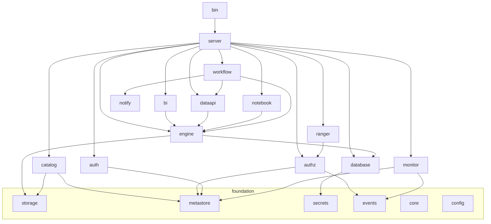

---

## 6. Kiến trúc frontend

Monorepo **pnpm workspaces**, kế thừa design system sparklabx (React + Vite + Tailwind v4 + Radix UI).

```text
frontend/
├── apps/
│   └── web/                  # 1 SPA Vite, 2 route-group
│       ├── src/routes/admin/     # Admin / Governance portal
│       └── src/routes/explore/   # Explorer portal
├── packages/
│   ├── ui/                   # design system tách từ sparklabx (theme tokens, Radix wrappers)
│   ├── api-client/           # sinh từ OpenAPI + hooks TanStack Query
│   ├── auth/                 # OIDC client, session, workspace switcher
│   ├── charts/               # wrapper ECharts (viz spec → render)
│   ├── sql-editor/           # Monaco + schema autocomplete
│   ├── workflow-canvas/      # React Flow (DAG editor kiểu n8n)
│   └── notebook/             # cells + Monaco + hyparquet parquet preview
```

### 6.1 App shell & điều hướng

- **Shell chung:** top bar, **workspace switcher**, theme toggle, user menu. Route guard theo role/permission.
- **`/admin/*`** (cần role admin/steward): Databases · Catalog browser · Ranger Policies · Users/Roles/Workspaces · Data API mgmt · Workflow (org-level) · Monitoring/Audit.
- **`/explore/*`** (scoped theo workspace đang chọn): SQL Lab · Datasets · Charts · Dashboards · Notebooks · Data API (workspace) · Workflows.

### 6.2 Thư viện chủ đạo

| Mục đích | Thư viện | Ghi chú |
|---|---|---|
| Data fetching | **TanStack Query** | đã có ở sparklabx |
| Code/SQL editor | **Monaco** | đã có |
| Charts | **Apache ECharts** | mới thêm |
| Workflow canvas | **React Flow** | mới thêm |
| Parquet preview | **hyparquet** | đã có |
| Notebook kernel | **@jupyterlab/services** | đã có |
| Auth | **openidconnect (BE)** + MSAL/Google (FE đã có) | OIDC chuẩn |

### 6.3 Giao tiếp realtime

- **WebSocket** (qua `egret-server` WS hub) cho: trạng thái async query (SQL Lab), workflow run live log, kernel output stream. Polling fallback.

---

## 7. Mô hình Workspace & Multi-tenancy

### 7.1 Hai tầng (ADR-12)

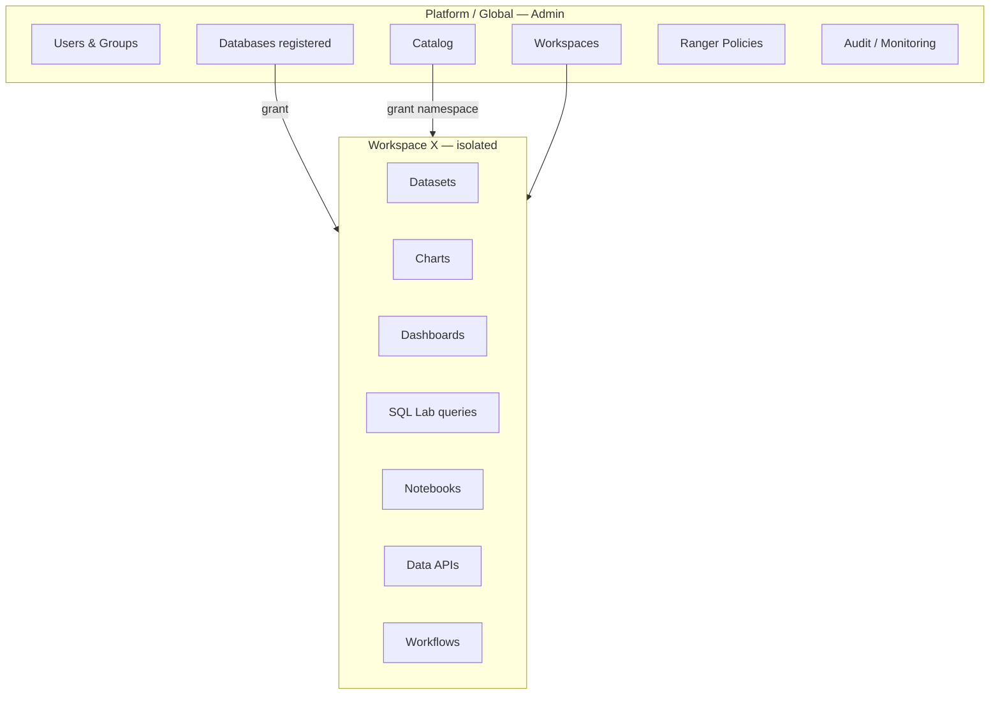

- **Global:** users, workspaces, databases, catalog, ranger policies, audit do Admin quản lý.
- **Workspace (cô lập):** dataset, chart, dashboard, sqllab, notebook, dataapi, workflow — phòng ban X **không thấy** của phòng ban Y.

### 7.2 Cấp phát tài nguyên

- Database & catalog **đăng ký global**, sau đó **grant** cho workspace (bảng `workspace_database_grant`, `workspace_catalog_grant`).
- Trong workspace, user chỉ chọn được database/namespace đã được grant.

### 7.3 Cách ly = **logic** (metadata + authz)

- Mọi entity workspace-scoped mang cột `workspace_id`; mọi truy vấn repository **bắt buộc** lọc theo `WorkspaceContext` (middleware bơm context; repository từ chối query thiếu scope).
- **Ranger policy** giới hạn workspace truy cập schema/table/column nào ở tầng engine — đây là lớp enforcement thực sự khi query chạy trên Trino/StarRocks.
- Không tách physical namespace/DB cho mỗi workspace (đã loại ở ADR-12) → engine dùng chung, vận hành đơn giản.

### 7.4 Vai trò (RBAC)

| Scope | Role mẫu | Quyền |
|---|---|---|
| Platform | `platform_admin` | toàn quyền |
| Platform | `data_steward` | quản lý catalog, policy, database |
| Workspace | `ws_admin` | quản lý thành viên & tài nguyên workspace |
| Workspace | `ws_editor` | tạo/sửa dataset, chart, dashboard, sqllab, dataapi, workflow |
| Workspace | `ws_viewer` | xem dashboard, chạy query trong giới hạn |

> RBAC (egret-auth) quyết định **truy cập tính năng/đối tượng Egret**; Ranger/authz (egret-authz)
> quyết định **truy cập dữ liệu** ở tầng engine. Hai lớp tách biệt, bổ sung nhau (§8).

---

## 8. AuthN / AuthZ

### 8.1 Authentication (egret-auth)

- **OIDC/SSO** qua `openidconnect`: authorization-code + PKCE. JIT provisioning user/group từ claims.
- Session: cookie httpOnly + (tùy chọn) JWT cho API. Refresh token rotation.
- Service-to-service: API key / token (dùng cho Data API gateway, engine callbacks).

### 8.2 Hai lớp authorization

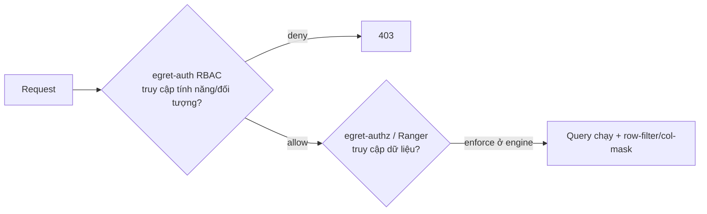

1. **Lớp ứng dụng (RBAC):** dashboard/dataset/dataapi… ai xem/sửa được — kiểm ở Egret.
2. **Lớp dữ liệu (Ranger/authz):** schema/table/column nào được đọc, row-filter, column-mask — **enforce tại engine** thông qua policy mà engine tải về từ Egret.

### 8.3 Ranger REST compatibility (egret-ranger)

Plugin Ranger gốc trong Trino/StarRocks định kỳ gọi Egret để tải policy. Egret expose (mount dưới
`/service`, theo base `/service/plugins` của Ranger):

| Endpoint (tương thích Ranger) | Mục đích |
|---|---|
| `GET /service/plugins/definitions` | service-def (trino, starrocks) |
| `GET/POST/PUT/DELETE /service/plugins/services` | quản lý service instance |
| `GET/POST/PUT/DELETE /service/plugins/policies` | CRUD policy |
| `GET /service/plugins/policies/download/{serviceName}` | **plugin tải policy** (hỗ trợ `lastKnownVersion`, trả 304 nếu chưa đổi) |
| `GET /service/tags/download/{serviceName}` | **tag-based policies** |

- **Model mapping:** Egret giữ policy model nội bộ (resource/access/condition/row-filter/masking) trong `egret-authz`; `egret-ranger` serialize sang JSON schema Ranger (`RangerPolicy`, `ServicePolicies`) khi plugin tải về. Version-based caching để trả 304.
- **Lợi ích:** không phải build/maintain Ranger Admin riêng; Trino/StarRocks dùng plugin chuẩn.

### 8.4 Policy authoring (Admin portal)

- UI tạo policy: chọn database (service) → resource (catalog/schema/table/column) → user/group/role → quyền (select/...) → điều kiện (row-filter expr, column-mask type).
- Tag-based policy: gắn tag (vd `pii`) → policy theo tag.
- Mọi thay đổi policy phát event `policy.changed` (bump version) → plugin tải bản mới ở lần poll kế.

---

## 9. Data model (Postgres)

Schema chia theo module (Postgres schema namespace hoặc prefix bảng). Liệt kê **bảng chính** (không
đầy đủ cột — chi tiết ở spec từng subsystem). Tất cả bảng product mang `workspace_id` đều có index
`(workspace_id, …)`.

### 9.1 Identity & workspace

```text
users(id, external_subject, email, name, status, created_at)
groups(id, name, source)             user_groups(user_id, group_id)
workspaces(id, slug, name, status, settings_jsonb, created_at)
workspace_members(workspace_id, user_id|group_id, role)         -- ws_admin/editor/viewer
roles(id, scope[platform|workspace], name)   role_permissions(role_id, permission)
sessions(id, user_id, expires_at, ...)        api_keys(id, owner, hash, scopes)
```

### 9.2 Database & secrets

```text
databases(id, name, engine[trino|starrocks], host, port, options_jsonb,
          secret_ref, status, created_by)                 -- global registered
workspace_database_grant(workspace_id, database_id, granted_by)
secrets(id, kind, ciphertext, key_id, created_at)          -- envelope-encrypted
database_health(database_id, checked_at, healthy, latency_ms, detail_jsonb)
```

### 9.3 Authz / Ranger

```text
authz_services(id, name, engine, config_jsonb, policy_version)   -- ~ Ranger service
authz_service_defs(id, name, resources_jsonb, access_types_jsonb)
authz_policies(id, service_id, name, resource_jsonb, items_jsonb,
               row_filters_jsonb, masks_jsonb, enabled, version, updated_at)
authz_tags(id, name)        authz_tag_assignments(tag_id, resource_ref)
policy_audit(id, policy_id, action, actor, at)
```

### 9.4 Catalog (Iceberg)

```text
catalog_namespaces(id, name, properties_jsonb)
catalog_tables(id, namespace_id, name, metadata_location, current_snapshot_id,
               format_version, properties_jsonb)
catalog_table_metadata_log(table_id, metadata_location, created_at)
catalog_views(id, namespace_id, name, metadata_location)
workspace_catalog_grant(workspace_id, namespace_id, granted_by)
catalog_commits(table_id, snapshot_id, parent_id, summary_jsonb, created_at)
```

### 9.5 Engine / query

```text
queries(id, workspace_id, database_id, user_id, sql, status, submitted_at,
        finished_at, rows, bytes_scanned, error, result_ref)    -- result_ref → object store
query_results_cache(hash, database_id, result_ref, expires_at)
```

### 9.6 BI

```text
datasets(id, workspace_id, database_id, kind[table|sql], schema_table|sql,
         columns_jsonb, metrics_jsonb, created_by)
saved_queries(id, workspace_id, database_id, name, sql, created_by)   -- SQL Lab
charts(id, workspace_id, dataset_id, viz_type, config_jsonb)
dashboards(id, workspace_id, name, layout_jsonb, filters_jsonb)
dashboard_charts(dashboard_id, chart_id, position_jsonb)
```

### 9.7 Notebook

```text
notebooks(id, workspace_id, name, kernel_spec, created_by)
notebook_cells(id, notebook_id, idx, cell_type, source, outputs_jsonb)
kernel_sessions(id, notebook_id, status, started_at)
```

### 9.8 Data API

```text
api_defs(id, workspace_id, path, method, database_id, sql_template,
         params_jsonb, version, status[draft|published], cache_ttl)
api_versions(api_def_id, version, snapshot_jsonb, published_at)
api_clients(id, workspace_id, name, key_hash, ip_allow_jsonb, ip_deny_jsonb)
api_client_grants(client_id, api_def_id, rate_limit)
api_call_logs(id, api_def_id, client_id, at, status, latency_ms, rows)
```

### 9.9 Workflow

```text
workflows(id, workspace_id, name, graph_jsonb, enabled, created_by)
workflow_triggers(id, workflow_id, kind[cron|webhook|event], config_jsonb)
workflow_runs(id, workflow_id, status, started_at, finished_at, trigger_jsonb)
workflow_node_runs(run_id, node_id, status, input_jsonb, output_jsonb, error, attempt)
```

### 9.10 Monitor / audit

```text
audit_log(id, actor, action, target_type, target_id, workspace_id, at, detail_jsonb)
usage_metrics(...)    -- rollups
```

---

## 10. Đặc tả subsystem

Mỗi subsystem nêu: trách nhiệm, interface, dữ liệu, điểm tích hợp, tham khảo. Chi tiết triển khai để
cho spec riêng từng phase.

### 10.1 Database management (`egret-database`)
- **Chức năng:** đăng ký database (engine, host, creds→secrets), test connection, health check định kỳ (`database_health`), monitor (latency, trạng thái), capability detection.
- **Engine MVP:** Trino, StarRocks. Trait `Connection` để mở rộng JDBC khác sau.
- **Tích hợp:** cung cấp connection cho `egret-engine`; grant cho workspace.

### 10.2 Query engine (`egret-engine`)
- **Connector:** Trino qua **REST statement protocol** (`POST /v1/statement` + nextUri polling); StarRocks qua **MySQL protocol** (`sqlx`/mysql_async).
- **JobManager:** submit async, theo dõi trạng thái, stream kết quả qua WS, cancel, áp limit (row/byte/timeout).
- **ResultStore:** cache theo hash(sql+db); kết quả lớn ghi object store, metadata ở `queries`.
- **Khách hàng:** SQL Lab, dataset preview, chart query, Data API, workflow run-query node.

### 10.3 Iceberg REST Catalog (`egret-catalog`)
- **Spec:** Iceberg REST Catalog API — `GET /v1/config`, namespaces CRUD, tables (`create/load/commit/drop/rename`), views, `report-metrics`, optional S3 remote signing.
- **Layout (theo Lakekeeper):** `api/iceberg` (HTTP handlers) + `service::CatalogStore` (Postgres) + `egret-storage` (data files). Mount dưới `/catalog`.
- **Tích hợp:** Trino/StarRocks/Spark cấu hình REST catalog trỏ về Egret; grant namespace theo workspace; metadata pointer ở `catalog_tables.metadata_location`.

### 10.4 Apache Ranger API (`egret-ranger`) — xem §8.3.

### 10.5 BI: SQL Lab / Dataset / Chart / Dashboard (`egret-bi`)
- **SQL Lab:** editor (Monaco) → submit qua engine async → kết quả + lưu `saved_queries` → "explore" thành chart.
- **Dataset:** logical layer trên table hoặc SQL; định nghĩa column type, metric (aggregate), computed column. Là nguồn của chart.
- **Chart:** `viz_type` + `config_jsonb` → build query → render **ECharts** spec ở FE.
- **Dashboard:** layout grid (`layout_jsonb`), cross-filter, dashboard-level filters; chart con qua `dashboard_charts`.
- **Tham khảo:** Superset (chart/dashboard/dataset model), Metabase.

### 10.6 Notebook (`egret-notebook`)
- Notebook cells (sql/markdown/python), kernel session qua **Jupyter/Spark** (tái dùng `sparklabx/kernel` + `@jupyterlab/services` ở FE), output stream qua WS, parquet preview (hyparquet).

### 10.7 Data API Builder (`egret-dataapi`)
- **Định nghĩa:** path/method + `sql_template` (dynamic SQL kiểu MyBatis: `<if>`, `<foreach>`, `<where>`) + params schema + database target.
- **Vòng đời:** draft → test/debug (chạy thử) → **publish** (version, hot-reload không downtime) → snapshot ở `api_versions`.
- **Gateway runtime:** match route → auth (api-key/token) → IP allow/deny → rate-limit → render SQL → chạy qua engine (multi-statement + transaction) → transform → cache (Redis, `cache_ttl`) → response → **call-log** + metrics.
- **Tham khảo:** DBApi (dbapi-controller, dbapi-cluster-gateway).

### 10.8 Workflow Automation (`egret-workflow`)
- **Model:** DAG `graph_jsonb` (nodes + edges).
- **Triggers:** cron (`tokio-cron-scheduler`), webhook (HTTP in), on-event (qua `egret-events`: query.finished, policy.changed, catalog.changed).
- **Executors (trait `NodeExecutor`):** run-query, **send-email** (egret-notify), http-request, transform (jq/script), branch/condition, call-dataapi, export-file (object store).
- **Run engine:** topo execution, truyền dữ liệu node→node, retry/backoff, alert khi fail, persisted `workflow_runs`/`workflow_node_runs`, live log qua WS.
- **Ví dụ:** cron hằng ngày → run-query (báo cáo) → transform → send-email.
- **Tham khảo:** n8n.

### 10.9 Notification (`egret-notify`)
- Trait `Notifier`: provider **SMTP** + **Microsoft Graph** (pluggable). Template render. Dùng bởi workflow & alerting (monitor, dataapi fail-alert).

### 10.10 Monitoring / Audit (`egret-monitor`)
- Audit log mọi hành động nhạy cảm (policy change, database register, grant, dataapi publish…), query monitoring, usage metrics, **Prometheus** exporter `/metrics`, health rollup cho Admin dashboard.

---

## 11. Sequence flows chính

### 11.1 Đăng nhập OIDC

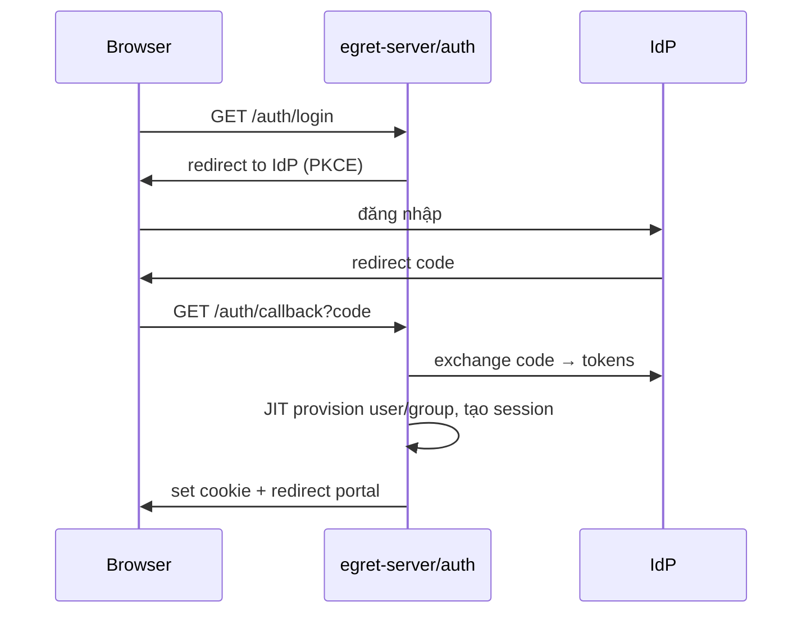

### 11.2 Chạy query (SQL Lab)

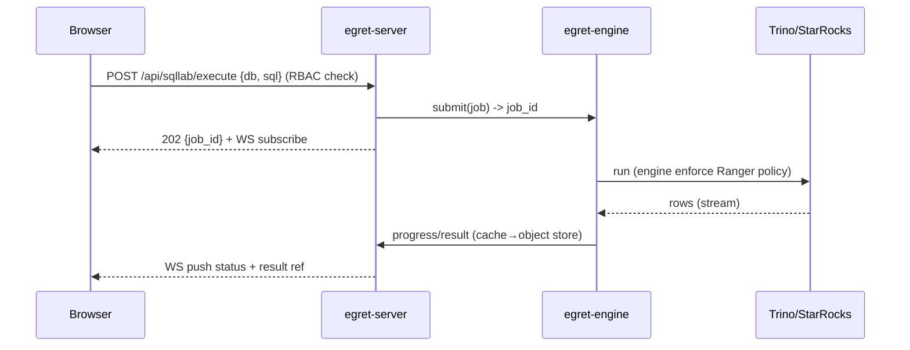

### 11.3 Engine tải Ranger policy

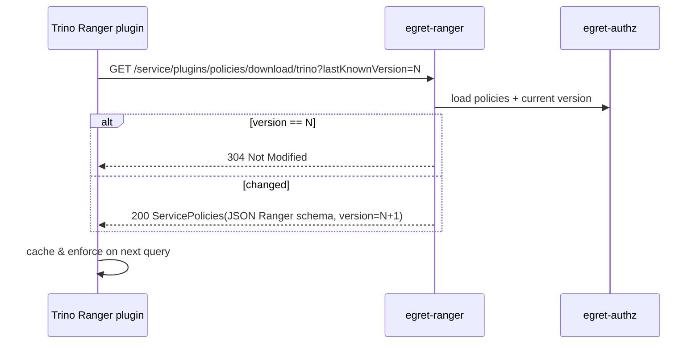

### 11.4 Iceberg commit (engine ghi bảng)

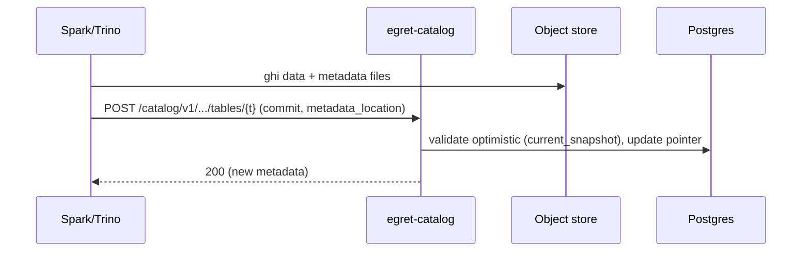

### 11.5 Publish & gọi Data API

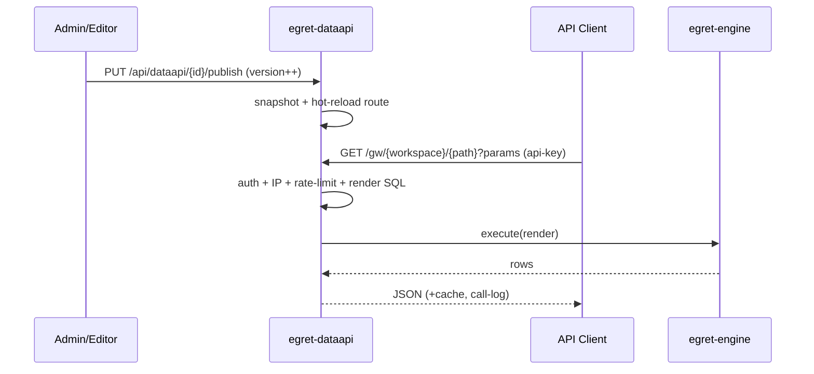

### 11.6 Workflow chạy theo lịch

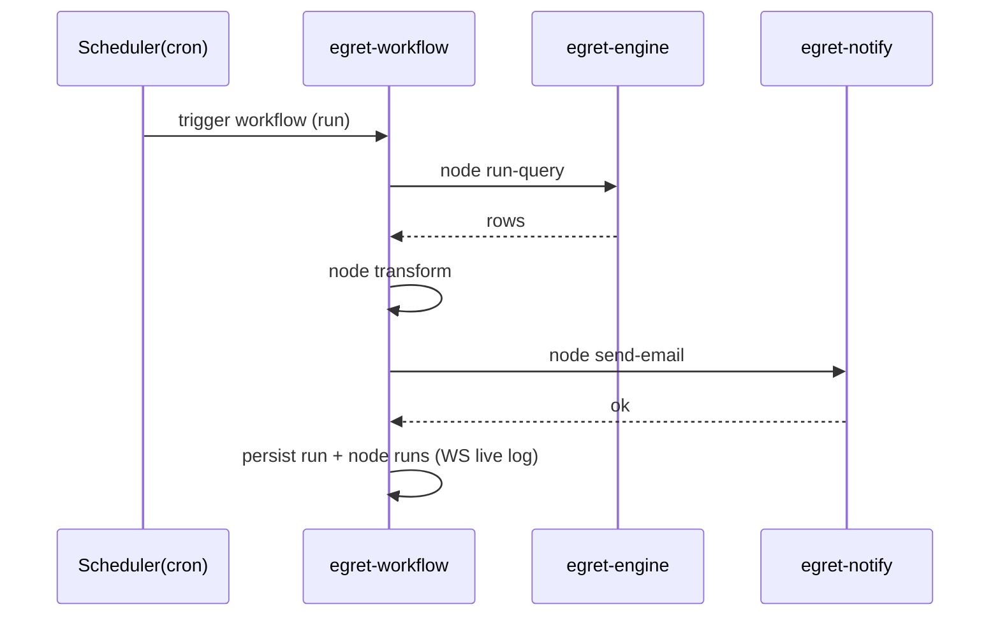

---

## 12. Cross-cutting concerns

- **Config (`egret-config`):** layered (defaults → file → env). Validate khi boot, fail-fast.
- **Secrets (`egret-secrets`):** envelope encryption; data key bọc bởi KMS/master key; chỉ giải mã khi cần kết nối.
- **Events (`egret-events`):** in-proc broadcast mặc định; adapter Kafka/NATS (kế thừa `lakekeeper-events-*`) cho multi-instance. Drives workflow triggers, cache invalidation, audit.
- **Error handling:** `egret-core::Error` thiserror; map sang HTTP problem+json; fail-fast, log có context (tracing span).
- **Observability:** `tracing` + OpenTelemetry export; Prometheus `/metrics`; structured JSON log; request-id + workspace-id trong span.
- **Caching:** query result (engine), dataapi response, ranger policy version (304), dataset metadata. Redis hoặc in-proc.
- **Migration:** sqlx migrations; `egret migrate` chạy lúc deploy; backward-compatible.
- **Testing:** unit theo crate (mock trait), integration với testcontainers (Postgres/MinIO/Trino), contract test cho Ranger & Iceberg REST (so với spec), e2e Playwright cho SPA.
- **Multi-instance:** monolith stateless (state ở PG/Redis/object store); scheduler workflow cần leader-election (advisory lock Postgres) để tránh chạy trùng.

---

## 13. API surface & OpenAPI

| Prefix | Module | Khách hàng |
|---|---|---|
| `/api/auth/*` | auth | SPA |
| `/api/admin/*` | databases, workspaces, users, monitor | Admin SPA |
| `/api/authz/*` | policy authoring | Admin SPA |
| `/service/plugins/*`, `/service/tags/*` | **Ranger compat** | Trino/StarRocks plugin |
| `/catalog/v1/*` | **Iceberg REST** | engine |
| `/api/ws/{workspace}/sqllab/*` | SQL Lab | Explorer SPA |
| `/api/ws/{workspace}/datasets|charts|dashboards/*` | BI | Explorer SPA |
| `/api/ws/{workspace}/notebooks/*` | notebook | Explorer SPA |
| `/api/ws/{workspace}/dataapi/*` | dataapi mgmt | Explorer/Admin SPA |
| `/gw/{workspace}/*` | **Data API gateway** runtime | API clients |
| `/api/ws/{workspace}/workflows/*` | workflow | Explorer SPA |
| `/ws` | WebSocket hub | SPA |
| `/metrics`, `/healthz` | monitor | ops |

- **OpenAPI** sinh tự động (utoipa) cho nhóm `/api/*`; FE `api-client` generate từ đó. Nhóm `/catalog` & `/service` tuân spec ngoài (Iceberg/Ranger), test theo contract.

---

## 14. Bảo mật

- **Least privilege:** RBAC + Ranger 2 lớp; service token scope hẹp.
- **Credential at-rest:** mã hóa (egret-secrets); không log secret.
- **Input validation:** validate mọi input; **SQL template (dataapi)** chỉ cho phép **parameter binding**, chặn SQL injection (no raw interpolation; dynamic chỉ ở cấu trúc, value luôn bound).
- **Network:** Ranger/Catalog endpoints chỉ cho engine (mTLS/allowlist tùy deploy).
- **Audit:** mọi hành động governance ghi `audit_log`.
- **Rate-limit & IP allow/deny:** ở Data API gateway và auth.
- **Tenant isolation:** middleware bắt buộc `workspace_id`; test rò rỉ cross-workspace.
- **Tuân thủ Global CLAUDE.md:** không commit secret; conventional commits; pin dependency.

---

## 15. Bố cục repository

```text
egret/
├── Cargo.toml                      # workspace
├── crates/
│   ├── egret-bin/
│   ├── egret-server/
│   ├── egret-core/
│   ├── egret-config/
│   ├── egret-metastore/
│   ├── egret-secrets/
│   ├── egret-storage/
│   ├── egret-events/
│   ├── egret-auth/
│   ├── egret-authz/
│   ├── egret-ranger/
│   ├── egret-database/
│   ├── egret-engine/
│   ├── egret-catalog/
│   ├── egret-bi/
│   ├── egret-notebook/
│   ├── egret-dataapi/
│   ├── egret-workflow/
│   ├── egret-notify/
│   └── egret-monitor/
├── migrations/                     # sqlx migrations
├── frontend/                       # pnpm monorepo (apps/web + packages/*)
├── deploy/                         # Dockerfile, docker-compose, helm/
├── docs/
│   ├── architecture/               # tài liệu này + diagrams
│   └── adr/                        # ADR chi tiết
└── tests/                          # integration / contract / e2e
```

---

## 16. Roadmap theo phase

> Nguyên tắc: **nền tảng trước → BI sau** (ADR roadmap). Mỗi phase là một hoặc nhiều spec riêng
> (brainstorm → plan → implement).

### Phase 0 — Bootstrap (móng)
- Cargo workspace + crate skeleton; `egret-core`, `egret-config`, `egret-metastore`, `egret-server`.
- CI, migration runner, Docker/compose dev (Postgres + MinIO + Trino + StarRocks).
- FE skeleton: tách `packages/ui` từ sparklabx, app shell + workspace switcher.

### Phase 1 — Nền tảng (auth, workspace, database)
- `egret-auth`: OIDC/SSO, session, RBAC, workspace membership.
- `egret-database`: đăng ký/test/health Trino & StarRocks; `egret-secrets`.
- Admin portal: users, workspaces, databases. Explorer shell.
- **Mốc:** đăng nhập SSO, tạo workspace, đăng ký + grant database.

### Phase 2 — Catalog & Ranger (governance core)
- `egret-storage`, `egret-catalog` (Iceberg REST), `egret-authz` + `egret-ranger`.
- Admin: catalog browser, policy authoring.
- **Mốc:** Trino/StarRocks dùng Egret làm Iceberg catalog + tải Ranger policy về enforce.

### Phase 3 — Query & SQL Lab & Dataset
- `egret-engine` (Trino REST + StarRocks MySQL, async, result store), `egret-bi` (sqllab + dataset).
- Explorer: SQL Lab, dataset.
- **Mốc:** chạy query async có cache, lưu saved query, tạo dataset.

### Phase 4 — Chart & Dashboard & Notebook
- `egret-bi` (chart ECharts + dashboard), `egret-notebook`.
- Explorer: charts, dashboards, notebooks.
- **Mốc:** dựng dashboard từ dataset; notebook chạy kernel.

### Phase 5 — Data API Builder
- `egret-dataapi`: template engine, gateway, client mgmt, call-log.
- **Mốc:** publish SQL→API, gọi qua api-key có rate-limit & cache.

### Phase 6 — Workflow Automation
- `egret-workflow` + `egret-notify`, FE workflow canvas (React Flow).
- **Mốc:** cron → run-query → send-email chạy được, có run history.

### Phase 7 — Monitoring, hardening, scale
- `egret-monitor` đầy đủ, audit, Prometheus, Helm, leader-election scheduler, event bus phân tán.

---

## 17. Câu hỏi mở / tương lai

- Tách `egret-catalog`/`egret-ranger` thành service riêng ở quy mô nào? (ADR-01 để mở.)
- Hỗ trợ thêm engine (BigQuery, ClickHouse, Postgres-as-source) — trait đã sẵn, ưu tiên sau.
- Caching layer cho dashboard (materialized) & alerting trên kết quả (Superset-style alert).
- Row-level security nâng cao & dynamic data masking policy templates.
- Embedded analytics / public dashboard sharing.
- Phiên bản hóa & migration cho dataset/chart khi schema nguồn đổi.

---

## 18. Phụ lục: nguồn tham khảo

| Repo (trong `data-portal/`) | Dùng cho |
|---|---|
| `lakekeeper/` | Iceberg REST catalog, storage IO, authz, events (Rust patterns) |
| `ranger/` | Ranger REST API schema & download endpoints |
| `superset/` | dataset/chart/dashboard model, ECharts, websocket |
| `metabase/` | BI UX, query/dataset model |
| `sparklabx/` | **frontend design system/theme**, notebook, kernel, parquet preview |
| `dbapi/` | Data API Builder (dynamic SQL, gateway, client mgmt) |
| `n8n/` (ngoài) | workflow automation model |

---

*Hết tài liệu gốc v0.1. Cập nhật qua PR; thay đổi lớn ghi ADR mới trong `docs/adr/`.*
