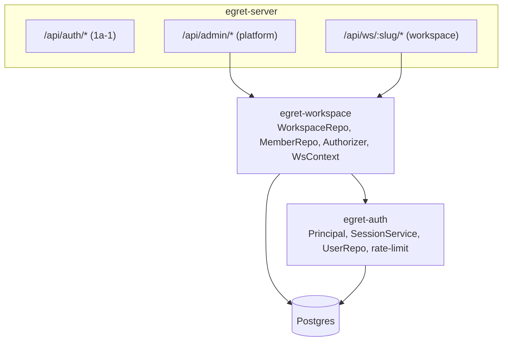

# Phase 1a-2 — Workspace & RBAC — Spec thiết kế

> **Trạng thái:** Bản tham khảo tiếng Việt · **Ngày:** 2026-06-17 · **Phiên bản:** 0.1
> ⚠️ Bản gốc (canonical) là tiếng Anh: [`docs/en/specs/2026-06-17-phase-1a-2-workspace-rbac-design.md`](../../en/specs/2026-06-17-phase-1a-2-workspace-rbac-design.md). Khác biệt thì ưu tiên bản tiếng Anh.
> Tiếp nối [spec identity Phase 1a](2026-06-17-phase-1a-identity-design.md) (§5, §10, §11) và [Phase 1a-1 AuthN & Session](../plans/2026-06-17-phase-1a-1-authn-session.md) đã ship.

---

## 1. Mục tiêu & phạm vi

Thêm workspace, membership, và RBAC trên nền identity 1a-1, kèm hardening đã defer từ 1a-1. Chỉ backend/API.

**Trong phạm vi**
- Crate `egret-workspace`: workspace CRUD, membership (user/group), `Authorizer` RBAC, workspace-context extractor.
- **Permission theo union (most-permissive)** qua mọi role của principal (trực tiếp + group).
- Role qua group: platform role (ở `egret-auth`) và workspace role (ở `Authorizer`).
- Admin routes (`/api/admin/workspaces`, `/api/admin/users` + gán platform role) và workspace routes (`/api/ws/{slug}/members`), enforce bởi `Authorizer`.
- Helper `map_idp_claims_to_roles` (định nghĩa ở đây; dùng bởi 1a-3 OIDC).
- Hardening: login rate-limit in-memory, dummy argon2-verify (chống timing), `egret init --force`, dọn dead-code.

**Ngoài phạm vi (hoãn)**
- OIDC/SSO + JIT đổ group → **1a-3**.
- Admin/Explorer SPA → **0b**.
- Custom/editable roles & API quản lý catalog permission → tương lai (roles cố định/seeded; xem §4).
- Authz data-plane (Ranger/row-filter) → Phase 2.

## 2. Quyết định (validate với Metabase & Superset)

| Quyết định | Lựa chọn | Bằng chứng |
|---|---|---|
| Gộp permission nhiều role | **Union / most-permissive** qua mọi role (trực tiếp + group) | Metabase gộp permission group "most-permissive" (`permissions/` — `most-permissive`/`coalesce-most`/`union`); Superset gom PVM của user là **union qua tất cả role** (`security/manager.py` filter `role.id IN user_roles`). |
| Resolve role qua group | **Có, ngay** (user + group) cho cả platform & workspace role | Cả hai resolve permission hiệu dụng qua group/role. |
| Roles & permissions | **Cố định / seeded** (5 role, catalog permission cố định); chỉ *gán* role là qua API | Cả hai ref hỗ trợ custom role; cố định là YAGNI có chủ đích cho MVP. Custom roles ghi nhận là extension tương lai. |
| Resolve workspace qua URL | **Slug** (`/api/ws/{slug}/*`) | Human-friendly; `workspaces.slug` unique. |
| Rate-limit login | **In-memory, per-process** (IP+email) | Chưa cần Redis; đủ cho single-instance MVP. |

> `WorkspaceContext.workspace_role` (single string) chỉ để **hiển thị** (role cao nhất cho UX). **Enforcement luôn union** qua `Authorizer`, không bao giờ check precedence một-role.

## 3. Kiến trúc



- `egret-workspace` **phụ thuộc** `egret-auth` (dùng extractor `Auth`/`Principal` + `UserRepo`). `egret-auth` KHÔNG phụ thuộc `egret-workspace` (không cycle).
- Module mới: `model.rs`, `workspaces.rs`, `members.rs`, `rbac.rs` (Authorizer), `context.rs` (WsContext), `mapping.rs`, `routes.rs`, `lib.rs`.
- Route admin/ws mutating nằm sau `csrf_layer` (1a-1); route GET miễn CSRF theo logic method của middleware.

## 4. Model RBAC & `Authorizer`

**Roles (seed ở migration `0003`, cố định):** `platform_admin`, `data_steward` (platform); `ws_admin`, `ws_editor`, `ws_viewer` (workspace). **Catalog permission (cố định):**

| Scope | Permission | Seed cho |
|---|---|---|
| platform | `workspace:create/read/update/archive` | platform_admin |
| platform | `user:read` | platform_admin, data_steward |
| platform | `user:assign_role` | platform_admin |
| platform | `workspace:read` | data_steward |
| workspace | `workspace:manage_members` | ws_admin |

`ws_editor`/`ws_viewer` chưa có permission (catalog mở rộng ở phase sau).

**`Authorizer` (`rbac.rs`):**
```rust
pub struct Authorizer { db: Db }
impl Authorizer {
    pub async fn platform_permissions(&self, user_id: UserId) -> Result<HashSet<String>>;
    pub async fn workspace_permissions(&self, user_id: UserId, ws: WorkspaceId) -> Result<HashSet<String>>;
    pub async fn require_platform(&self, p: &Principal, perm: &str) -> Result<()>;
    pub async fn require_workspace(&self, ctx: &WorkspaceContext, perm: &str) -> Result<()>;
}
```
- `require_platform`: `Ok` ⟺ `perm ∈ platform_permissions(p.user_id)`. (`platform_admin` được seed mọi platform permission → luôn pass, không cần special-case.)
- `require_workspace`: `Ok` nếu `ctx.principal.is_platform_admin()` (bypass), ngược lại ⟺ `perm ∈ workspace_permissions(user, ctx.workspace_id)`.

**SQL resolve group (workspace, union):**
```sql
SELECT DISTINCT rp.permission
FROM workspace_members wm
JOIN roles r ON r.scope = 'workspace' AND r.name = wm.role
JOIN role_permissions rp ON rp.role_id = r.id
WHERE wm.workspace_id = $1
  AND ( (wm.principal_type = 'user'  AND wm.principal_id = $2)
     OR (wm.principal_type = 'group' AND wm.principal_id IN
            (SELECT group_id FROM user_groups WHERE user_id = $2)) );
```

**Platform role kể cả group (sửa `egret-auth::SessionService`):** query `platform_roles` trong `validate` thêm nhánh group để `Principal.platform_roles` đầy đủ:
```sql
SELECT DISTINCT r.name
FROM platform_role_assignments pra JOIN roles r ON r.id = pra.role_id
WHERE (pra.principal_type = 'user'  AND pra.principal_id = $1)
   OR (pra.principal_type = 'group' AND pra.principal_id IN
          (SELECT group_id FROM user_groups WHERE user_id = $1));
```

## 5. Workspace (`workspaces.rs`, `routes.rs`)

```rust
pub struct WorkspaceRepo { db: Db }
impl WorkspaceRepo {
    pub async fn create(&self, slug: &str, name: &str, created_by: UserId) -> Result<Workspace>;
    pub async fn list(&self, page: Pagination) -> Result<Vec<Workspace>>;
    pub async fn get_by_slug(&self, slug: &str) -> Result<Option<Workspace>>;
    pub async fn update(&self, id: WorkspaceId, name: &str) -> Result<()>;
    pub async fn archive(&self, id: WorkspaceId) -> Result<()>;
}
```

**Routes (platform, `Authorizer.require_platform`):**
| Method | Path | Permission |
|---|---|---|
| POST | `/api/admin/workspaces` | `workspace:create` |
| GET | `/api/admin/workspaces` | `workspace:read` |
| GET | `/api/admin/workspaces/{id}` | `workspace:read` |
| PUT | `/api/admin/workspaces/{id}` | `workspace:update` |
| DELETE | `/api/admin/workspaces/{id}` (archive) | `workspace:archive` |

- `slug` validate: chữ thường `[a-z0-9-]`, unique → `Conflict` nếu trùng.

## 6. Membership (`members.rs`, `routes.rs`)

```rust
pub struct MemberRepo { db: Db }
impl MemberRepo {
    pub async fn add(&self, ws: WorkspaceId, ptype: &str, pid: Uuid, role: &str, by: UserId) -> Result<()>;
    pub async fn remove(&self, ws: WorkspaceId, ptype: &str, pid: Uuid) -> Result<()>;
    pub async fn list(&self, ws: WorkspaceId) -> Result<Vec<WorkspaceMember>>;
}
```
- `role` validate theo workspace roles seed (`ws_admin|ws_editor|ws_viewer`) → `InvalidInput` nếu sai.

**Routes (workspace, `Authorizer.require_workspace(ctx, "workspace:manage_members")`):**
| Method | Path |
|---|---|
| GET | `/api/ws/{slug}/members` |
| POST | `/api/ws/{slug}/members` |
| DELETE | `/api/ws/{slug}/members/{principal_type}/{principal_id}` |

**Quản lý user platform (`require_platform`):**
| Method | Path | Permission |
|---|---|---|
| GET | `/api/admin/users` | `user:read` |
| GET | `/api/admin/users/{id}` | `user:read` |
| PUT | `/api/admin/users/{id}/platform-roles` | `user:assign_role` |

`PUT .../platform-roles` thay toàn bộ `platform_role_assignments` của user bằng tập role platform truyền vào (validate theo platform roles seed).

## 7. Extractor workspace-context (`context.rs`)

`WsContext(pub WorkspaceContext)` — axum `FromRequestParts<S>` (với `WorkspaceRepo`, `Authorizer`, `SessionService` là `FromRef<S>`):
1. Xác thực qua extractor `Auth` → `Principal`.
2. Đọc path param `slug`.
3. `WorkspaceRepo.get_by_slug` → `NotFound` (404) nếu thiếu hoặc `status='archived'`.
4. Check membership: `platform_admin` (bypass) **hoặc** principal có ≥1 workspace role (trực tiếp/group) ở workspace này; ngược lại `Forbidden` (403).
5. Build `WorkspaceContext { workspace_id, principal, workspace_role }`, `workspace_role` = role cao nhất để hiển thị (`ws_admin` > `ws_editor` > `ws_viewer`, hoặc `"platform_admin"`).

## 8. Mapping claim IdP → role (`mapping.rs`)

```rust
pub struct IdpRoleMapping { pub claim: String, pub value: String, pub role: String, pub scope: String }
/// Hàm thuần: từ claim OIDC (JSON) + rule cấu hình → danh sách platform role cần gán.
/// Dùng bởi 1a-3 OIDC JIT; unit-test ở đây.
pub fn map_idp_claims_to_roles(claims: &serde_json::Value, rules: &[IdpRoleMapping]) -> Vec<String>;
```
Rule từ `egret-config` (`[[idp_role_mapping]]`, đã spec ở §12 identity — thêm ở 1a-3 khi có OIDC; hàm + test có ngay bây giờ).

## 9. Hardening (gộp từ 1a-1)

- **Rate-limit login (in-memory):** `RateLimiter` ở `egret-auth` keyed `ip:email`, sliding window. Vượt `login_max_attempts` trong `login_window_secs` → `429 Too Many Requests` trong `login_lockout_secs`. Lưu trong `AuthState`. Backed bởi `Mutex<HashMap<String, Vec<Instant>>>` (std `Instant`); prune khi truy cập. Reset khi restart (chấp nhận cho MVP; Redis khi multi-instance).
- **Dummy verify (chống timing):** khi không tìm thấy user (hoặc user không có password hash), vẫn chạy `verify_password` với một argon2 hash cố định trước khi trả `Unauthorized`, cân bằng thời gian.
- **`egret init --force`:** `Command::Init { force: bool }`; với `--force`, tạo thêm `platform_admin` dù đã có (không `--force` thì giữ hành vi idempotent refuse-only).
- **Dọn dead-code:** bỏ `model::Session` (chưa dùng); giữ `model::Provider` (dùng bởi 1a-3 OIDC).

## 10. Data model

Không bảng mới (schema ở migration `0003`). Thêm 1 migration index:

**`migrations/0004_rbac_indexes.sql`**
```sql
CREATE INDEX workspace_members_principal_idx ON workspace_members (principal_type, principal_id);
```
(`user_groups(user_id, ...)` PK đã cover subquery group; `platform_role_assignments` PK cover lookup của nó.)

## 11. Bổ sung cấu hình (`egret-config`)

```toml
[rate_limit]
login_max_attempts = 5
login_window_secs = 300
login_lockout_secs = 300
```

## 12. Ráp state (`egret-server`)

Mở rộng `AppState` thêm `workspace: Option<WorkspaceState>` với
```rust
pub struct WorkspaceState { pub workspaces: WorkspaceRepo, pub members: MemberRepo,
                            pub authz: Authorizer, pub users: UserRepo, pub sessions: SessionService }
```
(`FromRef<WorkspaceState>` cho `WorkspaceRepo`/`Authorizer`/`SessionService` để extractor resolve.) `build_router` mount admin + ws routers dưới `csrf_layer`; `egret-bin serve` build `WorkspaceState`. Rate-limiter thêm vào `AuthState` hiện có.

## 13. Xử lý lỗi & bảo mật

- Dùng lại mapping `AuthError`→HTTP của 1a-1; thêm `429` cho rate-limit.
- `Forbidden`→403 khi check permission fail; `NotFound`→404 workspace thiếu/archived; `Conflict`→409 slug trùng; `InvalidInput`→400 role/slug sai.
- Authorization **deny-by-default**: mọi handler admin/ws gọi `require_*` rõ ràng trước khi hành động.
- Union không làm *giảm* quyền sai: principal bị một role từ chối nhưng role khác cho phép → **được phép** (most-permissive), khớp ref.

## 14. Test

- **Unit:** **union** permission qua nhiều role; `require_platform`/`require_workspace` allow/deny; precedence role hiển thị; counter rate-limiter (cho N, chặn N+1, reset sau window — clock tiêm/window ngắn); `map_idp_claims_to_roles`; validate slug.
- **DB-integration (testcontainers / gate DATABASE_URL):** workspace CRUD + slug unique; membership add/remove/list; Authorizer union với **user gán qua group** (seed user→group→workspace_members(group), assert permission resolve); SessionService platform roles qua group.
- **HTTP/handler (axum oneshot, DB-gated):** admin route 403 thiếu permission / 200 có; tạo workspace rồi add member; `/api/ws/{slug}/members` 403 non-member, 200 `ws_admin`; workspace archived → 404; login bị rate-limit → 429.
- Giữ offline-green (DB test tự skip khi thiếu `DATABASE_URL`); CI chạy với Postgres.

## 15. Phân rã cho plan

Task nhỏ gợi ý: (1) index `0004` + scaffold `egret-workspace` + `model.rs`; (2) `WorkspaceRepo` + DB test; (3) `MemberRepo` + DB test; (4) `Authorizer` (union, group) + DB test; (5) nhánh group cho platform-roles của `SessionService`; (6) extractor `WsContext`; (7) admin workspace routes + enforce; (8) admin user routes + gán platform-role; (9) ws member routes; (10) rate-limiter + dummy-verify trong login; (11) `egret init --force` + dọn dead-code; (12) config + ráp state + verify toàn bộ.

## 16. Tham khảo

- Metabase: `metabase/src/metabase/permissions/` (gộp most-permissive / union permission group).
- Superset: `superset/superset/security/manager.py` (union PVM qua role của user; `add_role`/`copy_role` cho custom role).
- Egret: [spec identity Phase 1a](2026-06-17-phase-1a-identity-design.md) §5/§10/§11; [plan Phase 1a-1](../plans/2026-06-17-phase-1a-1-authn-session.md).
