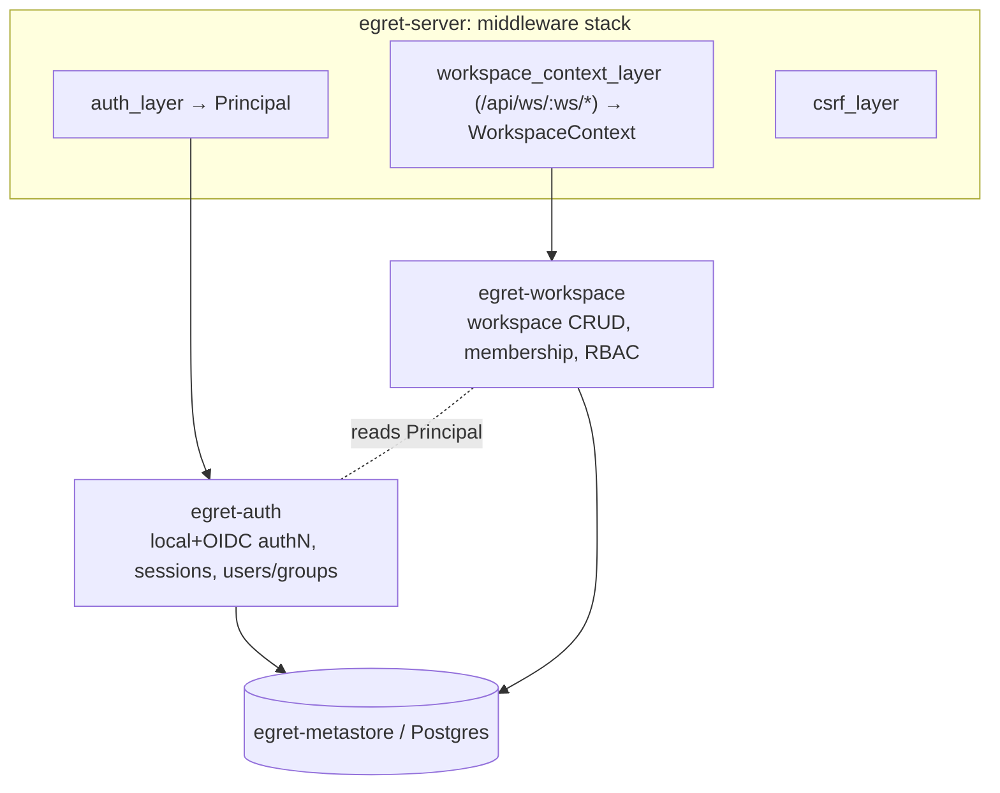
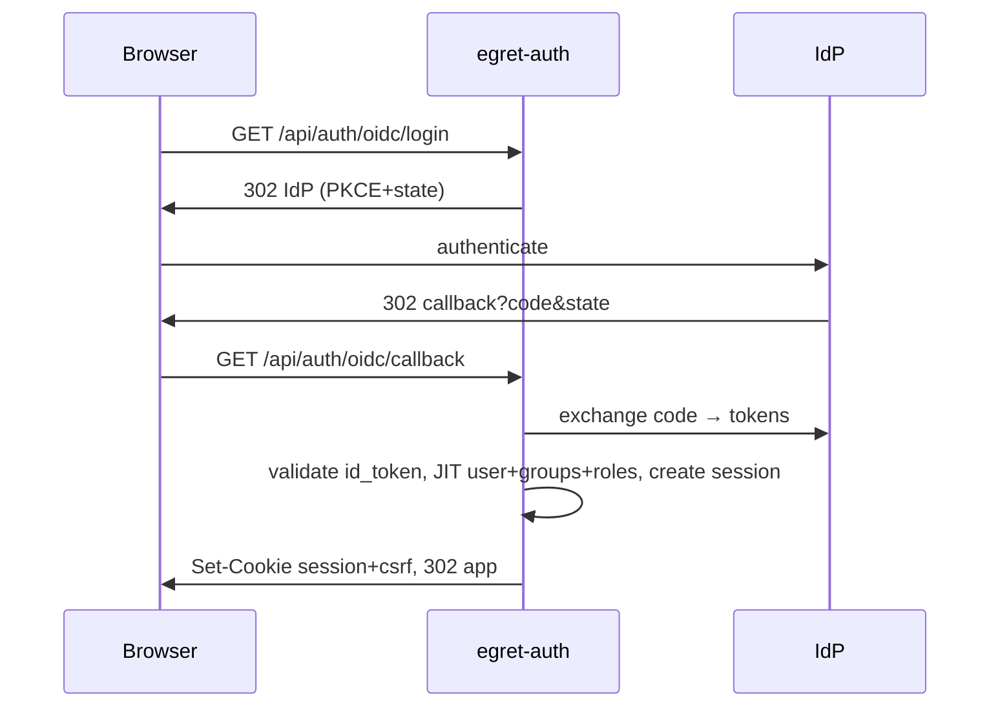

# Phase 1a — Identity (Auth, Session, Workspace, RBAC) — Spec thiết kế

> **Trạng thái:** Bản tham khảo tiếng Việt · **Ngày:** 2026-06-17 · **Phiên bản:** 0.1
> ⚠️ Bản gốc (canonical) là tiếng Anh: [`docs/en/specs/2026-06-17-phase-1a-identity-design.md`](../../en/specs/2026-06-17-phase-1a-identity-design.md). Khi khác biệt, ưu tiên bản tiếng Anh.
> Hiện thực phần identity của Phase 1 trong [Tài liệu kiến trúc gốc](../architecture/2026-06-17-egret-architecture-design.md) — xem §7, §8, §9.

---

## 1. Mục tiêu & phạm vi

Xây nền tảng identity mà mọi tính năng Egret khác phụ thuộc: xác thực (local + OIDC/SSO), session server-side, workspace + membership, và RBAC. **Chỉ backend/API** — Admin SPA là Phase 0b; authz data-plane (Ranger/`egret-authz`) là Phase 2.

**Trong phạm vi**
- Local password (admin bootstrap qua `egret init`) + OIDC/SSO authorization-code + PKCE.
- Session server-side ở Postgres, cookie httpOnly, hết hạn 2 tầng, rotate, revoke.
- Chống CSRF bằng double-submit token.
- Workspace CRUD (platform-admin) + membership (user/group, kèm role).
- RBAC: roles + permissions (scope platform & workspace), seed roles, mapping IdP-claim→role cấu hình được + gán thủ công.
- Middleware auth (`Principal`) + middleware workspace-context (`WorkspaceContext`) + permission guard.

**Ngoài phạm vi (hoãn)**
- Database registration / secrets / health → **Phase 1b**.
- Admin/Explorer SPA → **Phase 0b**.
- Authz data-plane, row-filter/column-mask, Ranger REST → **Phase 2**.
- JWT / API-key service-to-service → khi `egret-dataapi`/engine callback cần.
- User tự đăng ký, reset password qua email, nhiều IdP cùng lúc → tương lai (YAGNI).

## 2. Quyết định (đã validate với Metabase & Superset)

Đã kiểm chứng bằng cách đọc source repo tham khảo trong `data-portal/`:

| Quyết định | Lựa chọn | Bằng chứng |
|---|---|---|
| Session | **Server-side ở Postgres + cookie httpOnly** | Metabase bảng `core_session` + cookie `metabase.SESSION` / header `X-Metabase-Session`. Superset bật được `SESSION_SERVER_SIDE`. |
| Thuộc tính cookie | **httpOnly + SameSite=Lax + Secure (prod)** | Superset `SESSION_COOKIE_HTTPONLY=True`, `SAMESITE="Lax"`, `SECURE`. |
| Hết hạn | **2 tầng: absolute max-age + idle timeout (sliding)** | Metabase `max-age-minutes` + `session-timeout-seconds`. |
| Hash password | **argon2id** | Cả hai ref dùng bcrypt; argon2id là khuyến nghị OWASP hiện nay. |
| CSRF | **Double-submit CSRF token** | Superset Flask-WTF `WTF_CSRF_ENABLED=True`. |
| Phương thức authN | **Local + OIDC/SSO** | Superset `AUTH_TYPE=AUTH_DB` + `AUTH_OAUTH/AUTH_OID`. |
| RBAC | **Roles + permissions; gán thủ công + mapping IdP-claim** | Superset FAB roles + `AUTH_ROLES_MAPPING`. |
| API key | **Hoãn (concern riêng)** | Metabase có `api_key` model tách khỏi session. |

## 3. Kiến trúc

Hai crate mới (Approach A — tách rõ "bạn là ai" vs "bạn làm được gì ở đâu"):



- **`egret-auth`** — xác thực, vòng đời session, identity user/group. Sinh ra `Principal`.
- **`egret-workspace`** — workspace, membership, RBAC roles/permissions, authorization. Sinh `WorkspaceContext` và enforce permission.
- Cả hai persist qua `egret-metastore`; mount router vào `egret-server`. `WorkspaceContext`/`Principal` ở `egret-core` (đã định nghĩa ở Phase 0a — mở rộng khi cần).

**Thứ tự middleware (ngoài→trong):** `csrf_layer` → `auth_layer` (set `Principal`, bỏ qua `/api/auth/login`, `/api/auth/oidc/*`, `/healthz`) → route. Với `/api/ws/{workspace}/*`, `workspace_context_layer` chạy sau auth để resolve membership và build `WorkspaceContext`.

## 4. Crate `egret-auth`

**Trách nhiệm:** xác thực local + OIDC, JIT provision user/group, session create/validate/rotate/revoke, phát/đọc cookie, middleware `auth_layer`.

**Interface (phác thảo):**
```rust
pub enum Provider { Local, Oidc }

pub struct User { pub id: UserId, pub provider: Provider, pub email: String,
                  pub name: String, pub status: UserStatus /* active|disabled */ }

#[async_trait] pub trait Authenticator {
    async fn authenticate(&self, email: &str, password: &str) -> Result<User>; // local
}
pub struct LocalAuthenticator { /* argon2 verify với users.password_hash */ }

pub struct OidcService { /* openidconnect client */ }
impl OidcService {
    pub fn authorize_url(&self) -> (Url, CsrfStateToken, PkceVerifier);
    pub async fn exchange(&self, code: &str, state, verifier) -> Result<OidcClaims>;
}
pub fn provision_from_claims(claims: &OidcClaims) -> ProvisionedUser; // JIT

pub struct SessionService { /* db pool */ }
impl SessionService {
    pub async fn create(&self, user_id: UserId, ua: &str, ip: &str) -> Result<Session>;
    pub async fn validate(&self, token: &str) -> Result<Option<Principal>>;
    pub async fn revoke(&self, token: &str) -> Result<()>;
    pub async fn revoke_all_for_user(&self, user_id: UserId) -> Result<()>;
}
```

**Routes:**
| Method | Path | Mục đích | CSRF |
|---|---|---|---|
| POST | `/api/auth/login` | local email+password → set cookie session | miễn (chưa có session; rate-limit) |
| GET | `/api/auth/oidc/login` | redirect tới IdP (PKCE+state) | miễn |
| GET | `/api/auth/oidc/callback` | exchange code, JIT, set session | miễn |
| POST | `/api/auth/logout` | revoke session, xóa cookie | bắt buộc |
| GET | `/api/auth/me` | `Principal` hiện tại | n/a (GET) |

## 5. Crate `egret-workspace`

**Trách nhiệm:** workspace CRUD, membership, RBAC roles/permissions, `Authorizer`, áp mapping IdP-claim→role, middleware `workspace_context_layer`.

**Interface (phác thảo):**
```rust
pub struct Workspace { pub id: WorkspaceId, pub slug: String, pub name: String,
                       pub status: WorkspaceStatus /* active|archived */ }

pub enum Scope { Platform, Workspace }
pub struct Role { pub id: RoleId, pub scope: Scope, pub name: String }
pub struct Permission(pub String); // vd "workspace:create"

pub struct Authorizer { /* db pool / cache role→perms */ }
impl Authorizer {
    pub async fn platform_perms(&self, p: &Principal) -> Result<HashSet<Permission>>;
    pub async fn workspace_role(&self, p: &Principal, ws: WorkspaceId) -> Result<Option<String>>;
    pub async fn require_platform(&self, p: &Principal, perm: &str) -> Result<()>;
    pub async fn require_workspace(&self, ctx: &WorkspaceContext, perm: &str) -> Result<()>;
}

pub fn map_idp_claims_to_roles(claims: &OidcClaims, rules: &[IdpRoleMapping]) -> Vec<RoleAssignment>;
```

**Routes:**
| Method | Path | Permission |
|---|---|---|
| POST/GET/PUT/DELETE | `/api/admin/workspaces[/{id}]` | `workspace:create/read/update/archive` (platform) |
| GET | `/api/admin/users[/{id}]` | `user:read` (platform) |
| PUT | `/api/admin/users/{id}/platform-roles` | `user:assign_role` (platform) |
| GET/POST/DELETE | `/api/ws/{workspace}/members[/{principal}]` | `workspace:manage_members` (workspace) |

## 6. Data model (migrations)

Hai file migration mở rộng baseline Phase 0a.

**`migrations/0002_identity.sql`**
```text
users(id uuid pk, provider text[local|oidc], external_subject text null, email citext unique,
      name text, password_hash text null, status text[active|disabled] default 'active',
      created_at timestamptz, last_login_at timestamptz null)
groups(id uuid pk, name text unique, source text[local|oidc])
user_groups(user_id fk, group_id fk, primary key(user_id, group_id))
sessions(id uuid pk, token_hash text unique, user_id fk, created_at timestamptz,
         absolute_expires_at timestamptz, idle_expires_at timestamptz,
         last_seen_at timestamptz, user_agent text, ip text)
```
> `sessions.token_hash` lưu hash của token (token thô chỉ nằm trong cookie) → lộ DB không lộ session sống. Index `sessions(token_hash)` và `sessions(user_id)`.

**`migrations/0003_workspace_rbac.sql`**
```text
workspaces(id uuid pk, slug text unique, name text, status text[active|archived] default 'active',
           settings jsonb default '{}', created_by fk users, created_at timestamptz)
workspace_members(workspace_id fk, principal_type text[user|group], principal_id uuid,
                  role text, added_by fk users, added_at timestamptz,
                  primary key(workspace_id, principal_type, principal_id))
roles(id uuid pk, scope text[platform|workspace], name text, description text,
      unique(scope, name))
role_permissions(role_id fk, permission text, primary key(role_id, permission))
platform_role_assignments(principal_type text[user|group], principal_id uuid, role_id fk,
                          primary key(principal_type, principal_id, role_id))
```
**Seed (trong migration):** roles `platform_admin`, `data_steward` (platform); `ws_admin`, `ws_editor`, `ws_viewer` (workspace), mỗi role có tập permission khởi đầu. Catalog permission **mở rộng theo phase**; Phase 1a chỉ seed permission identity/workspace ở §5.

## 7. Luồng xác thực

**`egret init` (bootstrap):** tạo 1 dòng `users` local (`provider=local`, password hash argon2; password nhập hoặc sinh và in 1 lần) và gán role `platform_admin` qua `platform_role_assignments`. Idempotent: từ chối nếu đã có platform_admin trừ khi `--force`.

**Local login:** `POST /api/auth/login` → `LocalAuthenticator` verify argon2 → `SessionService.create` → set cookie `egret_session` + phát CSRF cookie → 200 kèm `Principal`. Rate-limit theo IP+email.

**OIDC login:** `GET /api/auth/oidc/login` → dựng authorize URL (PKCE verifier + state lưu server, ngắn hạn) → 302 tới IdP. `GET /api/auth/oidc/callback?code&state` → validate state → exchange code → validate id_token → `provision_from_claims` (JIT upsert user + groups, áp IdP role mapping) → tạo session → set cookie → redirect app.

**Validate session (mỗi request):** `auth_layer` đọc cookie → `SessionService.validate` kiểm `absolute_expires_at` và `idle_expires_at`; nếu hợp lệ, slide `idle_expires_at`/`last_seen_at` và trả `Principal`; nếu không 401 + xóa cookie.

**Logout:** `POST /api/auth/logout` → revoke session → xóa cookie.



## 8. Quản lý session

- **Token:** ngẫu nhiên opaque (≥256-bit); cookie chứa token thô, DB chứa `token_hash` (sha-256).
- **Cookie:** `egret_session`, `HttpOnly`, `SameSite=Lax`, `Secure` (cấu hình; bật ở prod), `Path=/`.
- **Hết hạn (2 tầng):** `absolute_expires_at = created_at + absolute_ttl` (cứng, không gia hạn); `idle_expires_at = now + idle_ttl` (slide mỗi request hợp lệ). Hợp lệ ⟺ `now < absolute_expires_at AND now < idle_expires_at`.
- **Rotate:** phát session mới (token + dòng mới) khi login thành công; không tái dùng token tiền-auth (chống session fixation).
- **Revoke:** logout xóa dòng; `revoke_all_for_user` cho force logout (vd khi disable user).

## 9. CSRF (double-submit token)

- Khi tạo session, set thêm cookie `egret_csrf` (token ngẫu nhiên, **không** httpOnly để JS đọc được).
- SPA gửi lại trong header `X-Egret-CSRF` ở mọi request mutating (POST/PUT/PATCH/DELETE).
- `csrf_layer` từ chối request mutating khi header thiếu hoặc ≠ giá trị cookie. Method an toàn (GET/HEAD/OPTIONS) và route login/oidc tiền-auth được miễn.
- Kết hợp `SameSite=Lax` → defense-in-depth ngang Superset.

## 10. RBAC

- **Model:** `roles(scope, name)` → `role_permissions(permission)`. Principal nhận role **platform** qua `platform_role_assignments` (user/group) và role **workspace** qua `workspace_members.role`.
- **Permission string:** `domain:action` (vd `workspace:create`, `user:assign_role`, `workspace:manage_members`). Catalog là const set Rust, validate với `role_permissions` đã seed.
- **Resolution:** platform permission hiệu dụng = hợp của role platform trực tiếp + qua group. Workspace permission = permission của `workspace_members.role` cho workspace đó.
- **Enforce:** handler nhận `Authorizer`, gọi `require_platform`/`require_workspace`; lỗi → `Error::Forbidden` (403). Hiện thực dạng axum extractor để guard khai báo gọn.
- **Mapping IdP-claim:** `egret-config` chứa rule `claim/value → role@scope`; áp khi OIDC JIT để set platform role và/hoặc workspace mặc định. Gán thủ công qua route admin luôn hoạt động bất kể mapping.

## 11. Middleware workspace-context

Cho route `/api/ws/{workspace}/*`: resolve `{workspace}` (slug/id) → load workspace (404 nếu thiếu/archived) → kiểm `Principal` là thành viên (trực tiếp/qua group) hoặc `platform_admin` → build `WorkspaceContext { workspace_id, principal, workspace_role }` và inject. Non-member → 403. Repository dữ liệu workspace-scoped bắt buộc context này (enforce ở phase sau).

## 12. Bổ sung cấu hình (`egret-config`)

```toml
[oidc]                     # optional; OIDC tắt nếu issuer_url trống
enabled = false
issuer_url = ""
client_id = ""
client_secret = ""
redirect_url = "http://localhost:8080/api/auth/oidc/callback"
scopes = ["openid", "email", "profile", "groups"]

[session]
cookie_name = "egret_session"
absolute_ttl_hours = 24
idle_ttl_minutes = 60
secure = false             # true ở prod

[csrf]
cookie_name = "egret_csrf"
header_name = "X-Egret-CSRF"

[[idp_role_mapping]]       # lặp lại được
claim = "groups"
value = "data-platform-admins"
role = "platform_admin"
scope = "platform"
```
`egret init` đọc `[bootstrap]` (optional `admin_email`) hoặc nhận flag.

## 13. Xử lý lỗi & bảo mật

- Dùng `egret-core::Error`; map `Unauthorized→401`, `Forbidden→403`, `NotFound→404`, `InvalidInput→400`, `Conflict→409`; còn lại 500 (không lộ chi tiết nội bộ).
- argon2id tham số hợp lý; không log password, token, `client_secret`, `password_hash`.
- Rate-limit login (theo IP+email) chống credential stuffing; thông báo lỗi đồng nhất cho sai email vs sai password (chống enumeration).
- OIDC: validate `state`, `nonce`, issuer, audience, chữ ký, hạn.
- Mọi cookie `HttpOnly` (trừ CSRF cookie theo thiết kế) + `Secure` ở prod.

## 14. Chiến lược test

- **Unit:** argon2 hash/verify; so sánh CSRF; resolution permission (`Authorizer`); mapping IdP claim→role; logic hết hạn session (absolute vs idle) với clock tiêm vào.
- **Integration (testcontainers Postgres):** session create/validate/slide/expire/revoke; repo workspace + membership; seed role & query permission; chạy migration.
- **OIDC:** mock endpoint token/userinfo (vd `wiremock`) và assert JIT + role mapping; không cần IdP thật.
- **HTTP/handler:** axum `oneshot` với `Authenticator` giả + Postgres test — login set cookie, route bảo vệ chặn khi không session, CSRF chặn mutating thiếu header, route workspace chặn non-member, route platform chặn thiếu permission.
- Test không-DB chạy offline; test DB/OIDC-mock chạy ở CI (Postgres service) — đồng nhất quy tắc offline-green của Phase 0a.

## 15. Phân rã để implement

Plan nên tạo các task TDD nhỏ, đại khái:
1. Migration `0002`/`0003` + seed (+ test migrator).
2. Scaffold crate `egret-auth` + argon2 hash/verify.
3. `SessionService` (create/validate/slide/expire/revoke) trên Postgres.
4. Helper cookie + CSRF; `auth_layer` + `csrf_layer`.
5. Route local login/logout/me.
6. OIDC service (authorize/exchange/JIT) + route login/callback (test bằng mock).
7. `egret-workspace`: repo/route workspace CRUD + membership.
8. RBAC: roles/permissions, `Authorizer`, extractor, IdP mapping.
9. `workspace_context_layer`.
10. Lệnh bootstrap `egret init`.
11. Ráp router + middleware vào `egret-server`; bổ sung config.

## 16. Tham khảo

- Metabase: `server/middleware/session.clj` (`core_session`, timeout 2 tầng, `X-Metabase-Session`), `util/password.clj` (bcrypt), `api_keys/models/api_key.clj` (API key riêng).
- Superset: `config.py` (`AUTH_TYPE=AUTH_DB`, `WTF_CSRF_ENABLED`, `SESSION_COOKIE_*`, `SESSION_SERVER_SIDE`, `AUTH_ROLES_MAPPING`), `security/manager.py` (FAB `SecurityManager`), `security/guest_token.py` (JWT embedding).
- Kiến trúc: [Tài liệu gốc](../architecture/2026-06-17-egret-architecture-design.md) §7, §8, §9.
